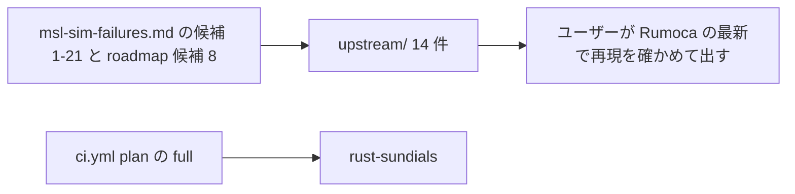

# S045 上流への報告の下書きと週次 CI の sundials

| | |
| --- | --- |
| セッション | S045 |
| 日付 | 2026-10-31 |
| ブランチ | `feature/s045-upstream-sundials` |
| Phase | 運用（[計画書](../../plan/2026-10-30-release-estimate-and-parallel-plan.md)の WP-H） |
| スライド | [slides.html](slides.html) |
| 作業記録 | `log/work/2026-10-31-s045-upstream-sundials.md` |

## 1. 目的

[msl-sim-failures.md](../../research/msl-sim-failures.md) の「上流に報告する候補」と [roadmap.md](../../roadmap.md) の候補 8 を、Rumoca と diffsol に出せる issue の下書きにする（9 件以上）。もう 1 つ、feature `sundials` の試験を毎週の CI に足す。

## 2. 決定と理由

| 項目 | 決定 | 理由 |
| --- | --- | --- |
| 出す人 | ユーザー。エージェントは出さない | 他人のリポジトリへの発言は人が決める。`gh issue create` は使わない |
| 置き場 | `doc/research/upstream/`。1 件 1 ファイル `NN-<slug>.md`、再現は同じ名前の `.mo` | `src/Modelica/` は MODELICAPATH として開けるパッケージだけを置く規則 |
| 言語 | 本文は英語（Summary / Steps to reproduce / Expected / Actual / Environment / Workaround in GlobeMode / Notes） | issue にそのまま貼る |
| 候補の選び方 | Rumoca か diffsol に出す価値があり、再現が書けるもの 14 件。再現の最小化が済んでいない 4・5・7・8・9・20 は外した | 再現の無い issue は読む側の負担になる |
| 断定の範囲 | 数字は msl-sim-failures.md の出典（S011〜S025）を引用。手元で確かめていない所は [not verified]、diffsol は "not verified against upstream diffsol main" | Rumoca の CLI がこの環境に無く、新しく測れない。cargo も回さない約束 |
| sundials | ジョブ `rust-sundials` を 1 つ。`full == 'true'`（毎週・手動）のときだけ | cmake で C のソースをビルドするので重い。push の差分の検査（ADR-0006）を遅くしない |

## 3. 図



下書きの一覧（回避の有無つき）は [upstream/README.md](../../research/upstream/README.md)。Rumoca 11 件（01〜09、13、14）、diffsol 3 件（10〜12）。回避が無いのは 01・03・07・08。

## 4. 再現手順

```bash
python3 -I .github/scripts/test_ci_plan.py
python3 -I .claude/skills/session-docs/check_docs.py
uv run --no-sync python .claude/skills/session-docs/render_slides.py doc/sessions/S045-upstream-sundials/slides.html
```

ジョブの中身は `cargo test -p globe-mode-cli -p globe-mode-exec -p globe-mode-sim --features sundials`。feature は CLI → `globe-mode` → `globe-mode-exec` → `globe-mode-sim` に伝わるが、exec と sim の試験も sundials つきで回すため 3 つを明示した。検証の数字は作業記録に書いた。cargo はこのセッションでは回していない。

## 5. 次回

- ユーザーが Rumoca の最新（main）で再現を確かめてから出す。出したら README の表に issue の URL と日付を足す。
- diffsol の 3 件は、Rumoca の vendor でなく単体の diffsol のプログラムに縮めてから出す。
- 初回の `rust-sundials` の run で、ランナーに cmake があるか、所要時間、rust-cache の大きさを確かめる。
