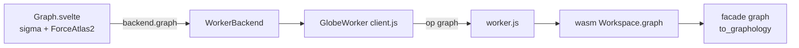

# S046 connect グラフの表示

| | |
| --- | --- |
| セッション | S046 |
| 日付 | 2026-10-31 |
| ブランチ | `feature/s046-graph` |
| Phase | P4（[計画書](../../plan/2026-10-30-release-estimate-and-parallel-plan.md)の WP-E） |
| スライド | [slides.html](slides.html) |
| 作業記録 | `log/work/2026-10-31-s046-graph.md` |

## 1. 目的

connect グラフ（[architecture.md §3.5](../../architecture.md)）をブラウザ UI に描く最小の形を作る。S041 が `check` を wasm・Worker・`Backend` に通したのと同じ道で `graph(model, depth)` を通し、`Graph.svelte`（sigma.js + graphology + ForceAtlas2）で描く。`App.svelte` への組み込みは S042（プロット）と競合するので、この回では入れない。

## 2. 決定と理由

| 項目 | 決定 | 理由 |
| --- | --- | --- |
| wasm の `graph` | facade の `graph` の結果を `to_graphology()` の JSON 文字列で返す。`GraphError` は例外の文字列 | S041 の `check` と同じ形。JSON の形は graphology の `Graph.from` がそのまま読める |
| TypeScript の型 | `GraphJson` を UI が使う項目だけ手書き | JSON Schema の書き出しは WP-0 の持ち越しのまま |
| レイアウト | 円に置いてから ForceAtlas2 を 100 反復、同期。`inferSettings` に任せる | worker の layout は入れない（最小）。5k ノードで Barnes-Hut が自動で入る |
| 描画 | sigma 4.0.4。動かしている間は辺とラベルを描かない（`settings.hideEdgesOnMove`） | 大きなグラフの fps のため。sigma 4 は 3 までと API が違い、設定は `settings` の下に置く |
| 試験の入口 | `graph-test.html` + `src/graph-test.ts`（vite の複数入口） | App.svelte に触らずに Graph を単体で mount し、本物のバックエンドと合成グラフの両方で回す |
| fps | 合成した 5k ノード・約 1 万辺で測る | MSL の `Electrical.Analog.Examples` を wasm で読むのは重い。そもそも `graph` は**ライブラリとして読んだモデルを引けない**（下の注意） |

注意: wasm の `graph` は `set_file` で渡した文書のモデルだけを引ける。`library`（`Workspace` のライブラリ）として読んだ MSL のモデルは索引に無く、「モデルが索引に無い」と断る。MSL のグラフを UI に出すには、モデルの閉包を文書として渡す道が要る（S039 の Python の `graph` も同じ制約）。

## 3. 図



## 4. 再現手順

```bash
export CARGO_TARGET_DIR=$PWD/target        # worktree なら main の target
mise run wasm:build
node src/Rust/mod/globe-mode-wasm/web/worker-node.mjs   # graph: ノード 4、辺 4
cargo test -p globe-mode-wasm
cd src/Svelte && pnpm install && pnpm check && pnpm build && cd ../..
uv run python src/Svelte/tests/test_graph.py
```

検証の結果は作業記録に数字で書いた。

## 5. 次回

- 締めで親が済ませた: `App.svelte` の「グラフ」ボタンと `onSelect`（名前の字面でエディタを選ぶ）、`ui:check` への `test_graph.py`。飛ぶ先を outline の位置にするのは次。
- ライブラリのモデルのグラフ（MSL）。閉包を文書で渡すか、`graph` をライブラリも引けるようにする。
- 実 GPU のブラウザでの fps の測定（ヘッドレス Chromium はソフトウェア描画）。
