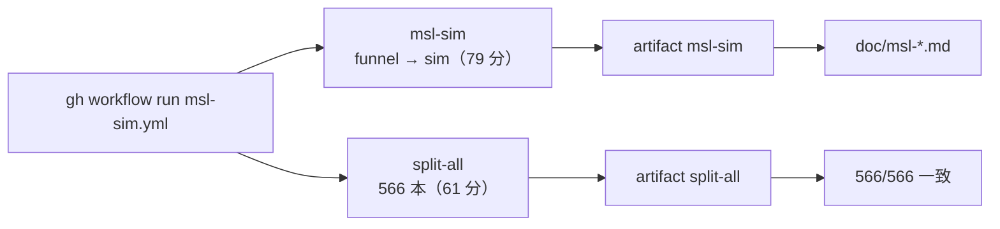

# S047 msl-reports-ci

| | |
| --- | --- |
| セッション | S047 |
| 日付 | 2026-10-31 |
| ブランチ | `feature/s047-msl-reports-ci` |
| Phase | P3 |
| スライド | [slides.html](slides.html) |
| 作業記録 | `log/work/2026-10-31-s047-msl-reports-ci.md` |

## 1. 目的

S037 で作った GitHub Actions の手動のワークフロー `msl-sim.yml` の結果を取り込む。`msl:funnel` と `msl:sim` の報告（[msl-funnel.md](../../msl-funnel.md)・[msl-sim.md](../../msl-sim.md)）を更新し、S043 のジョブ `split-all` の結果で、分割読み込み（S037）の持ち越しを閉じる。正典は [roadmap](../../roadmap.md) の S047 の節。

## 2. 決定と理由

| 項目 | 決定 | 理由 |
| --- | --- | --- |
| どの run の報告か | run 41174276501（2 回目） | 1 回目（run 41170414005）の JSON がキャッシュから戻り、前回との差の節が載る |
| 手元での回し直し | しない | ランナーで 2 回回して結果が一致した。手元は RAM 3 GB |

## 3. 図



## 4. 再現手順

```bash
gh workflow run msl-sim.yml
gh run download <run-id> -n msl-sim      # doc/msl-*.md と target/msl-*.json
gh run download <run-id> -n split-all    # split-models.txt と split-all.log
```

結果:

| 項目 | 2026-10-24（手元） | 2026-10-31（ランナー） |
| --- | --- | --- |
| funnel | OK 369・GM-U 184・NG 13・panic 0 | 同じ |
| sim | 実行できた 309・管に収まった 301/308 | 同じ |
| 回し直し（予算 180 s） | 13 本のうち実行できた 2 | 12 本のうち実行できた 1 |
| funnel の最大 RSS | 2.0 GiB（記録の値） | 7.2 GiB |
| 分割読み込みと全部読み | 20 本で一致 | 566 本で一致 |

## 5. 次回

- 止まった例題の残り（roadmap の候補 1）。
- Rumoca の制約の上流への報告の整理（候補 8）。
