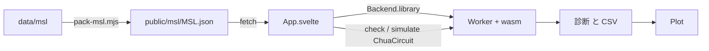

# S048 ui-msl

| | |
| --- | --- |
| セッション | S048 |
| 日付 | 2026-10-31 |
| ブランチ | `feature/s048-ui-msl` |
| Phase | P4（Desktop MVP の前半の完了条件をブラウザで） |
| スライド | [slides.html](slides.html) |
| 作業記録 | `log/work/2026-10-31-s048-ui-msl.md` |

## 1. 目的

[roadmap.md](../../roadmap.md) の P4 の完了条件「ChuaCircuit で開く・検査・実行・プロットが通る」の前半を、ブラウザ UI（`src/Svelte`、[ADR-0023](../../adr/0023-desktop-and-web-process-layout.md) の (c)）で通す。wasm 側（[S036](../S036-wasm-web-worker/解説書.md) の `GlobeWorker.library`、[S037](../S037-msl-split-load/解説書.md) の分割読み込み）は既にライブラリを読めるので、UI がそれを呼ぶ道を足すのが仕事。

## 2. 決定と理由

| 項目 | 決定 | 理由 |
| --- | --- | --- |
| MSL の渡し方 | `src/Svelte/scripts/pack-msl.mjs` が `data/msl` の `.mo` を `{ "data/msl/…": 本文 }` の JSON にし、`public/msl/MSL.json`（約 15 MiB、`.gitignore` 済み）に置く | 形は `globe-mode-wasm/node/smoke.mjs` の `readMo` と同じ。wasm と worker は変えない |
| 呼ぶ段 | `package.json` の `prepare-wasm` で `copy-wasm.mjs` のあとに呼ぶ。`data/msl` が無ければ警告だけで飛ばす | `dev` と `build` の両方で効く。MSL が無い環境でも UI は動く |
| 読む時機 | 「MSL を読む」ボタン。起動時は読まない | Decay だけ使う人に 15 MiB を取らせない |
| Backend | `library(name, json)` を足し、`WorkerBackend` が `GlobeWorker.library(json, name)` を呼ぶ | worker を作り直したとき client.js がライブラリを再生する |
| ライブラリのモデル | 追加の仕組みは要らない。モデル名の入力にそのまま書く | 分割読み込みで `check(model)` と `simulate({ model })` が使うファイルだけを読む |
| グラフ | ライブラリのモデルでは backend の失敗（「索引に無い」）をそのまま赤字で出し、MSL を読んだ後の注記にも書く | S046 の持ち越し。wasm の `graph` は `set_file` の文書のモデルだけ引ける |
| CI | `ui` ジョブに `data/msl` の `actions/cache`（`msl-sim.yml` と同じ key）と `cargo xtask fetch-msl` | `ui:check` が MSL の試験も回す。無ければ試験は飛ばす |

「MSL を読む」を押すと今のエディタ由来の診断・プロット・グラフは消える（`library` は Workspace を作り直すため）。ファイルは次の検査・実行の `setFile` で入れ直す。

## 3. 図



## 4. 再現手順

```bash
cargo xtask fetch-msl          # data/msl（無ければ）
mise run ui:check              # wasm:build、svelte-check、vite build、Playwright（MSL の試験を含む）
```

ヘッドレス Chromium（`tests/test_ui.py`）での数字（WSL、1 回の実測。目安）:

| 項目 | 値 |
| --- | --- |
| `MSL.json` | 15.2 MiB（`.mo` 2556 ファイル） |
| 「MSL を読む」（fetch と `library`） | 約 0.5〜1 s（ボタンを押してから完了の表示まで。UI の注記は 0.4〜0.6 s） |
| ChuaCircuit の検査 | 約 2 s、error 0（診断 0 行。experiment annotation があるため `GM-I10001` も出ない） |
| ChuaCircuit の実行（bdf） | 約 1.5 s、5 万点、信号 44 本（`C1.v` を含む） |
| ChuaCircuit の「グラフ」 | 「モデル … が索引に無い」と赤字で出る（未対応の確認） |

## 5. 次回

- ライブラリのモデルの `graph`（wasm の索引にライブラリを載せる。Rust の仕事）
- P4 の残り: ライブラリツリー、LSP、Tauri のシェル、RSS の基準値、.deb と .msi
- 実ブラウザ（実 GPU）での計測は未了
