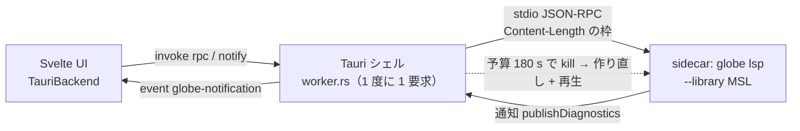

# S049 desktop-tauri

| | |
| --- | --- |
| セッション | S049 |
| 日付 | 2026-10-31 |
| ブランチ | `feature/s049-desktop-tauri` |
| Phase | P4（Desktop MVP。計画書の WP-C） |
| スライド | [slides.html](slides.html) |
| 作業記録 | [log/work/2026-10-31-s049-desktop-tauri.md](../../../log/work/2026-10-31-s049-desktop-tauri.md) |

## 1. 目的

[ADR-0023](../../adr/0023-desktop-and-web-process-layout.md) の (b) を実装する。Desktop は UI のプロセスで計算せず、`globe` の CLI を Tauri の sidecar に同梱し、`globe lsp` の stdio（`Content-Length` の枠の JSON-RPC）に独自の要求を足して話す。そのシェル（Tauri 2）を `src/Rust/apps/desktop` に作り、GitHub Actions が .deb（ubuntu-24.04）と .msi（windows-2025）を artifact に出すところまでを済ませる。計画書は [plan/2026-10-30-release-estimate-and-parallel-plan.md](../../plan/2026-10-30-release-estimate-and-parallel-plan.md) の WP-C。

## 2. 決定と理由

| 項目 | 決定 | 理由 |
| --- | --- | --- |
| Cargo workspace | desktop は**別の workspace**（自分の `[workspace]` と `Cargo.lock`） | Tauri は Linux で webkit2gtk を要求する。ルートに入れると手元と差分 CI の `cargo build --workspace` が落ちる |
| Rust 側の依存 | `tauri` 2 と `serde_json` だけ。facade はリンクしない | コアの実体を `globe` の 1 つに保つ（ADR-0023）。desktop の `deny.toml` の `bans` に `globe-mode` を入れて守る |
| 独自の要求 | `globe/check {model}`・`globe/simulate {request}`・`globe/graph {model, depth}`。`globe-mode-lsp` が facade を呼ぶだけ | UI の `Backend` の 3 つの操作と 1 対 1。ファイルは標準の `didOpen`。既存の 3 機能は変えない |
| UI ↔ Rust | command は `rpc`（要求）と `notify`（通知）の 2 つ。サーバの通知はイベント `globe-notification` | `window.__TAURI__`（`withGlobalTauri`）だけで足り、`@tauri-apps/api` を npm に足さずに済む |
| 予算 | `globe/simulate` は 180 s で sidecar を kill し、次の要求で作り直して開いているファイルを再生する | ADR-0023 の (a)(b)。簡単に入ったので持ち越さなかった。検査は予算なし（ADR-0018） |
| sidecar の場所 | 実行ファイルと同じ場所の `globe`（`GLOBE_SIDECAR` で上書き）。MSL は `--library` と `GLOBE_LIBRARY` | .deb も .msi も `externalBin` を主のバイナリの隣に置く |
| UI のビルド | 別ジョブで `pnpm exec vite build`（`pnpm build` ではない） | `pnpm build` は先に `prepare-wasm` が wasm の出力を探して落ちる。Desktop の UI に wasm は要らない |
| tauri-cli | `cargo install tauri-cli --version "^2" --locked` | npm の依存（`@tauri-apps/cli`）を増やさない。`tauri-action` は使わない（第三者の action を増やさない） |
| ライセンス | MPL-2.0 の 5 crate を desktop の `deny.toml` の例外にした | 改変せず使う。詳細は [licenses.md](../../licenses.md) |

## 3. 図



## 4. 再現手順

手元（webkit2gtk が無い機械）で回せるのは `globe-mode-lsp` と desktop の lock・deny だけ。

```bash
cargo test -p globe-mode-lsp
cargo clippy -p globe-mode-lsp --all-targets -- -D warnings
cargo deny --manifest-path src/Rust/apps/desktop/Cargo.toml --config src/Rust/apps/desktop/deny.toml check
# Desktop のビルドは Actions で（workflow_dispatch。main に入った後）
gh workflow run desktop.yml
gh run download <run-id> -n desktop-linux   # .deb
gh run download <run-id> -n desktop-windows # .msi
```

結果（数字）は [作業記録](../../../log/work/2026-10-31-s049-desktop-tauri.md)。

## 5. 次回

- App.svelte で `inTauri()` なら `TauriBackend`、そうでなければ `WorkerBackend` にする（別のセッション）。
- MSL の置き場（同梱か取得か）と、MSL を読んだ後の Desktop の RSS。
- 署名、自動更新、`didOpen` が毎回全モデルの検査を回す点（静かな `globe/setFile`）。
