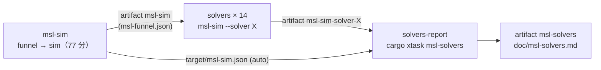

# S050 solver-matrix-ci

| | |
| --- | --- |
| セッション | S050 |
| 日付 | 2026-10-31 |
| ブランチ | `feature/s050-solver-matrix-ci` |
| Phase | P3（P8「ソルバの表がそろう」の準備） |
| スライド | [slides.html](slides.html) |
| 作業記録 | `log/work/2026-10-31-s050-solver-matrix-ci.md` |

## 1. 目的

ソルバごとに、MSL 4.1.0 の例題を実行できた本数と、MAP-LIB の参照結果の管に収まった本数を GitHub Actions で出し、1 枚の表 [msl-solvers.md](../../msl-solvers.md) にする。roadmap の S021〜S034 には手元で測った部分的な数字（Electrical.Analog.Examples の 54 本、全体 356 本の esdirk34 など）しか無かった。手元は RAM 3 GB で全例題を回せないので、S037 の [msl-sim.yml](../../../.github/workflows/msl-sim.yml) に matrix のジョブを足す。

## 2. 決定と理由

| 項目 | 決定 | 理由 |
| --- | --- | --- |
| 並べるソルバ | bdf・dopri45・esdirk34・trbdf2・tsit45・esdirk45・sdirk34hw・dopri853・cerk23・cerk34・cerk45・radau5・cvode・ida（14 本）と、`msl-sim` ジョブの auto | 刻み幅を制御する積分器は全部 |
| 入れないもの | `qss`、固定刻み（euler・heun・rk4・impeuler・trapezoid）、`esdirk23`、別名 | 固定刻みは既定の刻み（出力の間隔）で精度が足りず、管に収まる本数に意味が出ない。`qss` は硬い系が壁時計の上限で止まり時間がかかる。`esdirk23` は `trbdf2` と刻みの端の値が一致する |
| cvode・ida | 入れる。`cargo run --release -p xtask --features globe-mode-exec/sundials -- msl-sim …` | ワーカーは xtask 自身（`current_exe`）なので、xtask のビルドに feature を付ければ届く。ランナーに cmake が入っており、ビルドできた |
| 基準（baseline） | 渡さない | ソルバごとに前回との差を持たない。表は 1 回の run のスナップショット |
| 失敗したソルバ | 他を止めない（`fail-fast: false`）、`solvers-report` は `if: always()` | できた分で表を作る |
| 表の作り方 | `cargo xtask msl-solvers --inputs <JSON…> --report doc/msl-solvers.md`（[solvers.rs](../../../src/Rust/xtask/src/solvers.rs)） | JSON の `settings.solver` と `summary` だけを読む。`msl-sim` の形を変えない |

## 3. 図



## 4. 再現手順

```bash
git push origin <ブランチ>
gh workflow run msl-sim.yml --ref <ブランチ>      # 2 時間 45 分ほど
gh run download <run-id> -n msl-solvers           # doc/msl-solvers.md
gh run download <run-id> -n msl-sim-solver-bdf    # 各ソルバの報告と JSON（target/msl-sim-bdf.{md,json}）
```

結果（run 41194959752、`--tolerance-scale 0.1`、対象 356 本）:

| ソルバ | 実行できた | 管に収まった / 比べた | ジョブの時間 |
| --- | ---: | ---: | ---: |
| `auto` | 309 | 301 / 308（97.7%） | msl-sim ジョブの中 |
| `bdf` | 301 | 293 / 300（97.7%） | 63 分 |
| `esdirk34` | 294 | 285 / 293（97.3%） | 120 分 |
| `sdirk34hw` | 294 | 285 / 293（97.3%） | 140 分 |
| `cvode` | 294 | 281 / 293（95.9%） | 120 分 |
| `esdirk45` | 293 | 280 / 292（95.9%） | 132 分 |
| `dopri45` | 292 | 280 / 291（96.2%） | 129 分 |
| `trbdf2` | 295 | 280 / 294（95.2%） | 141 分 |
| `radau5` | 290 | 279 / 289（96.5%） | 145 分 |
| `ida` | 289 | 283 / 288（98.3%） | 142 分 |
| `cerk23` | 288 | 279 / 287（97.2%） | 174 分 |
| `tsit45` | 287 | 276 / 286（96.5%） | 147 分 |
| `cerk34` | 286 | 275 / 285（96.5%） | 172 分 |
| `cerk45` | 285 | 274 / 284（96.5%） | 150 分 |
| `dopri853` | 283 | 270 / 282（95.7%） | 144 分 |

読み取れること（止まった理由の内訳は [msl-solvers.md](../../msl-solvers.md)）:

- どのソルバも 283〜301 本を実行でき、管の割合は 95.2〜98.3%。`GM-U0004`（そのソルバが扱えない系）は 23〜26 本、初期化（`GM-E11001`）の 6 本は全ソルバで同じ。
- `auto`（309）が最多。`bdf` 単独（301）との差の 8 本は、`bdf` が内部エラー（`GM-U0005`）で止まる 10 本を dopri45 の回し直しで実行できたもの。
- 時間切れ（`GM-E11005`）は陽的 RK・cerk・SUNDIALS で 14〜27 本、`bdf` は 2 本。ジョブの時間が長いのも同じ理由（予算 180 s の回し直しが多い）。
- `cvode`・`ida` は cmake でビルドでき、そのまま動いた。`ida` の管の割合 98.3% は最高だが、比べた本数が 288 と少ない（時間切れ 17 本と内部エラー 8 本で実行できていない）。

## 5. 次回

- 時間切れの多い `cerk23`・`cerk34`（27 本）の予算を見直すか、原因（刻みが縮む）を調べる。
- 固定刻みと `qss` は、刻み幅の決め方を表の前提に入れてから足す。
- roadmap P8 の完了条件に使うときは、`msl-sim.yml` を回し直して表を更新する（手元では回さない）。
