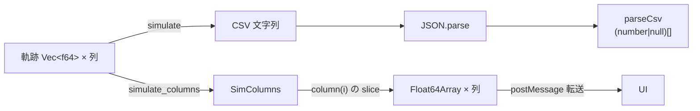

# S051 resources

| | |
| --- | --- |
| セッション | S051 |
| 日付 | 2026-10-31 |
| ブランチ | `feature/s051-resources` |
| Phase | P3（ADR-0023 の持ち越しの実測） |
| スライド | [slides.html](slides.html) |
| 作業記録 | `log/work/2026-10-31-s051-resources.md` |
| 調査 | [research/resources-2026-10-31.md](../../research/resources-2026-10-31.md) |

## 1. 目的

[ADR-0023](../../adr/0023-desktop-and-web-process-layout.md) は wasm の線形メモリの上限を 2 GiB と決めたが、実測の根拠が無かった（【未確認】、P6 で測る）。リソースの内訳を数字にし、コアを変えずにできる削減を探す。

1. wasm の線形メモリが MSL の全例題の検査で 2 GiB に達するか、達するなら何本目か。
2. 結果を CSV の文字列でなく列ごとの配列で渡す wasm の API（S042 の「CSV の解析が 10 万点で約 0.3 s」の持ち越し）。
3. `globe check` / `globe simulate` の最大 RSS。

## 2. 決定と理由

| 項目 | 決定 | 理由 |
| --- | --- | --- |
| 列の形 | `Workspace.simulate_columns(request_json)` が `SimColumns` を返す。`response`（`csv` なしの `SimulateResponse` の JSON）、`layout()`（`ColumnsLayout { names, points }` の JSON）、`column(i)`（`Float64Array`、0 が `time`） | wasm の中で 1 本の配列に束ねる複製が要らない。`column(i)` は wasm-bindgen の生成コードで `.slice()` され、新しい `ArrayBuffer` になるので Worker から転送できる |
| ゼロコピー | しない | `Float64Array::view` は線形メモリが伸びると無効になる |
| protocol | `ColumnsLayout` を足すだけ | 既存の型と CLI の `--json` の snapshot は変えない（`cargo test -p globe-mode-cli` で確認） |
| Worker | `worker.js` に op `simulate_columns`、`client.js` に `simulateColumns` | 呼び出しの中継だけ。転送リストに各列の `buffer` を入れる |
| 計測 | 手動のワークフロー `resources.yml`（ジョブ `rss` と `wasm`） | 手元は RAM が足りない。push の CI には入れない |
| Svelte | 触らない | 接続は次回 |

## 3. 図



## 4. 再現手順

```bash
export CARGO_TARGET_DIR=<共有の target> MISE_DISABLE_TOOLS=elixir
cargo test -p globe-mode-wasm -p globe-mode-protocol -p globe-mode-cli
mise run wasm:build
node src/Rust/mod/globe-mode-wasm/node/smoke.mjs --msl data/msl           # = mise run wasm:node
node src/Rust/mod/globe-mode-wasm/web/worker-node.mjs                     # simulateColumns の試験を含む
node src/Rust/mod/globe-mode-wasm/node/columns.mjs                        # CSV の道と列ごとの道
cargo xtask msl-funnel --list > models.txt
node src/Rust/mod/globe-mode-wasm/node/memory.mjs --msl data/msl --list models.txt --limit 30
gh workflow run resources.yml --ref main && gh run download <run-id> -n resources-rss -n resources-wasm
```

共有の target で複数の worktree がビルドすると、cargo は出力の更新時刻が新しい方を「最新」と見なし、別の worktree が先に作った成果物を再利用して変更を無視することがある。ソースを `touch` してからビルドし、`wasm-pkg` の生成物に `simulate_columns` があるか `grep` で確かめた。

検証の数字（詳細は調査の文書）:

- 列ごとの結果: 10 万点 × 7 列で 452 ms → 137 ms（wasm の呼び出しから JS の配列まで）。Worker 越しで 399 ms → 114 ms。全点で CSV の道と値が一致。
- RSS（ランナー）: `check` 1,493〜1,653 MiB、`simulate` 1,533〜1,929 MiB。
- wasm の線形メモリ: MSL の 566 本を順に `check`（ランナー、分割読み込み）して、読んだ直後 60.9 MiB、300 本目 520 MiB、**336 本目の `Spice3BenchmarkFourBitBinaryAdder` の 1 回で 668 → 3,802 MiB**（wasm32 の上限 4 GiB の手前 294 MiB）。2 GiB で作り直す設定でも最大は 3,802 MiB（作り直しは 1 回 609 ms）。この 1 本を除くと 566 本で 868 MiB。ADR-0023 (c) の「2 GiB を超えたら次の要求の前に作り直す」は、1 回の検査の中の伸びを止められない。run 41196216961
- `cargo test -p globe-mode-wasm -p globe-mode-protocol -p globe-mode-cli` 通過。wasm:node 相当（`smoke.mjs --msl data/msl`、`worker-node.mjs`）通過。

## 5. 次回

- `Backend` と `Plot` に `simulateColumns` を接続する（`uPlot` は `null` で線を切るが、列は `NaN` で来る。確認が要る【未確認】）。
- 削減案 1: `globe --library` も分割読み込みにして RSS を測り直す（閉包だけを渡すと 461 MiB）。
- スマートフォンのブラウザで線形メモリの上限を測る（P6）。
