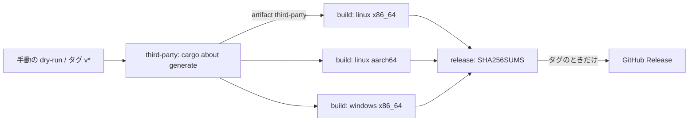

# S052 release.yml の dry-run と配布物のサードパーティのライセンス表

| | |
| --- | --- |
| セッション | S052 |
| 日付 | 2026-10-31 |
| ブランチ | `feature/s052-release-rc1-about` |
| Phase | P8（リリース。[計画書](../../plan/2026-10-30-release-estimate-and-parallel-plan.md)の WP-I の持ち越し） |
| スライド | [slides.html](slides.html) |
| 作業記録 | `log/work/2026-10-31-s052-release-rc1-about.md` |

## 1. 目的

[S044](../S044-release/解説書.md) の持ち越し 2 つを片付ける。

1. `release.yml` を手動実行（dry-run）で feature ブランチから回し、3 つの成果物（linux x86_64・linux aarch64・windows x86_64）が出ることを確かめる。
2. 配布物にサードパーティのライセンス表を入れる。cargo-about で `THIRD-PARTY.md` を作り、3 つのアーカイブへ同梱する。

あわせて `CHANGELOG.md` に S042〜S047 の分を足した。タグは打っていない（打つのはユーザー）。

## 2. 決定と理由

| 項目 | 決定 | 理由 |
| --- | --- | --- |
| 道具 | cargo-about 0.9.2（EmbarkStudios、MIT OR Apache-2.0）。CI の step で `cargo install --locked --features cli --version 0.9.2` | 計画（[licenses.md](../../licenses.md) の 3）に書いてあった道具。手元には入れず CI だけで回す（RAM 3 GB）。版は固定 |
| 作る場所 | ジョブ `third-party` で 1 回だけ作り、artifact で 3 つのビルドに渡す | 3 つのビルドごとに入れると cargo-about のビルドが 3 回になる。ライセンス表は 3 ターゲットの和集合で足りる |
| 範囲 | `--manifest-path src/Rust/mod/globe-mode-cli/Cargo.toml`。feature `sundials` なし。`targets` は配布する 3 つ | 配るのは `globe` のバイナリ。cfg で他のターゲットにしか入らない crate は表に載せない |
| 許可 | `about.toml` の `accepted` は deny.toml の `licenses.allow` と同じ 10 個。`--fail` | 許可外が 1 つでもあれば表が作れず CI が落ちる。cargo-deny と二重の検査になる |
| 優先順位 | `accepted` の先頭を `Apache-2.0`、次を `MIT` | `A OR B` の crate は先に書いた方だけで数えるので、本文の重複が減る |
| 形式 | Markdown（`about.hbs`） | 既存の文書は `THIRD_PARTY_LICENSES.html` と書いてあったが、アーカイブの中で読めること、差分が取れることを優先して `.md` にした。licenses.md を直した |
| 自分の crate | `private = { ignore = true }` | GlobeMode 自身（`publish = false`）は `LICENSE-MIT` / `LICENSE-APACHE` で足りる |
| build 依存 | 入れる。dev 依存は入れない | build script が生成するものがバイナリに入りうるので、build 依存は落とさない（保守側） |

## 3. 図



各アーカイブの中身: `globe[.exe]`・`LICENSE-MIT`・`LICENSE-APACHE`・`README.md`・`THIRD-PARTY.md`。

## 4. 再現手順

```bash
git push -u origin feature/s052-release-rc1-about
gh workflow run release.yml --ref feature/s052-release-rc1-about   # dry-run（Release は作らない）
gh run watch <run-id>
gh run download <run-id>                                           # globe-* と third-party と SHA256SUMS
tar tzf globe-x86_64-unknown-linux-gnu/*.tar.gz                    # THIRD-PARTY.md が入っている
```

手元で表だけ作るなら（重い）:

```bash
cargo install --locked --features cli --version 0.9.2 cargo-about
cargo about generate --locked --fail --manifest-path src/Rust/mod/globe-mode-cli/Cargo.toml about.hbs -o THIRD-PARTY.md
```

結果の数字は作業記録に書いた。

## 5. 次回

- ユーザーがタグ `v0.1.0-rc1` を打ち、Release（prerelease）に 3 つの成果物と `SHA256SUMS` が付くことを確かめる。
- npm の分（UI は配布物に入らない。Tauri の配布で足す）、wasm・Python の wheel のライセンス表、CycloneDX の SBOM は、それぞれの配布の道ができてから。
- 署名・deb・msi は Tauri（WP-C）と一緒に。
