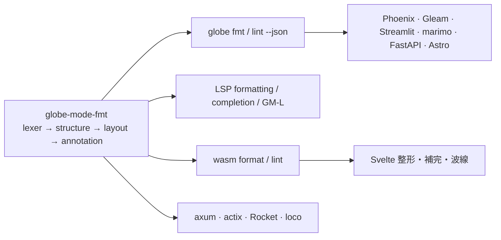

# S053 整形器・lint・補完

| | |
| --- | --- |
| セッション | S053 |
| 日付 | 2026-10-31 |
| ブランチ | `feature/s053-fmt-lint-completion` |
| Phase | P4 |
| スライド | [slides.html](slides.html) |
| 作業記録 | `log/work/2026-10-31-s053-fmt-lint-completion.md` |

## 1. 目的

コード補完・リンタ・フォーマッタを作り、ユーザーの好みの整形の型を対話で決めて記録する。IDE のほかに CLI・VS Code 拡張・ウェブアプリ（marimo、Streamlit、Phoenix、Astro、Axum、Actix-web、Rocket、loco）から単体で使えるようにする。P4 Desktop MVP の「CodeMirror 6 と LSP」の一部（[roadmap.md](../../roadmap.md)）。

## 2. 決定と理由

| 項目 | 決定 | 理由 |
| --- | --- | --- |
| 整形器の作り | 自前の crate `globe-mode-fmt`（依存 0、wasm 可）。字句解析 → 文の切り出し → 80 桁への配置 | 上流 `rumoca-tool-fmt` は折り返し・並べ替え・空行・`origin` の補完を持たない（[ADR-0024](../../adr/0024-own-formatter-and-lint.md)） |
| 整形の型 | [format-style.md](../../format-style.md) | ユーザーと対話して決めた（インデント 2、80 桁、グループの境目で改行、空行、`origin = {0, 0}`） |
| 安全装置 | 出力を字句解析し直してトークン列を照合。壊れた入力は `Err` で触らない | 整形で意味を変えない |
| lint | `line-too-long` / `class-name-pascal-case` / `missing-description`（`GM-L0001`〜`0003`） | ユーザーの選択。`unformatted` は入れない |
| 補完 | 予約語 + `Outline` の名前 + ライブラリの最上位クラス。`.` の後ろは部品の型の部品名 | 新しい解析を入れない |
| ウェブアプリ群 | [web-apps.md](../../web-apps.md) の契約。Rust は crate、他は CLI の `--json`。各アプリは独立したプロジェクトで、1 つずつサブエージェント（Haiku）が作った | 同じ機能を多言語で。ルートの workspace・`pyproject.toml`・CI を汚さない |
| 衝突の回避 | 新しいコードは新ファイル。既存の `lsp/lib.rs`・`App.svelte`・`wasm/lib.rs` への変更は差し込みだけ | s049（LSP・App.svelte）、s051（wasm）が未マージ |

## 3. 図



## 4. 再現手順

```bash
cargo test -p globe-mode-fmt                 # Before/After、冪等、トークン不変、壊れた入力、lint
cargo test -p globe-mode-cli --test lsp       # formatting / completion / GM-L0003
cargo run -p globe-mode-cli -- fmt --check src/Modelica
mise run check
mise run ui:check                              # 整形ボタンと lint の波線の試験を含む
# 各ウェブアプリの検査は src/*/<app>/README.md
```

検証の結果（数字）:

- `mise run check`（fmt / clippy / test / deny / uv）と `mise run ui:check`（svelte-check、Playwright の整形ボタン・lint の波線を含む）が通る。lint の波線の `data:` SVG のために CSP に `img-src 'self' data:` を足した。
- 整形器のテスト 11 本（単体 4、統合 7）が通る。`src/Modelica` の 69 ファイルすべてで冪等・末尾改行・行末空白なし。
- `globe fmt --check src/Modelica`: 69 / 69 が変わる（空行の規則）。書き換えはしていない。
- ウェブアプリ 10 種の検査は各 README のとおり（サブエージェントの報告: axum 1 本、actix・Rocket・loco は作業記録、Phoenix 9 本、Gleam 5 本、Streamlit 2 本、marimo 3 本、FastAPI 6 本、Astro 3 本）。画面はブラウザで操作していない（HTML の配信と API だけ）。

## 5. 次回

- `src/Modelica` を新しい型で書き換えるか（69 本）。
- 設定ファイル（`globe-fmt.toml`）、部品の型を辿る深い補完、定義ジャンプ、VS Code 拡張の実体。
- ウェブアプリの CI（`GLOBE_BIN` を要る）と、実ブラウザでの画面の操作の確認。
- 行コメントを含む長い式の折り返し。
