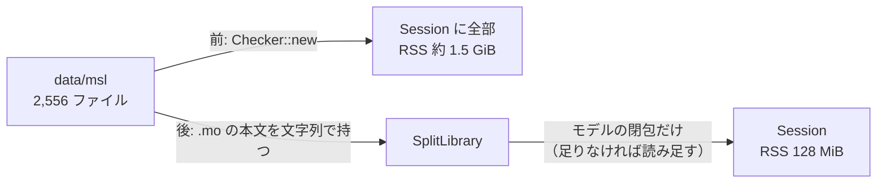

# S054 library-closure

| | |
| --- | --- |
| セッション | S054 |
| 日付 | 2026-11-01 |
| ブランチ | `feature/s054-library-closure` |
| Phase | P3（S051 の削減案 1） |
| スライド | [slides.html](slides.html) |
| 作業記録 | `log/work/2026-11-01-s054-library-closure.md` |
| 決定 | [ADR-0025](../../adr/0025-native-library-closure.md) |
| 調査 | [research/resources-2026-10-31.md](../../research/resources-2026-10-31.md) の §6 |

## 1. 目的

`globe check --library data/msl` は MSL 4.1.0 の 2,556 ファイルを Rumoca の Session に全部読み、`ChuaCircuit` で最大 RSS が約 1.5 GiB になる（S040・S051）。`globe lsp` と Desktop の sidecar（[ADR-0023](../../adr/0023-desktop-and-web-process-layout.md)）も同じ道を通る。wasm には S037 の分割読み込みがあり、S047 の `split-all` で MSL の 566 本すべてが全部読みと同じ検査結果になった。これをネイティブの `with_libraries` の既定にして RSS を減らす。

## 2. 決定と理由

| 項目 | 決定 | 理由 |
| --- | --- | --- |
| 切り替える場所 | facade の `Workspace::with_libraries` | CLI（`check`・`simulate`・`lsp`）、Python の束縛、sidecar が呼び出しのまま切り替わる。CLI の `main.rs` と `globe-mode-lsp` は変えない |
| 実装 | ディレクトリの `.mo` を読んで `GlobeDb::with_library_sources_split` に渡す | 新しい読み込みの仕組みを作らず、wasm と同じ道を使う |
| 全部読む道 | `with_libraries_full`（関数名 `with_libraries` は変えない） | 試験で比べる。1 ファイルに 2 つ以上のトップレベルのクラスがあるライブラリ向け |
| 戻る条件 | パスが空、またはディレクトリでないパスがある | 既存の挙動（Rumoca のローダ）を残す |
| 2 つ目以降のモデル | 閉包が増えたら読み足す（`ensure_library`） | `globe lsp` は複数のモデルを順に検査する。facade の試験は 1 つの `Workspace` で順に検査して一致を見る |
| `Checker` の内部 | 変えない | `msl:funnel`・`msl:compare`・xtask は全部読みのまま。数字が変わらない |

## 3. 図



## 4. 再現手順

```bash
cd .git-worktree/s054-library-closure
export CARGO_TARGET_DIR=<共有の target>
cargo test --release -p globe-mode --test library_closure   # 一致の試験（data/msl が無ければ MSL の分は飛ばす）
cargo build --release -p globe-mode-cli
/usr/bin/time -v target/release/globe check --library data/msl \
  -m Modelica.Electrical.Analog.Examples.ChuaCircuit
gh workflow run resources.yml --ref feature/s054-library-closure -f jobs=rss
gh run download <run-id> -n resources-rss
```

結果（最大 RSS、前 → 後、MiB）:

| モデル | 操作 | ランナー（run 41245881321） | 手元 |
| --- | --- | --- | --- |
| `ChuaCircuit` | check | 1,493 → 128 | 1,512 → 122 |
| `ChuaCircuit` | simulate | 1,533 → 167 | 1,539 → 159 |
| `FullRobot` | check | 1,653 → 298 | 1,655 → 291 |
| `FullRobot` | simulate | 1,929 → 573 | 1,669 → 512 |
| `HeatingSystem` | check | 1,618 → 480 | 1,614 → 476 |
| `HeatingSystem` | simulate | 1,589 → 486 | 1,604 → 477 |

手元の壁時計は、ほかのセッションが同じ機械で動いていたため参考にしない。ランナーの `ChuaCircuit` の check は 8.1 → 1.05 s。`resources.yml` は入力 `jobs`（`all`・`rss`・`wasm`）で rss だけを回せる。`msl:compare` は xtask が `Checker::new` を直接呼ぶので、この変更では数字が動かない構造になっている（結果は作業記録）。

## 5. 次回

- `globe lsp` を長く使ったときの RSS の伸び（閉包の読み足し。読んだものは外さないので増える一方）。
- ライブラリのファイルの構文の誤りは、そのファイルを読むときに見つかる（以前は起動時）。使わないファイルの誤りは見つからない。
- S051 の持ち越し: `Backend`/`Plot` への `simulateColumns` の接続、1 回の検査で大きく伸びる wasm のモデルの予告か上限。
