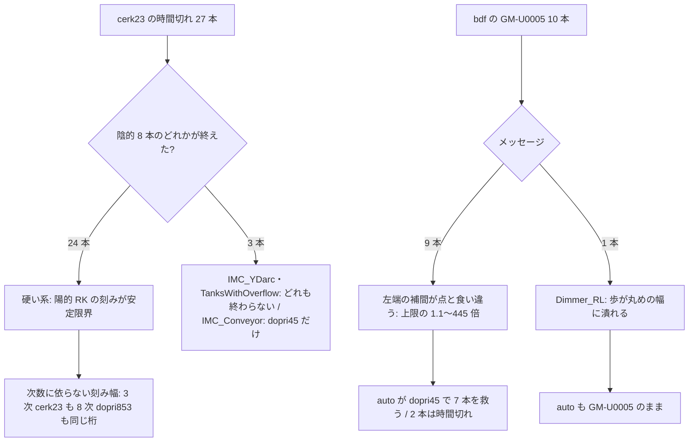

# S055 sim-failures

| | |
| --- | --- |
| セッション | S055 |
| 日付 | 2026-11-01 |
| ブランチ | `feature/s055-sim-failures` |
| Phase | P3 |
| スライド | [slides.html](slides.html) |
| 作業記録 | `log/work/2026-11-01-s055-sim-failures.md` |
| 調査の記録 | [research/msl-sim-failures.md](../../research/msl-sim-failures.md) の節「S055 で調べたこと」 |

## 1. 目的

[S050](../S050-solver-matrix-ci/解説書.md) のソルバ別の表（[msl-solvers.md](../../msl-solvers.md)、run 41194959752）で目立った 2 件の原因を数字で出し、GlobeMode の側で直せるものだけ直す。

- `cerk23`・`cerk34` は時間切れ（`GM-E11005`）が 27 本（`cerk45` は 22、`bdf` は 2）。
- `bdf` 単独は内部エラー（`GM-U0005`）が 10 本。`auto` は dopri45 の回し直しで救っている。

## 2. 決定と理由

| 項目 | 決定 | 理由 |
| --- | --- | --- |
| `cerk` の時間切れ | 直さない。分類と案内だけ足す | 27 本のうち 24 本は陰的ソルバが終える硬い系で、陽的な方法の刻みは安定限界に張り付く（刻み幅が次数 3 から 8 までほぼ同じ）。実装の誤りは見つからなかった |
| GM-E11005 の補足 | 陽的ソルバ（dopri45・tsit45・dopri853・cerk23・cerk34・cerk45）が時間切れのとき、`bdf`・`esdirk34`・`radau5`・`auto` を勧める | 数値は変えず、利用者が次に何を試すかを示す |
| `bdf` の `GM-U0005` | 直さない。上流の下書き 15 を足す | 検査は Rumoca の host、補間は Rumoca の BDF。native の `bdf` は GlobeMode のコードを通らない。許容誤差を緩めても単調に通らない |
| `auto` の切り替え先 | 変えない（次の候補にする） | `auto` の挙動を変えるので ADR-0015 の改訂が要る。見込みは表の読みで、まだ回していない |
| `msl-sim.yml` | 入力 `solvers`（JSON 配列。空なら 14 本）を足す | 2〜3 時間かかる run を、調べたいソルバだけに絞る。既存のジョブの中身は変えていない |
| `doc/msl-solvers.md` | 更新しない | 表は全ソルバ同時の run で作る決まり。今回の run は 3 ソルバだけ |

## 3. 図



## 4. 再現手順

```bash
# JSON を取る（14 ソルバ。run 41194959752）
gh run download 41194959752 -n msl-sim-solver-cerk23 -D <置き場>

# 手元の再現（release ビルド）
cargo build --release -p globe-mode-cli
globe simulate -L data/msl -m Modelica.Electrical.Machines.Examples.DCMachines.DCPM_Drive \
  --solver cerk23 --tolerance 1e-7 --timeout 20 -o /tmp/out.csv
globe simulate -L data/msl -m Modelica.Electrical.PowerConverters.Examples.ACDC.RectifierBridge2Pulse.ThyristorBridge2Pulse_RLV_Characteristic \
  --solver bdf --tolerance 1e-7        # GM-U0005。1e-6・3e-7 なら通る

# CI で 3 ソルバだけ回す
gh workflow run msl-sim.yml --ref feature/s055-sim-failures -f solvers='["cerk23","cerk34","bdf"]'
```

刻み幅の測定は `rk.rs` に一時的な出力を入れて行った（コミットしていない）。検証の数字:

- 27 本のうち、陰的ソルバ 8 本のどれかが終えた 24 本（bdf が終えた 21 本）、どれも終えない 2 本、dopri45 だけが終える 1 本。
- 刻み幅（cerk23）: `DCPM_Drive` 2.6e-8、`SmoothStep` 2.9e-9、`Polyphase.Rectifier` 8.5e-9、`SMPM_Braking` 2.4e-10。終了時刻まで 9.2e5〜3.3e9 歩。
- `IMC_Inverter` の t ≈ 0.12〜0.15 で、刻み幅の範囲は cerk23 2.6e-6〜9.5e-6、dopri853 6.9e-6〜1.4e-5（次数 3 と 8 で同じ桁）。
- `bdf` の許容誤差を 1e-6・3e-7・1e-7 にした 7 本: 1e-7 で 7/7 が失敗、1e-6 と 3e-7 で 4/7 が通る。単調でない。
- 一時的な出力は戻した。`cargo test -p globe-mode-sim`（106 件）と `cargo test -p globe-mode-exec --lib`（19 件）は通る。`cerk45` を含む数値は変えていない。
- CI の結果（run 41247200921）は research の節「CI での再確認」。

## 5. 次回

- `auto` の切り替え先を `esdirk34` にする案を、`msl-sim.yml` の `solvers` で回して確かめる（`bdf` の `GM-U0005` 10 本のうち `auto` が救えない 3 本が対象）。ADR-0015 の改訂が要る。
- diffsol の陽的 RK に `dopri45`（Rumoca）と同じ刻み幅制御を足して、Rumoca の `dopri45` だけが終える 7 本（`IMC_Inverter` など）の差が縮むか確かめる。原因はまだ【未確認】。
- 上流の下書き 15（[upstream/15](../../research/upstream/15-bdf-sampler-left-endpoint-tight-tolerance.md)）を出すかどうかはユーザーが決める。
