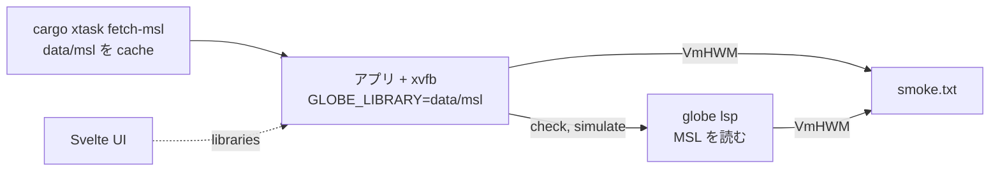

# S056 desktop-msl

| | |
| --- | --- |
| セッション | S056 |
| 日付 | 2026-11-01 |
| ブランチ | `feature/s056-desktop-msl` |
| Phase | P4（Desktop MVP。計画書の WP-C の続き） |
| スライド | [slides.html](slides.html) |
| 作業記録 | [log/work/2026-11-01-s056-desktop-msl.md](../../../log/work/2026-11-01-s056-desktop-msl.md) |

## 1. 目的

P4 の完了条件（[roadmap.md](../../roadmap.md)）の残り 2 つを済ませる。(1) Desktop で MSL が読める（UI の「MSL を読む」ボタンが `backend.library(name, json)` を呼ぶ）。(2) MSL を読んだ後の RSS の基準値を記録する。S049 の smoke は MSL なしで、sidecar の VmHWM は 21,424 kB だった。

## 2. 決定と理由

| 項目 | 決定 | 理由 |
| --- | --- | --- |
| MSL の渡し方 | JSON で送らず、sidecar が起動時に `--library` / `GLOBE_LIBRARY` で読む（S049 のまま） | 15 MiB の JSON を IPC に載せる必要が無い。ネイティブの sidecar は `.mo` を直接読める |
| UI への知らせ | Tauri の command `libraries`（起動時に渡したパスの一覧）。sidecar ではなくシェルが持つ | sidecar の起動（MSL の読み込み、約 3 s）のロックを待たずに答えられる |
| `TauriBackend.library()` | 一覧が空でなければ resolve（JSON は捨てる）、空なら今までの reject | App.svelte と `Backend` を変えずに、ボタンがそのまま動く |
| smoke の指定 | 環境変数 `GLOBE_DESKTOP_SMOKE_MODEL`（ライブラリのモデル名）。無ければ従来の `D` | 引数の解析を足さない最小の変更 |
| RSS の測り方 | アプリが `/proc/self/status` と sidecar の `/proc/<pid>/status` の VmHWM を、検査の後と実行の後に表示。`time -v` も残す | `time -v` は 1 つの最大値だけ。アプリと sidecar を分けて見る |
| 成果物 | smoke の出力 `smoke.txt`・`time.txt` を artifact `desktop-linux-smoke` に、ジョブの summary にも出す | 数字を run から取り出せるように |

試験 `budget_kills_a_silent_sidecar` が最初の run で落ちた（`Text file busy`、ETXTBSY）。別の試験が fork した子が、書き込み中の fd を exec まで持つ競合で、S049 から潜在していた。`Text file busy` のときだけ 50 ms 待って再試行するようにした。

## 3. 図



## 4. 再現手順

```bash
cd src/Rust/apps/desktop && cargo fmt -- --check        # 手元で見るのは整形だけ（webkit2gtk が無い）
cd src/Svelte && pnpm install --frozen-lockfile && pnpm run check
git push -u origin feature/s056-desktop-msl
gh workflow run desktop.yml --ref feature/s056-desktop-msl
gh run download <run-id> -n desktop-linux-smoke
```

結果（run 41244465666、ubuntu-24.04 の .deb、`ChuaCircuit`、Linux・Windows とも成功）:

| 時点 | アプリの VmHWM | sidecar の VmHWM |
| --- | --- | --- |
| `globe/check` の後 | 139,508 kB（136 MiB） | 1,565,032 kB（1.49 GiB） |
| `globe/simulate` の後 | 139,508 kB（136 MiB） | 1,598,636 kB（1.52 GiB） |

- `time -v` の Maximum resident は 139,508 kB でアプリの値と同じ。sidecar はアプリの終了（`handle.exit`）で wait されない孫のため含まれず、`time -v` ではプロセス木の合計も最大も見えない。sidecar は VmHWM で測る。
- 壁時計 37.6 s（WebKit の起動と終了を含む）。sidecar の値は ADR-0023 の `globe check ChuaCircuit`（1.48 GiB）と同じ桁。
- 成果物の大きさ: .deb 20,023,364 B（S049 は 20,018,578 B）、.msi 18,165,760 B（18,161,664 B）。

## 5. 次回

- MSL の置き場（同梱か取得か）、署名と自動更新、静かな `globe/setFile`。
- Windows での RSS は測っていない（smoke は Linux だけ）。
