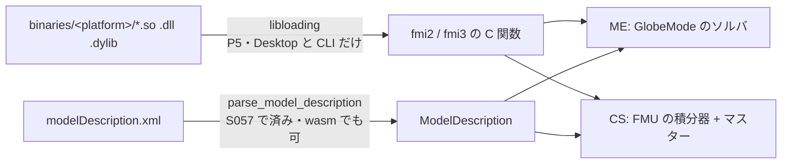

# S057 fmi-prep

| | |
| --- | --- |
| セッション | S057 |
| 日付 | 2026-11-01 |
| ブランチ | `feature/s057-fmi-prep` |
| Phase | P5 の準備（調査と骨格） |
| スライド | [slides.html](slides.html) |
| 作業記録 | `log/work/2026-11-01-s057-fmi-prep.md` |
| 調査 | [research/fmi-2026-11-01.md](../../research/fmi-2026-11-01.md) |
| ADR | [ADR-0026](../../adr/0026-fmi-import-placement.md)（Proposed） |

## 1. 目的

P5 は「FMI Import（ME / CS / SE）とマスター。Export は後」。完了条件は「Reference-FMUs が linux64 と win64 で一致する」（[roadmap.md](../../roadmap.md)）。実装の前に、置き方（crate を使うか自前か、どこで動かすか）を調べ、骨格だけを作る。共有ライブラリの読み込みは書かない。

## 2. 決定と理由

| 項目 | 決定 | 理由 |
| --- | --- | --- |
| XML の読み取り | 自前。`roxmltree` 0.21（MIT OR Apache-2.0） | 依存が `memchr` だけで、Cargo.lock に既にある。DOM で足りる。wasm32 で通る。`fmi-schema` は 42 パッケージ増える |
| 共有ライブラリと C ABI | **案を 2 つ示した**（A: 自前、B: `fmi` 0.8）。推奨は A。**ユーザーが決める** | driver が自前なので C ABI の層は薄くてよい。bindgen（libclang）を通常ビルドに入れない。依存を増やさない。外れたら B に切り替える |
| 実行の場所 | Desktop と CLI の別プロセスのワーカーの中だけ | FMU は任意のネイティブコード。落ちても UI は巻き込まれない（[ADR-0023](../../adr/0023-desktop-and-web-process-layout.md)）。ブラウザは `modelDescription.xml` の閲覧まで |
| ME / CS | ME は GlobeMode のソルバ、CS は FMU の積分器 | `HybridSystem` を FMU でも使う目標（architecture.md §3.3）。Rumoca の FMI ME 風の host は Modelica のモデル用で、FMU を読む道ではない |
| `fmi-rs` | 採らない | 公開から 3 日、`colored` が MPL-2.0、build.rs の C が wasm32 を落とす。fmusim の基盤なので検証の相手と重なる |
| fixture | `modelDescription.xml` 4 つだけコミット | BSD-2。バイナリは入れない。`tests/data/LICENSE` に原文 |

調査で分かったこと（詳細と出典は調査の文書）: ヘッダ・XSD・Reference-FMUs は BSD-2。Reference-FMUs v0.0.42 の zip は 4,455,975 B、sha256 `b6b4a195b9c0f6bdd3459cd949cbb35fc21ee2049d6dab4cb7a3ba7da63b1e97`、FMI 2.0 が 6 本・3.0 が 9 本。3.0 の FMU には `wasm32-wasip2` のバイナリも入っている。fmuCheck は開発終了で FMI 1/2 のみ。

## 3. 図



`globe-mode-fmi` の `ModelDescription`: `fmi_version`、`model_name`、`instantiation_token`（2.0 は `guid`）、`model_exchange` / `co_simulation` / `scheduled_execution`（`Option<Interface>`）、`variables`（名前、値参照、causality、variability、型）。2.0 の `Real` は `Float64`、`Integer` は `Int32` に写す。

## 4. 再現手順

```bash
export CARGO_TARGET_DIR=<共有の target> MISE_DISABLE_TOOLS=elixir
cargo test -p globe-mode-fmi                                  # 4 本
cargo clippy -p globe-mode-fmi --all-targets -- -D warnings
cargo check -p globe-mode-fmi --target wasm32-unknown-unknown
cargo deny check
cargo xtask fetch-reference-fmus                              # data/reference-fmus/ に 17 ファイル、8.6 MB
```

検証の数字: 試験 4 本（Dahlquist の 2.0 と 3.0 で変数表が一致、Feedthrough は 2.0 が 15 変数・3.0 が 35 変数、SE と Clock、壊れた入力が panic でなく `Error`）。Cargo.lock に増えたのは `roxmltree` と `globe-mode-fmi` だけ。

## 5. 次回

- ユーザーが ADR-0026 (b) の案を決める。決まったら architecture.md §3.4 と表の `globe-mode-fmi` の行を直す。
- 案 A なら、ヘッダと関数の一覧を突き合わせて工数を確かめ、2.0 の Dahlquist の ME を `.so` から 1 本通す（`linux64`）。
- 3.0 の `variability` の既定値（Float 以外は `discrete` か）を仕様本文で確かめる。
- fmi-standard.org の validation のページを読み、FMPy・fmusim の突き合わせの道を決める。
