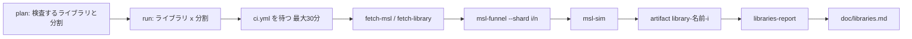

# S058 extra-libs-ci: MSL 以外の公開ライブラリの検査を Actions で回す

| | |
| --- | --- |
| セッション | S058 |
| 日付 | 2026-11-01 |
| ブランチ | `feature/s058-extra-libs-ci` |
| Phase | P3 |
| スライド | [slides.html](slides.html) |
| 作業記録 | `log/work/2026-11-01-s058-extra-libs-ci.md` |
| 調査 | [research/libraries-2026-11-01.md](../../research/libraries-2026-11-01.md) |
| ワークフロー | [.github/workflows/libraries.yml](../../../.github/workflows/libraries.yml) |

## 1. 目的

MSL の全例題に回している `msl-funnel`（S0〜S10 の判定）と `msl-sim`（実行）を、Buildings・AixLib・IBPSA・ClaRa・ThermofluidStream・DeltaRobot・Chemical にも GitHub Actions で回す。MSL にだけ合わせた作りが、他の実際のライブラリでどこまで通じるかを数字で見るため（[roadmap](../../roadmap.md) P3 の外側の確かめ）。

- 本筋の CI（ci.yml の push）を優先し、結果を待たずに進める。
- 実行に失敗しても全モデルを検査する。落ちた本数は数えるだけで、失敗扱いにしない。

## 2. 決定と理由

| 項目 | 決定 | 理由 |
| --- | --- | --- |
| 取得 | `cargo xtask fetch-library <名前>`。commit 固定の `archive/<commit>.zip` を sha256 で確かめ、`data/libs/<名前>/<パッケージ>/` に置く | release の zip があるのは Buildings だけ。IBPSA 4.0.0 と ClaRa は tag が無いか古い。書き方を 1 つにそろえる |
| 出典・版・ライセンス | [research/libraries-2026-11-01.md](../../research/libraries-2026-11-01.md) | 7 つとも BSD-3-Clause 系（TILMedia だけ【未確認】）。読むだけなので静的リンクの規則の外 |
| xtask の引数 | `--library <DIR>`（何度でも）、`--package <根>`、`--examples-in <段>`、`--shard i/n`。引数なしは従来と同じ出力 | 例題の規則は MSL と同じで、根の名前と「例題の段」だけが違う。DeltaRobot には `Examples` が無く `Scenarios`・`Tests` を使う |
| 複数のルート | MSL とライブラリを `target/library-roots/<名前>/` の symlink で 1 つにまとめて読む | `Checker::new(&[msl, lib])` では別のルートの `Modelica.Units.SI` が引けず、全例題が unresolved import になった |
| 分割 | Buildings 6・AixLib 3・IBPSA 2・ClaRa 2・ほか 1 | funnel は JSON を最後に書くので、間に合わなかった分割だけが欠けるようにする。MSL の読み込みは分割ごとにやり直す |
| ci.yml の優先 | 各ジョブの最初に ci.yml が `in_progress`・`queued` なら 60 s ごとに待つ（上限 30 分）。`concurrency` は自分専用の `libraries` | 本筋を遅らせない。上限を超えたら進む |
| 失敗の扱い | `fail-fast: false`、funnel・sim は `continue-on-error`、ジョブ 360 分（ステップ 170 分ずつ）、artifact は `if: always()` | 全モデルを数える。ワーカーは 1 本ずつ別プロセスで、panic・時間切れ・外からの停止で全体は止まらない |
| 参照結果 | 無し（MAP-LIB は MSL のみ） | `msl-sim` は参照が無くてもそのまま動く（「参照結果なし」と数える）ので、モードは足さない |
| 起動 | 手動（`libraries` に JSON か名前）と毎週月曜 06:00 JST | ci.yml の定期実行（03:00 JST）の後 |

## 3. 図



## 4. 再現手順

```bash
cargo xtask fetch-msl
cargo xtask fetch-library DeltaRobot
cargo xtask msl-funnel --library data/libs/DeltaRobot --package DeltaRobot --examples-in Scenarios --examples-in Tests \
  --report target/DeltaRobot-1-funnel.md --json target/DeltaRobot-1-funnel.json
cargo xtask msl-sim --library data/libs/DeltaRobot --package DeltaRobot \
  --funnel-json target/DeltaRobot-1-funnel.json --tolerance-scale 0.1 \
  --report target/DeltaRobot-1-sim.md --json target/DeltaRobot-1-sim.json
cargo xtask libraries-report --dir target --report doc/libraries.md
# Actions
gh workflow run libraries.yml -f 'libraries=["DeltaRobot","Chemical"]'
gh run download <run-id> -n libraries
```

検証の数字:

- `cargo test -p xtask` 46 本、`cargo clippy -p xtask --all-targets -- -D warnings` が通る。
- 手元（RAM 3 GB）の DeltaRobot: 例題 21 本、OK 9・NG 7・GM-U 5・panic 0。OK の 9 本を実行して 5 本が終わりまで実行できた（実行 NG 4。GM-U0004 が 3 本、GM-E11001 が 1 本）。最大 RSS 1.4 GiB。
- 手元の Chemical（先頭 4 本）: OK 0・NG 3・GM-U 1。
- CI の結果: 下の「CI の結果」。

### CI の結果

- 新しいワークフローは main に入るまで `workflow_dispatch` で起動できない（`gh workflow run` が 404）。feature ブランチの push で起動する一時のトリガー（コミットメッセージの `[libraries: …]` で絞る）で試し、試した後に消した。main に入れた後は `gh workflow run libraries.yml` で起動する。
- **小さい 2 つ**（run 41248143483、約 16 分、全ジョブ success。1 ジョブの大半は xtask の release ビルド約 7 分）:

  | ライブラリ | 例題 | OK | NG | GM-U | panic | 実行した | 実行できた |
  | --- | ---: | ---: | ---: | ---: | ---: | ---: | ---: |
  | DeltaRobot | 21 | 9 | 7（S3） | 5 | 0 | 9 | 5 |
  | Chemical | 76 | 12 | 21（S4、GM-E4001） | 43 | 0 | 12 | 0 |

  Chemical の GM-U は「動的な if 方程式の枝の形が違う」41 本ほか、NG は `Chemical.Interfaces.Definition` の呼び出しの名前付き引数が合わない 16 本ほか（MSL 4.0.0 向けの記述が 4.1.0 で通らないのか、Rumoca の未対応かは見分けていない）。実行した 12 本はすべて実行系の未対応（GM-U0004）。手元の DeltaRobot の結果と一致した。
- **全部の run**: 41249259332（Buildings 6・AixLib 3・IBPSA 2・ClaRa 2・ThermofluidStream 1 の 14 ジョブ）。結果は後で取り込む。

## 5. 次回

- 全部の run（Buildings・AixLib など大きいもの）の結果を取り込み、`doc/libraries.md` に反映する。GM-E1001 などの多い原因を数えて、Rumoca の未対応か、MSL 4.0.0 と 4.1.0 の差か、取得しない依存（SDF・Modelica_DeviceDrivers・SMArtInt）かに分ける。
- `Checker::new` で別々のルートの間の名前が引けない原因を確かめる（今回は xtask で迂回した）。
- `globe-mode-frontend` の `Checker::new` は、ライブラリの 1 ファイルに構文の誤りがあると全体を断る。大きいライブラリではファイル単位で読み飛ばす方がよいか検討する。
