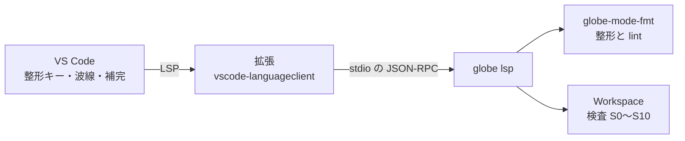

# S059 VS Code 拡張

| | |
| --- | --- |
| セッション | S059 |
| 日付 | 2026-11-01 |
| ブランチ | `feature/s059-vscode-extension` |
| Phase | P4 |
| スライド | [slides.html](slides.html) |
| 作業記録 | `log/work/2026-11-01-s059-vscode-extension.md` |

## 1. 目的

ユーザーの依頼は「標準キーで整形できるように `globe lsp` を起動する小さな VS Code 拡張を作る」。S053 で持ち越した「VS Code 拡張の実体」にあたる。

整形・lint・補完・検査は S053 までに `globe lsp` が持っている（[format-style.md](../../format-style.md)、[ADR-0024](../../adr/0024-own-formatter-and-lint.md)）。拡張はそれを起動してつなぐだけで、計算は足さない。

## 2. 決定と理由

| 項目 | 決定 | 理由 |
| --- | --- | --- |
| 置き場 | `src/VSCode/globe-mode/`（独立した pnpm のプロジェクト） | ルートの依存と CI を増やさない。Astro のウェブアプリと同じ置き方 |
| クライアント | vscode-languageclient 9.0.1（MIT）を esbuild で `dist/extension.js` に束ねる | LSP の往復を自分で書かない。VSIX に `node_modules` を入れずに済む |
| VSIX の作り方 | `pack_vsix.py`（Python の標準ライブラリだけ） | 公式の `@vscode/vsce` は、ライセンス欄の無い署名用バイナリ `@vscode/vsce-sign` と WTFPL・Artistic-2.0 を引き込む（[licenses.md](../../licenses.md)） |
| インデント | `configurationDefaults` で `.mo` の `editor.tabSize` を 2 にする | LSP の整形は `options.tabSize` をインデントに使う。VS Code の既定 4 のままだと、ユーザーの規則（4 は明示したときだけ）に反する |
| 動く側 | `extensionKind: ["workspace"]` | Remote - WSL の窓でも、`globe` と同じ WSL の側で起動する |
| 設定 | `globeMode.path`（既定 `globe`）と `globeMode.libraries`（`--library` に渡す） | 起動時に 1 回だけ読む。変えたら「ウィンドウの再読み込み」 |

## 3. 図



## 4. 再現手順

```bash
cargo build -p globe-mode-cli
cd src/VSCode/globe-mode
mise exec -- pnpm install
mise exec -- pnpm package                      # globe-mode-0.0.1.vsix
GLOBE_BIN=$PWD/../../../target/debug/globe mise exec -- pnpm test
code --install-extension globe-mode-0.0.1.vsix
```

検証の結果（数字）:

- `pnpm test`: 1 本が通る。`globe lsp` を VS Code と同じ形（`file://` の URI、拡張の既定の tabSize 2）で起こし、整形の結果、lint の診断 `GM-L0002`、補完の `equation` と `x` を確かめる。
- VSIX: 8 ファイル（`[Content_Types].xml`、`extension.vsixmanifest`、`extension/` の下に package.json・束ねた `dist/extension.js` 約 0.8 MB・言語設定・README・ライセンス 2 つ）。VS Code Server の CLI で使い捨ての拡張フォルダに入れると `globe-mode.globe-mode@0.0.1` として受け付けられた。
- 束ねた `dist/extension.js` を、`vscode` を差し替えた Node で読み込める（`activate` と `deactivate` を出す）。
- 同梱する npm は 10 個で、MIT 8・ISC 2。
- VS Code の本体の窓で整形キーを押す確認はしていない。

## 5. 次回

- VS Code の本体を起動しての試験（`@vscode/test-electron`。VS Code を約 150 MB 取得し、画面が要る）。
- 構文の色付け（TextMate 文法）。今は色が付かない。別の Modelica 拡張と併用したときの振る舞いは【未確認】。
- 設定を変えたときの自動の作り直し（`client.restart`）。Marketplace への公開は未定。
