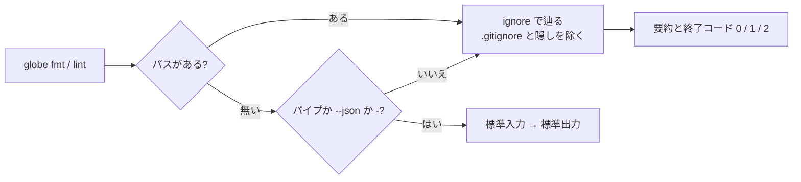

# S060 CLI の走査と VS Code のキー

| | |
| --- | --- |
| セッション | S060 |
| 日付 | 2026-11-01 |
| ブランチ | `feature/s060-fmt-cli-vscode-keys` |
| Phase | P4 |
| スライド | [slides.html](slides.html) |
| 作業記録 | `log/work/2026-11-01-s060-fmt-cli-vscode-keys.md` |

## 1. 目的

ユーザーが S053・S059 の成果を試して出した 4 つの依頼に応える。

- [web-apps.md](../../web-apps.md) に起動コマンドの一覧を足す。Phoenix は初回の `mix deps.get` を飛ばして止まっていた。
- VS Code では Ctrl+Shift+I がエージェントの窓を開いてしまう。Shift+Alt+F で整形し、保存時の整形を設定で選べるようにする（既定はオフ）。
- 拡張がどこにあるかわからない。調べると、窓はプロファイル「20250606_4900」で開いていた。CLI の `code --install-extension` は既定のプロファイルに入れるので、その窓には拡張が読み込まれず、`.mo` は言語の自動推定で Lua になっていた。
- CLI はディレクトリを ruff のように辿る。

## 2. 決定と理由

| 項目 | 決定 | 理由 |
| --- | --- | --- |
| パスを省いたとき | 端末から打ったならカレントディレクトリ。パイプ・`--json`・`-` なら標準入力 | ruff と同じ操作性にしつつ、ウェブアプリ 10 種（どれも `--json` とパイプ）の呼び方を変えない |
| 除外 | `.gitignore` と隠しディレクトリを辿らない（crate `ignore`、`require_git(false)`）。明示したファイルは除外しない | ruff と同じ crate と規則。ルートで打っても `data/msl`（`.gitignore` 済み）を整形しない |
| 壊れたファイル | 残りを続け、最後に要約を出して終了コード 2 | 前は 1 本で止まっていた。ruff も続ける |
| 出力 | 「整形が要る: パス」と要約（「1 ファイルを整形した、66 ファイルは変更なし」）。lint は最後に件数 | CLI のほかの文言に合わせて日本語 |
| VS Code のキー | 拡張が Shift+Alt+F を `.mo` の整形に割り当てる | Windows の標準と同じキーで、Linux でも同じにする |
| 保存時の整形 | 設定 `globeMode.formatOnSave`（既定はオフ）。保存のたびに読む | ユーザーの指定。VS Code 全体の `editor.formatOnSave` より見つけやすい |
| 入れ方 | 画面の「VSIX からのインストール」 | 今の窓のプロファイルに入る。VS Code Server の CLI にはプロファイルの指定が無い |

`--diff`（差分の表示）と `--exclude` は入れていない。

## 3. 図



## 4. 再現手順

```bash
cargo test -p globe-mode-cli --test fmt_dirs
cd src/VSCode/globe-mode && GLOBE_BIN=$PWD/../../../target/debug/globe mise exec -- pnpm test
cd src/Modelica && ../../target/debug/globe fmt --check
```

検証の結果（数字）:

- `fmt_dirs` 3 本: `.gitignore` と隠しディレクトリを除く、明示したファイルは整形する、壊れたファイルがあっても続けて終了コード 2、lint の要約、パイプの標準入力。
- 拡張の試験 2 本: `globe lsp` との往復と、保存時の整形（オフのとき・`.mo` 以外は頼まない）。
- `src/Modelica` で `globe fmt --check`: 「69 ファイルは整形が要る、0 ファイルは整形済み」。
- 増えた crate は `ignore` と `globset` の 2 つ（MIT OR Unlicense）。

## 5. 次回

- `--diff` と `--exclude`。設定ファイル（`globe-fmt.toml`）と合わせて考える。
- VS Code の窓での確認（ユーザー）。
- `src/Modelica` の 69 本の書き換え。
