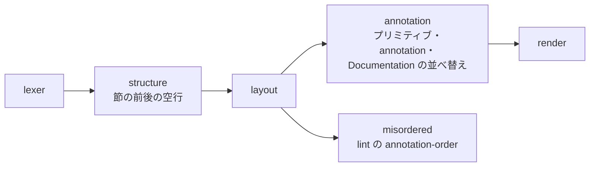

# S061 節の空行と annotation の並び

| | |
| --- | --- |
| セッション | S061 |
| 日付 | 2026-11-01 |
| ブランチ | `feature/s061-fmt-sections-annotation-order` |
| Phase | P4 |
| スライド | [slides.html](slides.html) |
| 作業記録 | `log/work/2026-11-01-s061-fmt-sections-annotation-order.md` |

## 1. 目的

ユーザーは S060 の VS Code 拡張で、整形と診断が出ることを確かめた。そのうえで、整形の規則を 2 つ頼んだ（規則の正典は [format-style.md](../../format-style.md)）。

- `equation` と `algorithm` の前後に空行を置く。既定はオンで、切れるようにする。
- annotation の中を `experiment` → `Diagram` → `Documentation`（中は header → info → revisions）の順に整形し、ずれを lint で通知する。

## 2. 決定と理由

| 項目 | 決定 | 理由 |
| --- | --- | --- |
| 空行の対象 | `equation` `algorithm` と、`initial` の付いたもの。`public` `protected` は対象外 | 依頼の範囲 |
| 切り方 | `Options.blank_around_sections`、CLI `--no-blank-around-sections`、LSP の `blankAroundSections`、VS Code の `globeMode.blankAroundSections` | 既定オンで、どの入口からも切れるように |
| `Icon` の位置 | `Diagram` の直後 | 指定に無い。図の 2 つを隣に置いた【ユーザーに未確認】 |
| 表に無い引数 | `uses` や `version` などは後ろに、元の順で | 図形プリミティブの並べ替えと同じ規則 |
| header | `__OpenModelica_infoHeader` | Modelica の仕様の `Documentation` に header は無く、OMEdit が使う名前 |
| 並べ替えの範囲 | 名前が `annotation` と `Documentation` の `(…)` の中。ランクによる強制改行は付けない | 並べるだけで、改行は 80 桁の規則に任せる |
| lint | `annotation-order`、LSP では `GM-L0004` の Information | 整形で直るものなので、警告より軽くする |
| VS Code の整形 | 拡張は独自の要求 `globe/format` で頼む | vscode-languageclient 9 の `asFormattingOptions` は `tabSize` と `insertSpaces` しか通さず、追加の設定を捨てる |

## 3. 図



## 4. 再現手順

```bash
cargo test -p globe-mode-fmt
cargo test -p globe-mode-lsp --lib annotation_order
cd src/VSCode/globe-mode && GLOBE_BIN=$PWD/../../../target/debug/globe mise exec -- pnpm test
```

検証の結果（数字）:

- 整形器の統合試験 8 本。新しい試験 `annotation_and_documentation_order` は、ユーザーが貼った例に `experiment` と `uses` を足し、`Documentation` の引数を逆順にした入力を使う。期待値と一致し、冪等で、lint は整形前に 2 件・整形後に 0 件。
- `spacing_and_blank_lines` は、空行がオンの出力と、オフにしたとき前の出力に戻ることの両方を確かめる。
- LSP の単体試験 1 本: `GM-L0004` が Information で出ること、`globe/format` の `blankAroundSections: false` が効くこと。
- 拡張の試験 2 本: `globe lsp` との往復（新しい既定の出力）と、保存時の整形・`globe/format` への振り替え。

## 5. 次回

- `Icon` の位置をユーザーに確かめる。
- wasm の `format` とウェブアプリ 10 種には、空行を切る口を足していない。既定のオンで動く。
- `src/Modelica` の 69 本の書き換え。
