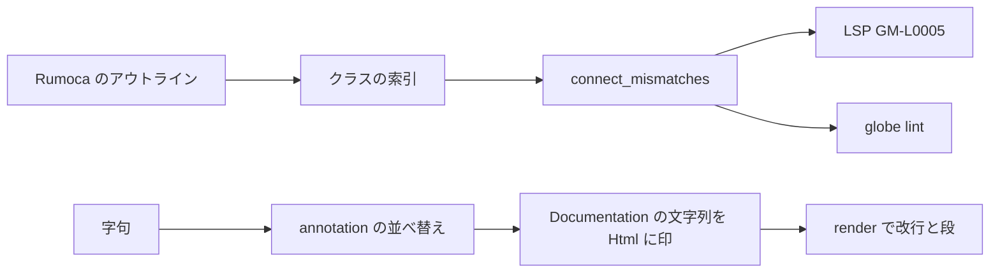

# S062 connect の型の検査と HTML の整形

| | |
| --- | --- |
| セッション | S062 |
| 日付 | 2026-11-01 |
| ブランチ | `feature/s062-connect-type-lint` |
| Phase | P4 |
| スライド | [slides.html](slides.html) |
| 作業記録 | `log/work/2026-11-01-s062-connect-type-lint.md` |

## 1. 目的

ユーザーは S061 の VS Code 拡張を確かめたうえで、次を頼んだ。

- 型の検査を足し、違う型で `connect` したら lint で通知する。
- README に、今後必要になりそうな機能と今の規則を表で足す。処理の流れは Mermaid で描く。
- （途中で追加）`Documentation` の HTML を改行とインデントで整える。切り替えられて既定はオン、lint はしない。

規則の正典は [format-style.md](../../format-style.md)、一覧は [README.md](../../../README.md) の「エディタ機能」。

## 2. 決定と理由

| 項目 | 決定 | 理由 |
| --- | --- | --- |
| 型の検査の置き場 | `globe_mode_graph::connect_mismatches`（クラスの索引から） | connect グラフが既にコネクタの型を同じ索引で解決している。新しい解析を入れない |
| 「同じ型」の判定 | 名前が同じか、中身（変数の名前・flow / stream・型）が同じ | MLS 9.3 は構造の同値で判定する。`PositivePin` と `NegativePin`、`RealInput` と `RealOutput` をつなげる |
| 解決できない端 | 判定しない | `--library` の MSL の型は索引に無い。誤った通知を出さないほうを取る |
| 重さ | LSP の `GM-L0005` を warning | 型の合わない connect はコンパイルで落ちる。並びの通知（GM-L0004）より重い |
| CLI | `globe lint` が渡したファイルをまとめて 1 つのワークスペースにする | パッケージをまたぐ型を解決できる。`--disable connect-type-mismatch` で止まる |
| HTML の範囲 | `Documentation(…)` の `name = "…"` で、タグを含む文字列 | 依頼の範囲。ほかの文字列は今までどおり触らない |
| HTML の書き方 | ブロックの要素は 1 行ずつ、文字とインラインだけなら 1 行、`<html><head>…</head><body>` は 1 行 | ユーザーが貼った例と同じ出力 |
| HTML の安全 | 変えるのは空白だけ。組み立て直して空白以外が変われば触らない。`<pre>` などは触らない | 整形の「意味を変えない」保証を、文字列については空白を除いた比較に緩めるだけで保つ |

## 3. 図



## 4. 再現手順

```bash
cargo test -p globe-mode-graph -p globe-mode-fmt -p globe-mode-lsp -p globe-mode-cli
./target/debug/globe lint src/Modelica | grep connect-type-mismatch
cd src/VSCode/globe-mode && GLOBE_BIN=$PWD/../../../target/debug/globe mise exec -- pnpm test
```

検証の結果（数字）:

- 型の検査: graph の単体試験 1 本（合わない 2 組を出し、`PositivePin`–`NegativePin`・`RealOutput`–`RealInput`・解決できない端・添字つきの端は出さない）。LSP の単体試験 1 本（GM-L0005 が warning で 2 本目の connect に付く）。CLI の試験 1 本（ファイルをまたいで解決し、`--disable` で止まる）。
- `globe lint src/Modelica`（69 ファイル、connect のあるもの 9 本）: 型の通知は 1 件だけで、わざと誤らせた `Invalid/SignalTypeMismatch.mo`（RealOutput と BooleanInput）。誤った通知は 0 件。
- HTML: 単体試験 2 本（貼られた例、冪等、HTML でない文字列と `<pre>` は触らない）。統合試験 1 本（例のとおりの出力、冪等、CRLF、オフで元のまま、lint は変わらない）。`annotation_order_after.mo` の期待値を新しい既定に直した。
- 拡張の試験 2/2（0.0.4、`formatHtml` を `globe/format` に渡す）。

## 5. 次回

- LSP が開いていないファイルと `--library` の型でも突き合わせる（README の「今後必要になりそうな機能」）。
- connect の向き（input 同士）・配列の大きさ・単位の検査。
- wasm の `format` とウェブアプリ 10 種には、空行と HTML を切る口が無い（既定のオンで動く）。
