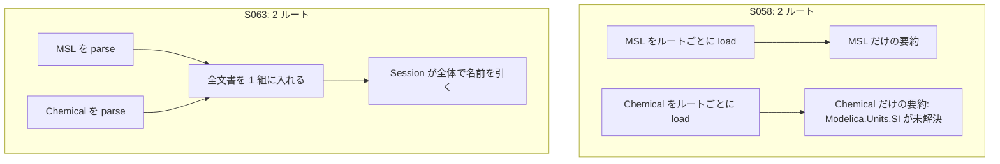

# S063 libs-failures

| | |
| --- | --- |
| セッション | S063 |
| 日付 | 2026-11-01 |
| ブランチ | `feature/s063-libs-failures` |
| Phase | P3 |
| スライド | [slides.html](slides.html) |
| 作業記録 | `log/work/2026-11-01-s063-libs-failures.md` |

## 1. 目的

S058（[解説書](../S058-extra-libs-ci/解説書.md)）の持ち越し 2 つを片付ける。

1. `Checker::new` に MSL とライブラリを別々のルートで渡すと、ライブラリの `import Modelica.Units.SI` が `GM-E1001` になる原因を突き止めて直し、xtask の symlink の迂回を外す。
2. 7 ライブラリの失敗（NG・GM-U 1,781 本）を原因別に集計し、ClaRa の 5 本（OK 0）の原因を追う。

## 2. 決定と理由

| 項目 | 決定 | 理由 |
| --- | --- | --- |
| 原因の切り分け | Rumoca の Session を直接使う小さなプログラムで、ディスクのルート 2 つ・メモリの組 2 つ・1 組の 3 通りを比べた | 2 組にすること自体ではなく、ディスクのルートごとの `load_source_root_tolerant`（意味の要約をルート単位で作る）だけが失敗した |
| 修正の場所 | `Checker::new` のルートが 2 つ以上のときだけ、`parse_source_root_with_cache` で読んで 1 組にまとめる | 1 ルートの道（要約あり）は触らない。Rumoca は改変しない。パッケージ配置の検査とキャッシュはそのまま |
| xtask | MSL の symlink をやめ、ライブラリだけのミラー（読めないファイルを除く）にした | 除く仕組みは残す必要がある（ThermofluidStream・ClaRa の PKG-006/010 と構文の誤り） |
| 分類の単位 | 例題 1 本に 1 つの原因（最初の診断）。`rumoca_code` とメッセージの形で分ける | `GM-E1001` は ER070 や ER132 のような名前解決でない検査も含むため、GlobeMode のコードでは分けられない |
| `libraries-report` | 「主な原因」の列は足さない | 依頼どおり。research に表を書いた |

## 3. 図



## 4. 再現手順

```bash
export CARGO_TARGET_DIR=<絶対パス>
cargo test -p globe-mode-frontend --test multi_root       # 2 ルートの最小の試験（直す前は GM-E1001）
cargo xtask fetch-library DeltaRobot
cargo xtask msl-funnel --library data/libs/DeltaRobot --package DeltaRobot --examples-in Scenarios --examples-in Tests
gh run download 41250636800 -n library-AixLib-1            # 分類の入力（funnel の JSON）
```

検証の結果（数字）:

- DeltaRobot 21 本、Chemical 76 本、ClaRa 5 本の `msl-funnel` が、S058 の run の JSON と判定・段・コードとも全部同じ（差 0）。
- `cargo test -p globe-mode-frontend`・`-p xtask`、`cargo clippy -p globe-mode-frontend -p xtask --all-targets -- -D warnings`、`cargo fmt --check` が通る。

## 5. 次回

- 原因の大きいものは Rumoca 側の検査: ER132（`redeclare function extends product`、267 本）、ER070（`Dzero` の `Evaluate`、258 本）、EI032（`stateSelect`、235 本）、ER023（ClaRa の record の成分が ExternalObject）。上流に出すか、GlobeMode 側で緩めるか。
- MSL 4.0.0 を取得して回し直し、版の差の数を測る。
- `libraries.yml` を 1 回回して、手元の結果（debug）と Actions の結果が同じことを確かめる。
