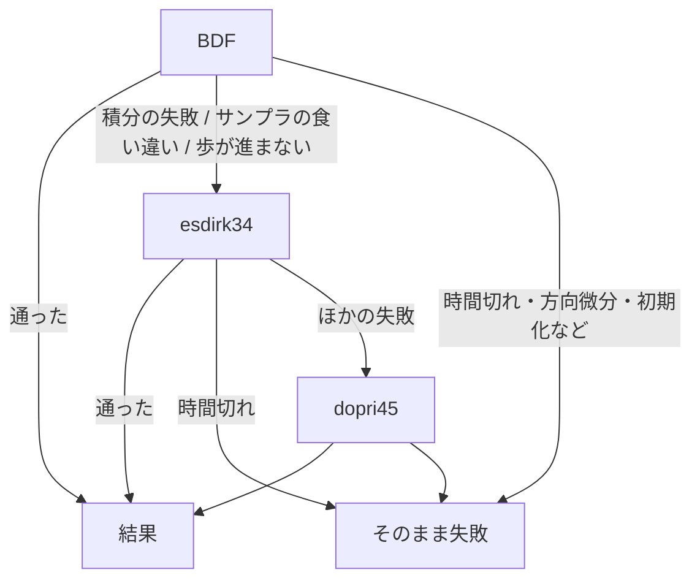

# S064 auto-esdirk-fallback

| | |
| --- | --- |
| セッション | S064 |
| 日付 | 2026-11-01 |
| ブランチ | `feature/s064-auto-esdirk-fallback` |
| Phase | P3 |
| スライド | [slides.html](slides.html) |
| 作業記録 | `log/work/2026-11-01-s064-auto-esdirk-fallback.md` |
| 設計 | [ADR-0028](../../adr/0028-auto-esdirk34-fallback.md) |

## 1. 目的

[S055](../S055-sim-failures/解説書.md) の持ち越し。`auto` は BDF が失敗すると dopri45 で回し直すが、dopri45 は陽的なので硬い系で終わらない。S055 で、`bdf` の `GM-U0005` 10 本のうち `auto` が救えないのは 3 本（dopri45 でも時間切れ 2、回し直しの対象外の文言 1）と分かった。回し直しの先に `esdirk34`（陰的）を足し、本数が増えるか、減らないかを全例題で確かめる。数値を変えるので、CI の全例題で本数を比べ、減ったモデルが 0 と確かめてから Accepted にした。

## 2. 決定と理由

| 項目 | 決定 | 理由 |
| --- | --- | --- |
| 順序 | BDF → esdirk34 → dopri45（案 B） | 剛性の系は dopri45 が予算を使い切るので、dopri45 を先にすると esdirk34 に時間が残らない。`TwoMass` のように dopri45 だけが救える系は、esdirk34 が 3 秒以内に落ちるのでそのまま dopri45 に回る |
| 2 回目の回し直し | 時間切れ以外ならすべて対象 | dopri45 が救える系を esdirk34 の失敗の種類で取りこぼさない |
| `Dimmer_RL` の文言 | 回し直しの対象に足す | 歩が丸めの幅より進まない契約違反。esdirk34 が 92.6 s（手元）で終える |
| 予算 | 回し直しにも元の予算をそのまま渡す（残りの時間を渡す案は採らなかった） | 残りの時間を渡す版を CI で回すと `Lightning` が 1 本減った。msl-sim の最初の予算 30 s では BDF の組み立てと積分で使い切り、回し直せなかった |
| 診断 | esdirk34 への切り替えは新しい `GM-I11003`、dopri45 は `GM-I11002` のまま | `msl-sim` の「使ったソルバ」を `auto → esdirk34` などと分けて数えるため |
| ADR | [ADR-0028](../../adr/0028-auto-esdirk34-fallback.md)（Accepted）。ADR-0015 は覆さない | 0015 の (a) 方向微分で切り替えない・(b) 許容誤差の倍率は変わらない。切り替え先を拡げるだけ |

## 3. 図



## 4. 再現手順

```bash
# 手元（release）。許容誤差は S050 の設定（注釈の 0.1 倍）
cargo build --release -p globe-mode-cli
globe simulate -L data/msl -m Modelica.Electrical.PowerConverters.Examples.ACAC.Dimmer_RL \
  --solver auto --tolerance 1e-7 --timeout 180 -o /dev/null
# CI（全例題。ソルバの表のジョブは auto だけにする）
gh workflow run msl-sim.yml --ref feature/s064-auto-esdirk-fallback -f 'solvers=["auto"]'
gh run download <run-id> -n msl-sim
```

手元の前後（21 本、前は main の ea7dcd8、後はこのブランチ。他のセッションのビルドで負荷が変わるので秒数は目安）:

- 救えた: `Dimmer_RL`（`GM-U0005` → esdirk34 で終了）。dopri45 で終えていた 7 本は esdirk34 で終了（1.1〜2 倍の時間）。
- 変わらない失敗: `ThyristorBridge2Pulse_DC_Drive`（esdirk34 は `GM-E11003`）、`HeatingNPN_NORGate` ほか 5 本（全ソルバが落ちる）。
- `ThyristorBridge2mPulse_DC_Drive`: 手元は時間切れ（esdirk34 単独で 162 s、CI のランナーでは 94 s）。
- `TwoMass`: esdirk34 が `GM-E11002`、dopri45 で終了。
- BDF で通る 5 本（`SinCosEncoder` など）: 回し直しなし。
- 試験: `cargo test -p globe-mode-exec -p globe-mode-sim -p globe-mode -p xtask` 全部通る（exec に回し直しの順序と残りの予算の試験を足した）。clippy は警告 0。

CI の結果（`msl-sim` ジョブ。比べる相手は S055 の run 41247200921）:

| | S055 | run 41282411061（残りの予算を渡す版） | run 41287267439（採った版） |
| --- | ---: | ---: | ---: |
| 実行できた | 309 | 311 | **310** |
| 管に収まった / 比べた | 301 / 308 | 302 / 310 | **301 / 309** |
| `GM-U0005` の止まり | 1 | 1 | **0** |

- 採った版は、減ったモデルが 0。増えたのは `Dimmer_RL`（実行できるが `y_arg` の 2 信号が管の外。`Dimmer_R` と同じ信号）。
- 最初の版は `Lightning` が 1 本減った（回し直しに「残りの時間」を渡したため）。そこで元の予算を渡す版に戻した。
- `ThyristorBridge2mPulse_DC_Drive` は run 41282411061 で終え、41287267439 で時間切れ（esdirk34 単独で 94 s。ランナーの速さで境目を行き来する）。
- 時間切れの回し直しが 12 → 15 本。esdirk34 は最初の予算 30 s を超えることがあり、180 s で回し直されて終える。
- 手順の注意: `msl-sim.yml` の `solvers` を `["auto"]` にしても、ジョブ `solvers` が `auto` をもう 1 度回す（約 1 時間）。`msl-sim` ジョブの完了後に `gh run cancel` で取り消した。`doc/msl-sim.md` は artifact `msl-sim` の報告で、「前回との差」だけ S055 の結果に直した（キャッシュの前回が最初の run だったため）。

## 5. 次回

- `ThyristorBridge2mPulse_DC_Drive` のように esdirk34 で 94 s かかる系が、時間切れの境目にある。予算の分け方か、陰的ソルバの速さ（ヤコビ行列の使い回し）を見る。
- `auto` の全体の予算。Rumoca の dopri45 が最初の予算 30 s を超えて走る件を調べてから、残りの時間を渡す規則を決める。
- `Dimmer_RL` の `y_arg` の外れの原因（`Dimmer_R` と同じか）。
- diffsol の陽的 RK に dopri45 と同じ刻み幅制御を足す案は S055 のまま残っている。
