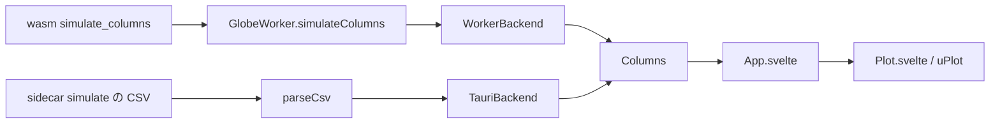

# S065 ブラウザ UI の列ごとの結果

| | |
| --- | --- |
| セッション | S065 |
| 日付 | 2026-11-01 |
| ブランチ | `feature/s065-columns-ui` |
| Phase | P4 |
| スライド | [slides.html](slides.html) |
| 作業記録 | `log/work/2026-11-01-s065-columns-ui.md` |

## 1. 目的

S051 で wasm に `Workspace.simulate_columns`（列ごとの `Float64Array`）を足したが、UI は今も `simulate` の CSV を `parseCsv` で解析していた。S051 の計測では 10 万点 × 7 列で CSV の道が 548 ms、列の道が 159 ms。この持ち越しを済ませ、`Backend` に列の道を足して `Plot` がそれを使うようにする（[roadmap](../../roadmap.md) の S065 の節）。

## 2. 決定と理由

| 項目 | 決定 | 理由 |
| --- | --- | --- |
| `Backend.simulateColumns` | `{ response, columns }` を返す。`response.csv` は null | 既存の `simulate` は残す。診断・`refused` は `response` で今まで通り |
| `Columns` の形 | `{ names（time を除く）, points, data: ArrayLike<number \| null>[] }` | `parseCsv` の結果と wasm の列を同じ型で表す。`data[0]` が time |
| `WorkerBackend` | `GlobeWorker.simulateColumns` の `layout.names` から time を外す | 列の buffer は worker から転送されて来るので、コピーは無い |
| `TauriBackend` | `simulate` の CSV を `parseCsv` して同じ形にする | sidecar（`globe lsp`）に列の道が無い。UI は 1 つの形だけ見る |
| `App.svelte` の状態 | `$state.raw` | `$state` は配列を丸ごと Proxy にする。10 万点では無駄 |
| 確認の属性 | `.plot` の `data-typed`（先頭の列が `Float64Array` か） | 前の `data-parse-ms`（CSV の解析の時間）は、解析が無くなったので消した |

## 3. 図



## 4. 再現手順

wasm は S051 から変えていない（`src/Rust/mod/globe-mode-wasm` に変更なし）。

```bash
mise run ui:check   # wasm:build、pnpm check、pnpm build、test_ui.py、test_graph.py
```

Decay・ChuaCircuit の既存の試験に加えて、10 万点の実行のあとに `data-typed` が `true` であることを確かめる。

測定（ヘッドレス Chromium、WSL。10 万点 × 4 状態の `Big`、系列は既定の 3 本を表示）:

| | 前（CSV の道） | 後（列の道、2 回） |
| --- | --- | --- |
| CSV の解析 | 129.9 ms | なし |
| 最初の描画まで（`data-ms`） | 151.3 ms | 20.7 ms / 27.0 ms |
| 「実行」を押してから戻るまで | 810 ms | 222 ms / 213 ms |
| ChuaCircuit の実行（50195 点 × 44 列） | 1.3 s | 0.8 s / 0.8 s |

## 5. 次回

- 列の道の NaN / Inf は uPlot の欠損（null）にならない（CSV の道は null にして線を切っていた）。発散した結果の描画が崩れたら、`Plot` で null に直す（`csv.ts` の `shortcut:` コメント）。
- sidecar に列の道（バイナリ）を足すか。今の Desktop は CSV の解析のまま。
