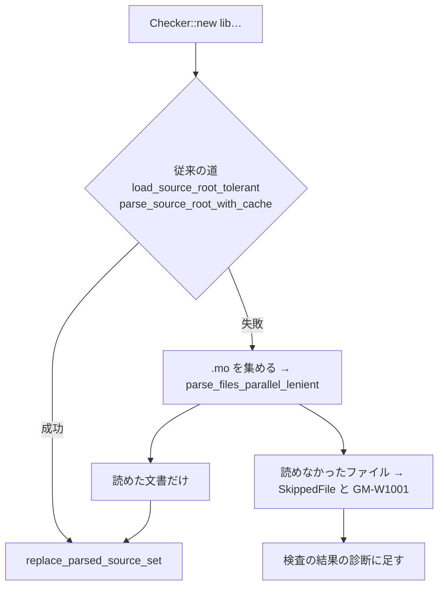

# S066 libs-tolerant-roots

| | |
| --- | --- |
| セッション | S066 |
| 日付 | 2026-11-01 |
| ブランチ | `feature/s066-libs-tolerant-roots` |
| Phase | P3 |
| スライド | [slides.html](slides.html) |
| 作業記録 | `log/work/2026-11-01-s066-libs-tolerant-roots.md` |

## 1. 目的

S058・S063 の持ち越し。`Checker::new` は、ライブラリの `.mo` が 1 つでも構文の誤りだと、ライブラリ全体を `GM-E1003` で断った。公開ライブラリ（ThermofluidStream の `TILMediaWrapper/UsersGuide/Contact.mo`、ClaRa の `physicalMills`）にはそういうファイルがあるので、xtask が構文の誤りのファイルと配置の誤りのファイルを除いた symlink の写しを作って迂回していた（[S063 の解説書](../S063-libs-failures/解説書.md)）。

1. `Checker::new` が読めるファイルだけでライブラリを読み、読めなかったファイルを断らずに知らせる。
2. xtask の迂回を外す。

## 2. 決定と理由

| 項目 | 決定 | 理由 |
| --- | --- | --- |
| 方法 | 従来の道が失敗したルートだけ、`.mo` を集めて `parse_files_parallel_lenient` で 1 ファイルずつ読み、読めた文書を `replace_parsed_source_set` に渡す | Rumoca の公開 API だけで足りる。Rumoca は改変しない。全部読めるルートの道（MSL）は変えないので、初回の速さも変わらない |
| 知らせ方 | 検査の結果の診断に S1 の警告 `GM-W1001`（ルートごとに 1 件）。`Checker::skipped_library_files()` と `library_warnings()` でも取れる | 断らずに知らせる。警告は `passed()` を変えない。xtask と UI はこの一覧を読む |
| 配置の検査（PKG-006・PKG-010） | 失敗したルートでは飛ばし、警告に元の診断を書く | 配置の検査は Rumoca の非公開関数で呼べない。名前は `within` で決まるので、ディレクトリの構成が合わなくても解決に効かない |
| xtask | `mirror_libraries`・`layout_offenders`（繰り返し 20 回）・`unparsable_files` を外し、`make_checker` は `Checker::new` を呼ぶだけ。読み飛ばしの一覧 `target/library-roots/<名前>.skipped.txt` は今も書く | 迂回を外せば、1 ファイルずつ別の Session で読み直す処理（`unparsable_files`）もいらない。libraries.yml の artifact の仕組みはそのまま |
| ADR | 書かない | 公開 API の組み合わせで、覆す設計の判断ではない。理由は research に書いた |

## 3. 図



## 4. 再現手順

```bash
export CARGO_TARGET_DIR=<絶対パス>
cargo test -p globe-mode-frontend --test tolerant_roots   # 構文の誤りのファイルを含むライブラリ（ルート 1 つ・2 つ）
cargo xtask fetch-library ClaRa
cargo xtask msl-funnel --library data/libs/ClaRa --package ClaRa --examples-in Examples
gh workflow run libraries.yml --ref feature/s066-libs-tolerant-roots -f 'libraries=["Chemical","ClaRa","ThermofluidStream","DeltaRobot"]'
```

検証の結果（数字）:

- `cargo test -p globe-mode-frontend --test tolerant_roots` 4 本、`cargo test -p globe-mode-frontend -p xtask`（xtask 46 本）、`cargo clippy -p globe-mode-frontend -p xtask --all-targets -- -D warnings`、`cargo fmt --all --check` が通る。`mise run msl:compare` は 20 本中 20 本が一致（読み込みの成功時の道は変えていない）。
- 手元の `msl-funnel`（release）を S063 の run（41250636800）の JSON と比べた: ThermofluidStream 122 本、ClaRa 5 本とも判定・段・GM コード・Rumoca コードが全部同じ（差 0）。ThermofluidStream は OK 4・GM-U 115・panic 0、検査 134.2 秒（S063 は 135.3 秒）。ClaRa は OK 0・S1 で NG 5、6.5 秒（5.0 秒）。
- ThermofluidStream は `Contact.mo` を読み飛ばした警告 1 件、ClaRa は構文の誤り 0 ファイルで「配置の検査を飛ばして読んだ」警告 1 件。Chemical・DeltaRobot は読み飛ばしが無く、従来の道のまま。
- Actions（`libraries.yml`、run 41295588356、Chemical・ClaRa・ThermofluidStream・DeltaRobot）の結果は @@RUNRESULT@@。

## 5. 次回

- 失敗したルートでは `Checker::new` が配置の検査を飛ばす。配置の誤りを警告以上にしたいなら、Rumoca に `validate_source_root_package_layout` の公開か、`parse_source_root_with_cache` のファイル単位の寛容な版を出す。
- `GM-W1001` を UI の診断の一覧に出す（今は検査結果の `diagnostics` に入るだけ）。
- 分割読み込みの `with_library_sources`（wasm）は構文の誤りで断るまま。
