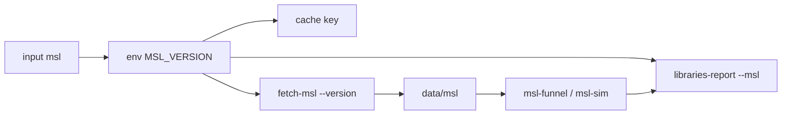

# S067 libs-msl-400

| | |
| --- | --- |
| セッション | S067 |
| 日付 | 2026-11-01 |
| ブランチ | `feature/s067-libs-msl-400` |
| Phase | P3 |
| スライド | [slides.html](slides.html) |
| 作業記録 | `log/work/2026-11-01-s067-libs-msl-400.md` |

## 1. 目的

S063（[解説書](../S063-libs-failures/解説書.md)）の持ち越し「MSL 4.0.0 で回し直したときの版の差の数」。公開ライブラリの検査 `libraries.yml`（S058）は MSL 4.1.0 と一緒に読んでいたが、AixLib・ClaRa・DeltaRobot・Chemical の `uses` は MSL 4.0.0 で、S063 の失敗 1,781 本の分類に版の差が混ざっているか分からなかった。4.0.0 でも同じ検査を回せるようにして、ライブラリごとの本数の差を測る。

## 2. 決定と理由

| 項目 | 決定 | 理由 |
| --- | --- | --- |
| `fetch-msl` | `--version`（既定 `4.1.0`、`4.0.0` も可）。4.0.0 の URL と sha256 は定数にした（sha256 は 2026-11-01 に取得して計算） | GitHub の API は digest を返さなかった。表を持たずに定数 2 つだけで足りる |
| 置き場 | 既定の `--dest data/msl` のまま。ただし**別の版が展開済みの `--dest` は断る** | 展開は上書きなので、版を替えて同じ場所に取ると `Modelica 4.1.0` と `Modelica 4.0.0` が両方残って 2 つ読まれる。目印（`version sha256`）の版を見て断るだけで足りる（CI は新しいランナーなので影響しない）。手元で 2 つを持つときは `--dest data/msl-4.0.0` |
| `libraries.yml` | 入力 `msl`（`4.1.0` / `4.0.0`）。`MSL_VERSION` を workflow の `env` に置き、cache の key と `fetch-msl --version`、`libraries-report --msl` に渡す | 定期実行は入力が空なので 4.1.0 のまま。artifact 名は変えない |
| 表の見出し | `libraries-report --msl <版>` が「**MSL 4.0.0** と一緒に読んで」と書く | funnel の JSON の `msl_version` は xtask の定数（4.1.0）で、検査に使った版ではない。`funnel.rs`・`sim.rs` は触らない |
| `doc/libraries.md` | 4.1.0 の表を正とする。4.0.0 は research に別表 | 最小。依頼どおり |
| 差の測り方 | run 41295445820（4.0.0）の artifact と、S058 の 4.1.0 の run（41250636800・41248143483）の artifact を、例題ごとに突き合わせた | 全ライブラリを 4.0.0 で回したので、版を替えた分だけが差になる |

`uses` の表（`package.mo` を取得に使う commit で読んだ）:

| ライブラリ | MSL |
| --- | --- |
| Buildings 14.0.0・IBPSA 4.0.0・ThermofluidStream 1.4.1（TILMediaWrapper も） | 4.1.0 |
| AixLib 3.0.1・ClaRa 1.9.0（TILMedia も）・DeltaRobot 1.0.2・Chemical 2.0.0 | 4.0.0 |

## 3. 図



## 4. 再現手順

```bash
export CARGO_TARGET_DIR=<絶対パス>
cargo xtask fetch-msl --version 4.0.0 --dest data/msl-4.0.0   # sha256 98d8e785…a783、12,403 ファイル
cargo fmt --check && cargo clippy -p xtask -- -D warnings && cargo test -p xtask
git push -u origin feature/s067-libs-msl-400
gh workflow run libraries.yml --ref feature/s067-libs-msl-400 -f msl=4.0.0   # 全ライブラリ（run 41295445820、全ジョブ success）
gh run download 41295445820 -n libraries -D target/libs-ci-400               # 表（MSL 4.0.0 と書いてある）
```

結果（4.1.0 は S058 の run、4.0.0 は run 41295445820）:

| ライブラリ | 例題 | OK 4.1.0 / 4.0.0 | 判定の違う例題 | 実行できた 4.1.0 / 4.0.0 |
| --- | ---: | --- | ---: | --- |
| AixLib | 642 | 119 / 118 | 1 | 98 / 71 |
| Buildings | 809 | 119 / 119 | 0 | 88 / 61 |
| IBPSA | 457 | 88 / 88 | 0 | 66 / 47 |
| DeltaRobot | 21 | 9 / 9 | 0 | 5 / 2 |
| Chemical | 76 | 12 / 12 | 0 | 0 / 0 |
| ThermofluidStream | 122 | 4 / 4 | 0 | 2 / 2 |
| ClaRa | 5 | 0 / 0 | 0 | 0 / 0 |
| 計 | 2,132 | 351 / 350 | 1 | 259 / 183 |

- **判定の差**: 判定・段・GlobeMode のコード・Rumoca のコードのどれかが違う例題は 2,132 本中 1 本（AixLib の `Obsolete.YearIndependent.FastHVAC.Examples.Sensors.SensorVerification`。OK → GM-U S5 の ED019）。ER132・ER070・EI032・EF004・EF025 を含む失敗の分類は、版を替えても同じ。S063 の分類に版の差は混ざっていない。
- **実行の差**: 4.1.0 で実行できて 4.0.0 で `GM-U0004` になったのが 75 本、判定が変わった 1 本を足して 76 本。70 本は `external builtin function 'Modelica.Math.{sin,exp,log,cos,asin}'`。MSL 4.0.0 の `Math/package.mo` は `external "builtin"` を 13 か所で使い、4.1.0 は `algorithm y := .log(u);` の形に書き直した（0 か所）。Rumoca の実行系は builtin の外部関数を実行できない。残り 5 本は Solve IR の契約（Buildings 2、DeltaRobot 3）で、MSL の関数の書き方に依る実行系の失敗と思われる【未確認】。
- **比較の土台**: 4.1.0 をこの branch のコードで回し直した（run 41302566710、Buildings を除く 6 つ）結果は S058 の run と判定・実行とも差 0。差は MSL の版の差で、S058 以降のコードの変化ではない。Buildings だけは S058 の run のまま。
- 詳細は [research/libraries-2026-11-01.md](../../research/libraries-2026-11-01.md) の「MSL 4.0.0 で回し直した差（S067）」。

## 5. 次回

- 実行系（`globe-mode-exec`）で `external "builtin"` の数学関数を解く道。4.0.0 が前提のライブラリ（AixLib・ClaRa・DeltaRobot・Chemical）の利用者が 4.0.0 で動かすときに効く（今は 4.1.0 を使えば足りる）。
- `SensorVerification` の ED019 が 4.0.0 だけで出る理由（`function shape proof`）。
- Buildings の `Interior`・`InteriorConvection` と DeltaRobot の 3 本の、4.0.0 の MSL の何に依るか。
- ER132・ER070・EI032・ER023 の扱い（S063 から持ち越し）。
