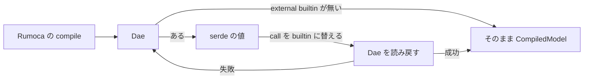

# S068 external-builtin

| | |
| --- | --- |
| セッション | S068 |
| 日付 | 2026-11-01 |
| ブランチ | `feature/s068-external-builtin` |
| Phase | P3 |
| スライド | [slides.html](slides.html) |
| 作業記録 | `log/work/2026-11-01-s068-external-builtin.md` |
| 設計 | [ADR-0029](../../adr/0029-external-builtin-rewrite.md) |
| 調査 | [research/external-builtin-2026-11-01.md](../../research/external-builtin-2026-11-01.md) |

## 1. 目的

[S067](../S067-libs-msl-400/解説書.md) の持ち越し。MSL 4.0.0 の `Modelica.Math` は `sin`・`cos`・`exp`・`log` など 13 個を `external "builtin" y = sin(u);` と書く（4.1.0 は `algorithm y := .sin(u);`）。Rumoca の実行系はこれを実行できず（`EL005` / `EX002`、GlobeMode では `GM-U0004`）、公開ライブラリ 7 つを 4.0.0 で回すと funnel が OK の例題 70 本がこれだけで実行できなかった。組み込みの数学関数を呼ぶだけの `external "builtin"` を実行できるようにする。4.1.0 の結果は変えない。

## 2. 決定と理由

| 項目 | 決定 | 理由 |
| --- | --- | --- |
| 道 | `Dae` を直列化の形で書き換える（(b)） | (a) Rumoca の公開 API に hook は無い。(c) 文字列置換は版とライブラリに結びつく。`Dae` は不変だが serde を実装し、読み戻すときに Rumoca が検査し直すので、公開 API だけで書き換えられる |
| 場所 | `globe-mode-frontend/src/external_builtin.rs`、`compile_strict`（`CompiledModel` を作る所） | 実行・プリフライト・wasm が同じ `Dae` を使う。`check`（判定）は元の `Dae` のままで、判定の数は変わらない |
| 対象の判定 | 関数の external 節から（言語 `builtin`・記号が組み込み関数・入力をそのまま渡す・出力 1 つ）。名前 `Modelica.Math.*` は見ない | 他のライブラリの同じ書き方にも効く。`"C"` や別の記号は今まで通り `GM-U0004` |
| 失敗したら | 元の `Dae` を返す | 形が変わったとき、`GM-U0004` に戻るだけで誤った結果にならない |
| 依存 | `serde_json` を frontend に足した（workspace に既にある。新しい外部依存は無い） | 直列化した値を書き換えるため |
| ADR | [ADR-0029](../../adr/0029-external-builtin-rewrite.md) | |

## 3. 図



## 4. 再現手順

```bash
# 小さなモデル（直す前は GM-U0004、直した後は解析解と一致）
cargo test -p globe-mode-exec --test simulate external_builtin
# MSL 4.0.0 の例題
cargo xtask fetch-msl --version 4.0.0 --dest data/msl-4.0.0
globe simulate -L data/msl-4.0.0 -m Modelica.Mechanics.MultiBody.Examples.Elementary.Pendulum -o /dev/null
# 公開ライブラリ
gh workflow run libraries.yml --ref feature/s068-external-builtin -f msl=4.0.0 \
  -f 'libraries=["DeltaRobot","IBPSA","AixLib"]'
```

## 5. 結果

実行できた本数（funnel が OK の例題のうち、`libraries.yml -f msl=4.0.0`、run 41313259246）:

| ライブラリ | 4.0.0 の実行できた（S067、run 41295445820） | 4.0.0 + 今回（run 41313259246） | 4.1.0（S058 の run） |
| --- | ---: | ---: | ---: |
| AixLib（OK 118） | 71 | **97** | 98（OK 119） |
| IBPSA（OK 88） | 47 | **66** | 66 |
| DeltaRobot（OK 9） | 2 | **5** | 5 |
| 計 | 120 | **168** | 169 |

- 判定の本数は変わらない（`check` は元の `Dae`）。IBPSA・DeltaRobot は 4.1.0 の本数に届き、AixLib は 4.1.0 より 1 本少ない（4.1.0 の OK が 1 本多いのと同じ差）。
- 小さなモデル `ExternalBuiltin` は直す前 `GM-U0004`、直した後は解析解と一致。`wasm:compare` は 20 ソルバすべてでネイティブと一致。
- MSL 4.0.0 の例題: `Pendulum`・`Surfaces`・`IMC_DOL` が `GM-U0004` から実行できるように。
- S067 が「別の原因」とした残りのうち DeltaRobot の 3 本は直った（2 → 5）。Buildings の `Interior` ほか 2 本と Buildings の 27 本は回し直していないので未確認。
- 道中の CI（run 41307189067 / 41309463666 / 41312015621）で見つけた 3 件は [research](../../research/external-builtin-2026-11-01.md) の表。

## 6. S066 の退行（この回で見つけて直した）

最初の CI（run 41307189067）で AixLib の例題 642 本が全部 `GM-E1001`（EM001: `Duplicate class '…RadiatorTypes.RadiatorType'`）になった。AixLib は `RadiatorTypes.mo` と、`package.mo` の無い `RadiatorTypes/` が並ぶ（PKG-008）。S066 で xtask の symlink の迂回（`package.mo` の無いディレクトリを除く）を外し、`Checker::new` の読み飛ばしの道が両方を読むので、同じクラスが二重になっていた。S066 の確認は ClaRa・ThermofluidStream・Chemical・DeltaRobot の 4 つで、AixLib は入っていなかった。`collect_mo_files` で、`X.mo` と `package.mo` の無い `X/` が並ぶときは `X/` を読まないことにして直した（試験つき。手元で AixLib の例題 3 本が OK 1・GM-U 2 に戻った）。

## 7. 次回

- `Modelica.Math` 以外の `external "builtin"`（`Modelica.Utilities.*` の `ModelicaStrings` などは `"C"` で対象外）は今回の範囲外。
- 残りの実行の差: Buildings を回し直して、27 本と `Interior` ほか 2 本（`invalid Solve IR contract`）を確かめる。AixLib の残り 21 本は `Modelica.Math` 以外の原因（インデックス 3 の構造解析、`String` のメタデータ、非有限な値など）。
- 上流への報告の下書き: [upstream/16](../../research/upstream/16-external-builtin-math-functions.md)。Rumoca が直したら、この変換は外す。
