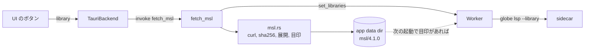

# S069 desktop-msl-fetch

| | |
| --- | --- |
| セッション | S069 |
| 日付 | 2026-11-01 |
| ブランチ | `feature/s069-desktop-msl-fetch` |
| Phase | P4（Desktop MVP） |
| スライド | [slides.html](slides.html) |
| 作業記録 | [log/work/2026-11-01-s069-desktop-msl-fetch.md](../../../log/work/2026-11-01-s069-desktop-msl-fetch.md) |

## 1. 目的

S056 の持ち越し「MSL の置き場（同梱か取得か）」を決めて実装する。S056 までの Desktop は MSL を `--library` か `GLOBE_LIBRARY` で sidecar に渡すだけで、配布版（.deb・.msi）を起動した利用者は MSL を使えなかった（`TauriBackend.library()` は例外になる）。

## 2. 決定と理由

詳しくは [ADR-0030](../../adr/0030-desktop-msl-placement.md)。

| 項目 | 決定 | 理由 |
| --- | --- | --- |
| 置き方 | 同梱せず、初回に取得 | 配布物（20 MB）が 29 MB 以上増えるのと、MSL の版を上げるたびに配り直すのを避ける。4.0.0 と 4.1.0 が併存する（S067）ので版を焼き込まない |
| 置き場 | app data dir の `msl/4.1.0/` | 版ごとに分けられる。ユーザーの作業ディレクトリを汚さない |
| 優先順位 | `--library`・`GLOBE_LIBRARY` があればそれだけ。無ければ置き場（目印あり）。どちらも無ければ MSL 無し | 今の道（MSL 以外のライブラリを含む）を壊さない |
| 取得 | `curl` で落とし、sha256 を照合、`zip` で展開、目印を最後に書く | xtask の `fetch-msl` と同じ URL・sha256・目印。途中で落ちたら目印が無く、やり直せる |
| HTTP | 外部コマンド `curl`。.deb は `Depends: curl` | TLS の依存を足さない。Windows 10 以降は `curl.exe` を OS が持つ |
| 依存 | `sha2`（`Cargo.lock` に既にあった）、`zip` 9（xtask と同じ版・features） | [licenses.md](../../licenses.md) に追記。desktop の `cargo deny` は ok |
| xtask との共有 | しない。定数の一致を `desktop.yml` が確かめる | xtask は root workspace の重い bin。共有 crate は約 100 行のためには大きい |
| sidecar の再起動 | 取得のあと `Worker::set_libraries` で止め、次の要求で `--library` 付きで作り直す | 開いているファイルは `Worker` が送り直す（S049） |
| UI | Desktop でだけボタンを「MSL を取得する（29 MB、初回のみ）」にし、押すと `library()` が command `fetch_msl` を呼ぶ。起動時に sidecar がライブラリを読んでいれば最初から「読んだ」状態 | App.svelte の変更は最小。業務ロジックは Rust 側 |

## 3. 図



## 4. 再現手順

```bash
cd src/Rust/apps/desktop && cargo fmt -- --check      # 手元には webkit2gtk が無く、ビルドは CI
cd src/Svelte && pnpm install --frozen-lockfile && pnpm run check
uv run python src/Svelte/tests/test_ui.py             # 先に pnpm build
git push -u origin feature/s069-desktop-msl-fetch
gh workflow run desktop.yml --ref feature/s069-desktop-msl-fetch
gh run download <run-id> -n desktop-linux-smoke
```

`msl.rs` の試験（sha256 の不一致では展開も目印も無い、展開先の外を指す名前を拒む）は、desktop の試験として `cargo test`（CI）で回る。手元では tauri に依存しない `msl.rs`・`worker.rs` だけを別 crate に取り込んで 5 本とも通した。

結果（run 41308587091、ubuntu-24.04）:

| 起動 | MSL の渡し方 | 取得 | check の後（アプリ / sidecar の VmHWM） | simulate の後（アプリ / sidecar の VmHWM） |
| --- | --- | --- | --- | --- |
| 1（S056 と同じ道） | `GLOBE_LIBRARY=data/msl` | 無し | 139,860 kB / 132,516 kB | 139,860 kB / 171,444 kB |
| 2（取得） | 渡さない。`GLOBE_DESKTOP_SMOKE_FETCH=1` | **1.0 s** で `~/.local/share/io.github.asari300.globemode/msl/4.1.0` へ | 144,316 kB / 132,276 kB | 144,316 kB / 171,576 kB |
| 3（2 度目） | 渡さない。置き場の目印を起動時に見つける | 無し（`fetched msl` の行が出ない） | 141,072 kB / 132,328 kB | 141,072 kB / 171,516 kB |

- 3 回とも `ChuaCircuit` の `globe/check`（`passed=true`）と `globe/simulate`（`ok=true`）が通った。壁時計は 33.5 s・32.3 s（WebKit の起動と終了を含む）。
- sidecar の VmHWM は S056 の 1.52 GiB から 171,576 kB（約 168 MiB）に下がっている。S056 の値は S054（[ADR-0025](../../adr/0025-native-library-closure.md)、閉包のファイルだけを読む）の前で、今回の変更ではなくその差。取得した MSL でも `data/msl` を渡したときと同じ値。

## 5. 次回

- 署名と自動更新（対象外のまま）。
- 取得の進捗の割合と取り消し、MSL 4.0.0 への切り替えの UI。
- 静かな `globe/setFile`。
