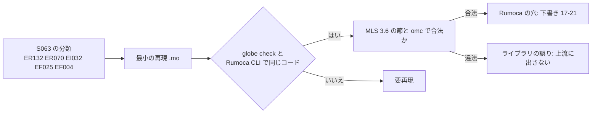

# S070 rumoca-upstream-libs

| | |
| --- | --- |
| セッション | S070 |
| 日付 | 2026-11-01 |
| ブランチ | `feature/s070-rumoca-upstream-libs` |
| Phase | P3 |
| スライド | [slides.html](slides.html) |
| 作業記録 | `log/work/2026-11-01-s070-rumoca-upstream-libs.md` |

## 1. 目的

S063（[解説書](../S063-libs-failures/解説書.md)、[research](../../research/libraries-2026-11-01.md)）は、公開ライブラリ 7 つの失敗 1,781 本の上位の原因を Rumoca の検査コードごとに挙げたが、「ライブラリの誤りか Rumoca の穴か」は【未確認】のままで、上流にも出していなかった。上位 5 つ（ER132・ER070・EI032・EF025・EF004）について、

1. ライブラリに依存しない最小の再現 `.mo` を作る
2. MLS 3.6 の該当節で書き方が合法かを判定する
3. Rumoca のどの箇所かを突き止める（ファイル名と行番号だけ。コードは複製しない）
4. 上流（Rumoca）に出す英語の下書き（[17〜21](../../research/upstream/README.md)）にする

製品コード・xtask・CI は変えない。issue は出さない（出すのはユーザー）。

## 2. 決定と理由

| 項目 | 決定 | 理由 |
| --- | --- | --- |
| 再現の置き場 | `doc/research/upstream/17-….mo`〜（`src/Modelica/` には置かない） | 既存の規則（MODELICAPATH として開けるパッケージだけを `src/Modelica/` に置く） |
| モデル名 | `Rep17`〜`Rep21` で始める | Rumoca の CLI は同じフォルダの `.mo` を全部読むので、他の再現と名前が重なると `EM001`（重複クラス）になる |
| 確かめる道具 | `globe check`、Rumoca v0.10.2 の CLI（`cargo xtask fetch-rumoca`）、omc 1.27.2 の `checkModel` の 3 つ | `globe` は同じ Rumoca の crate を呼ぶ。CLI で同じコードが出れば GlobeMode の側の問題でないと言える。omc は「合法」の裏付け |
| MLS の引用 | 節のページ（`specification.modelica.org/maint/3.6/…`）から本文を取り出して確かめる | 要約を信じず、文言を引くため。節番号が Rumoca のメッセージと違うものは本文に書いた |
| EF025 の Medium の関数 | 最小の再現を作れなかったので不明のまま、README の状態に「要再現」を付けた | 単純な `Medium.setState_pTX` は通る。失敗する IBPSA の呼び出しは ER132 に先に止められ、手元で名前を取り出せなかった |
| EF004 | 1 つの下書きに原因 2 つ（`getInstanceName()`、成分配列を含む式の行数） | コードは 1 つ（EF004）だが原因は別。出すときは 2 つに分けてもよい |

判定の要点（詳しくは各下書き）:

| 下書き | 再現 | 合法か | Rumoca の箇所（rev `276e82b`） |
| --- | --- | --- | --- |
| 17 ER132 | `product` を `prod` にすると通る。`sum`・`max`・`min`・`abs`・`sin`・`ceil` も同じ | 合法（MLS §7.3.1、§5.3.1。`product` は予約語でない） | `rumoca-ir-ast/src/external_object.rs` の `external_object_lifecycle`（組み込みの関数の DefId を知らない）、`rumoca-phase-resolve/src/semantic_checks/external_objects.rs` |
| 18 ER070 | MSL の `Constant` に `annotation(Evaluate = true)` | 合法（MLS §18.3 Annotation 18.1。効くのは parameter だけで、誤りとは言わない。Rumoca の `§18.6` は Graphical Objects） | `rumoca-phase-resolve/src/semantic_checks/annotations.rs` の `check_component_evaluate_annotations`（関数の局所変数は警告 WR006、成分は ER070） |
| 19 EI032 | 兄弟成分の parameter を指す if 式、親から渡す parameter | 合法（MLS §4.8.1 は `parameter StateSelect stateSelect`） | `rumoca-phase-instantiate/src/attributes.rs` の `parse_required_state_select`、`rumoca-eval-ast/…/component_params.rs` |
| 20 EF025 | MSL の `Files.loadResource` と、自己完結の「extends が 2 つの関数」 | 合法（MLS §7.1.1。同一の要素は 1 つ残る。MSL 自体が使う） | `rumoca-phase-flatten/src/pipeline/function_overrides_and_dims/function_selection.rs` の `exact_function_implementation` |
| 21 EF004 | `final parameter String name = getInstanceName();`、成分配列の項を含む if 方程式（n ≠ 1） | 合法（MLS §3.7.4.6、§10.6.4） | `ast_lower.rs` の `lower_get_instance_name_call` と `variables.rs`、`equations/conditional_and_eval.rs` と `shape_inference.rs` |

ライブラリ側の誤りは 1 件も無かった。この結果から、S063 の失敗 1,781 本のうち、5 コード合計 1,115 本（最初の診断で数えた本数。直した先で別の診断に当たる例題もある）で止まる原因は GlobeMode でなく Rumoca の側にある。

## 3. 図



## 4. 再現手順

```bash
export CARGO_TARGET_DIR=<絶対パス>/.git-worktree/target-shared
cargo xtask fetch-rumoca                                  # data/rumoca/rumoca-linux-x86_64
cargo xtask fetch-library IBPSA                           # 17・18・19 の出典の確認だけに使う（再現には不要）
globe check doc/research/upstream/17-er132-redeclare-function-extends-product.mo --model Rep17.M
globe check doc/research/upstream/18-er070-evaluate-on-non-parameter-component.mo --library data/msl --model Rep18
data/rumoca/rumoca-linux-x86_64 compile doc/research/upstream/17-er132-redeclare-function-extends-product.mo -m Rep17.M
# omc（loadFile の後に checkModel）
omc run.mos      # loadFile("…mo"); checkModel(Rep17.M); getErrorString();
```

検証の結果（数字）:

- 再現できた件: 5 件中 5 件（EF025 は `loadResource` と自己完結の版。Medium の関数の分は再現できず）。モデルは 17 が 1、18 が 2、19 が 4、20 が 3（うち失敗 2）、21 が 7（うち EF004 が 3、ED001 が 1）。`globe check` と Rumoca の CLI のコードは全部一致。
- 対照（直したり単純にした版）は全部通る: `prod`（17）、`Rep18Plain`、`Rep19A0`・`Rep19B0`、`Rep20Load0`、`Rep21A2`・`Rep21A3`・`Rep21B1`。
- omc 1.27.2: 失敗するモデルも対照も `checkModel` が成功。

## 5. 次回

- 下書きを Rumoca の main（0.10.3 以降）で確かめてから出す（ユーザー）。
- EF025 の replaceable な Medium の関数（約 85 本）を最小の再現にする。ER132 を除いて IBPSA の呼び出しを調べる。
- 同じ形で ER023・ER003（ClaRa）、EI006（条件付き成分の条件、Buildings・IBPSA）、ED019、ED008 を判定する。
