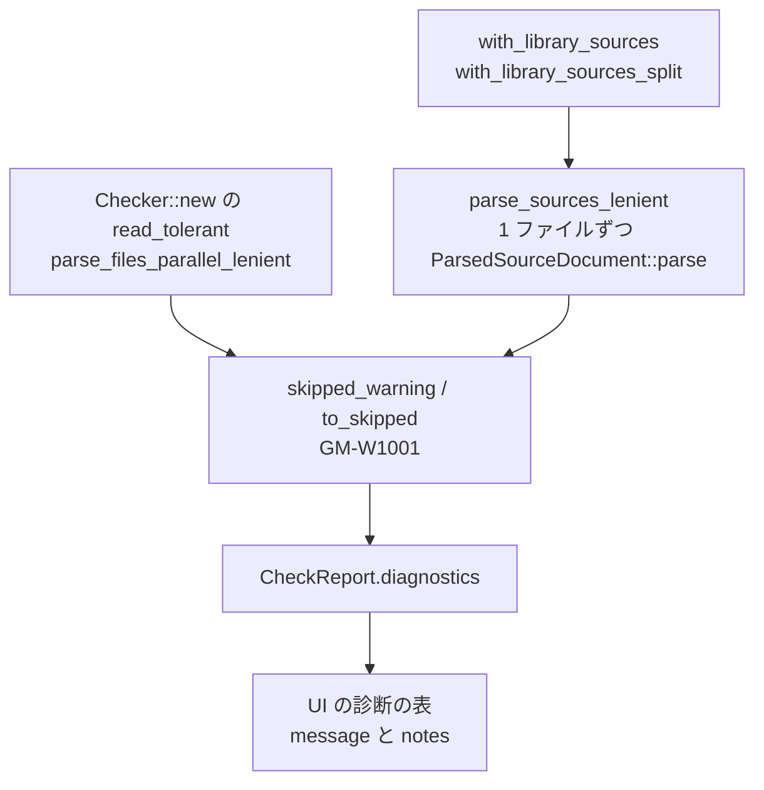

# S071 ui-w1001-tolerant-wasm

| | |
| --- | --- |
| セッション | S071 |
| 日付 | 2026-11-02 |
| ブランチ | `feature/s071-ui-w1001-tolerant-wasm` |
| Phase | P3 |
| スライド | [slides.html](slides.html) |
| 作業記録 | `log/work/2026-11-02-s071-ui-w1001-tolerant-wasm.md` |

## 1. 目的

[S066](../S066-libs-tolerant-roots/解説書.md) の持ち越し 2 つ。

1. 読み飛ばしの警告 `GM-W1001` が、ブラウザ/Desktop の UI（`src/Svelte`）の診断の一覧に出るかを確かめ、出ていなければ出す。
2. in-memory の読み込み（`Checker::with_library_sources` と分割の `with_library_sources_split`。wasm と、ネイティブの既定の `Workspace::with_libraries`）は、構文の誤りのファイルが 1 つでもあると断っていた。ディスクの `Checker::new` と同じく、読めるファイルだけで読み、読み飛ばしを `GM-W1001` で知らせる。

## 2. 決定と理由

| 項目 | 決定 | 理由 |
| --- | --- | --- |
| 共有 | `read_tolerant` から、構文の誤りの理由（`syntax_reason`）・警告の組み立て（`skipped_warning`）・`SkippedFile` への変換（`to_skipped`）を関数に切り出し、in-memory の 1 ファイルずつの読み（`parse_sources_lenient`）と共有する | 新しい抽象を作らない。`parse_files_parallel_lenient` はパスを読むので in-memory には使えず、in-memory は元から `ParsedSourceDocument::parse` を 1 ファイルずつ呼んでいた（Session への入れ方も元の `replace_in_memory_source_set` のまま） |
| 全部読み | 読めないファイルは読み飛ばし、`GM-W1001`（1 件）と `skipped_library_files()` に出す。読めるファイルが 0 なら今まで通り `GM-E1003` | ディスクの道と同じ |
| 分割読み | 読むときに構文の誤りのファイルを読み飛ばし、その後の検査の結果に `GM-W1001` を付ける（`SplitState::warning`）。作るときに索引に無いファイルが全部読めず、ほかにファイルも無ければ `GM-E1003` | 分割の目的（使うファイルだけを読む）を保つ。作るときに全部の構文を確かめると MSL の 2556 ファイルを読むことになる |
| 分割読みの限り | `skipped_library_files()` と `library_warnings()` には出ない（検査の結果にだけ）。`shortcut:` のコメントに書いた | 読んだファイルの分しか分からない。今の呼び手（xtask の funnel）は `Checker::new` を使う |
| UI | 診断の表は元から `file`・`range` の無い診断も全部の行を出していた（エディタの波線と行の押下だけがファイルで絞る）。どのファイルを読み飛ばしたかが `notes` にしか無いので、表のメッセージの下に `notes` を出す | 見えないのは notes だけだった。表示だけで、業務ロジックは足さない |
| UI の試験 | `test_ui.py` に、`MSL.json` の取得を Playwright の `route` で frontend の fixture（`tests/data/tolerant/a`）に差し替え、`A.Broken` を検査して `GM-W1001` の行と `Broken.mo` が出ることを足す | 実ブラウザの wasm の分割読みの道を通る。MSL が無くても回る |

## 3. 図



## 4. 再現手順

```bash
export CARGO_TARGET_DIR=<絶対パス>
cargo test -p globe-mode --test library_closure broken_library_file_is_skipped_in_memory
cargo test -p globe-mode-frontend --test split --test tolerant_roots
mise run check
mise run wasm:node && mise run wasm:compare
mise run msl:compare
mise run ui:check   # svelte-check と test_ui.py（GM-W1001 の行を含む）
```

検証の結果（数字）:

- `cargo test -p globe-mode --test library_closure`（3 本、新しい `broken_library_file_is_skipped_in_memory` を含む）、`-p globe-mode-frontend --test split`（2 本）・`--test tolerant_roots`（4 本）が通る。
- `mise run check`（fmt・clippy `-D warnings`・test・deny・`uv sync --locked`）: EXIT 0。test の集計 597 通過・0 失敗・11 ignored、deny は advisories・bans・licenses・sources とも ok。
- `mise run wasm:node`: EXIT 0（MSL 2556 ファイル、in-memory のライブラリ 169.2 ms、ChuaCircuit bdf 2330 ms・113 MiB）。
- `mise run wasm:compare`: 367 / 380 件が一致、既知の差 13 件、一致しない 0 件。
- `mise run msl:compare`: 20 本中 20 本が一致（両方とも成功 17 本）。
- `mise run ui:check`（svelte-check 0 errors・0 warnings、`test_ui.py`、`test_graph.py`）: EXIT 0。新しい確認は `GM-W1001 S1 warning ライブラリ MSL の 1 ファイルを読めず、読み飛ばした` の行と notes の `A/Broken.mo: unexpected `x``。
- `check_docs.py`: スライド OK、リンク 1550 件中の切れ 0 件。`render_slides.py` は手元で `Page.screenshot` が 30 s で時間切れ（いつもの手元の事情）。CI に任せる。
- 最初の `wasm:node`・`ui:check` は、main のチェックアウトの `data/msl/msl`（09:43 に別のセッションが張った、行き先の無い symlink）で ENOENT になった。その symlink を消して回し直した。

## 5. 次回

- 分割読みで、まだ読んでいない構文の誤りのファイルは知らせない。作るときに知らせたいなら、構文だけを先に確かめる（MSL で読み込みの時間が増える）。
- Desktop（sidecar の `globe lsp`）の UI での表示は、同じ診断の表なので同じに出るはず【未確認】（Desktop は手元で起動していない）。
