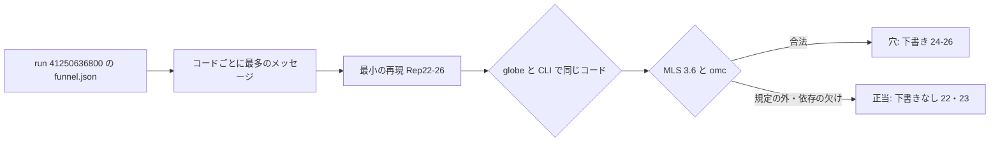

# S072 upstream-second-batch

| | |
| --- | --- |
| セッション | S072 |
| 日付 | 2026-11-02 |
| ブランチ | `feature/s072-upstream-second-batch` |
| Phase | P3 |
| スライド | [slides.html](slides.html) |
| 作業記録 | `log/work/2026-11-02-s072-upstream-second-batch.md` |

## 1. 目的

S070（[解説書](../S070-rumoca-upstream-libs/解説書.md)）の「次回」に挙げた 5 つの Rumoca のコード（ER023・ER003・EI006・ED019・ED008）を、S070 と同じ形で判定する。

1. ライブラリで出ている実際の箇所を 1 つ選ぶ
2. 最小の再現 `.mo`（`Rep22`〜`Rep26`）を書く
3. `globe check`、Rumoca v0.10.2 の CLI、omc 1.27.2 で確かめる
4. MLS 3.6 で Rumoca の穴か正当な拒否かを決め、穴は英語の下書きにする

製品コード・xtask・CI は変えない。issue は出さない（出すのはユーザー）。

## 2. 決定と理由

| 項目 | 決定 | 理由 |
| --- | --- | --- |
| 番号 | 22〜26 をコードの順に振り、`.mo` は 5 つとも置く。`.md`（下書き）は穴の 24〜26 だけ | 正当な拒否は上流に出さないが、判定の根拠として再現は残す |
| 代表の箇所 | 本数の最も多いメッセージを選ぶ（EI006 は `X_w`、ED019 は `function conditional`、ED008 は `Media.Air.dryair.cp`） | 1 つ直すと効く本数が大きい |
| ED019 の `function shape proof` | 依頼で名指しされた MSL 4.0.0 の `SensorVerification` はライブラリで再現したが、最小にできなかったので【未確認】 | メッセージがファイル（`Modelica/Media/package.mo`）しか指さず、時間内に関数を特定できなかった |
| ER023 | 正当と判定 | MLS 3.6 §4.6 は record の成分を record か type に限る。omc が通すのは緩さで、規定ではない |

判定（詳しくは [upstream/README.md](../../research/upstream/README.md) と [libraries-2026-11-01.md](../../research/libraries-2026-11-01.md) の「2 回目の判定（S072）」）:

| # | コード | 判定 | 下書き |
| ---: | --- | --- | --- |
| 22 | ER023 | 正当（MLS §4.6）。Rumoca のメッセージの節番号 §4.7 は誤り | なし |
| 23 | ER003 | 正当（無い基底クラス）。ClaRa は依存の取得で避けられ、AixLib の 1 本はライブラリの誤り | なし |
| 24 | EI006 | Rumoca の穴 | [24](../../research/upstream/24-ei006-condition-on-package-constant.md) |
| 25 | ED019 | Rumoca の未対応（代表の形） | [25](../../research/upstream/25-ed019-function-conditional-boolean-loop.md) |
| 26 | ED008 | Rumoca の穴（内部エラー） | [26](../../research/upstream/26-ed008-field-of-package-record-constant.md) |

## 3. 図



## 4. 再現手順

```bash
export CARGO_TARGET_DIR=<絶対パス>/.git-worktree/target-shared
cargo xtask fetch-rumoca
cargo xtask fetch-library IBPSA   # 実際の例題の確認だけ（再現には不要）
cargo xtask fetch-library ClaRa
globe check doc/research/upstream/24-ei006-condition-on-package-constant.mo --model Rep24.C
data/rumoca/rumoca-linux-x86_64 compile doc/research/upstream/24-ei006-condition-on-package-constant.mo -m Rep24.C
omc run.mos   # loadFile("…mo"); checkModel(Rep24.C); getErrorString();
```

検証の結果（数字）:

- モデル 17（失敗させる 9、対照 8）。`globe check` と CLI のコードは 17/17 一致。対照は 8/8 通る。
- omc 1.27.2: 17 のうち `Rep23.M`（無い基底クラス）だけを断り、16 を通す。
- 実際の例題で同じコード: `IBPSA.Fluid.FMI.ExportContainers.Examples.FMUs.Fan`（EI006）、`…BaseClasses.Examples.WindPressureProfile`（ED019）、`IBPSA.Airflow.Multizone.Examples.Orifice`（ED008）、`ClaRa.Examples.SteamCycle_01`（ER023）、`AixLib…SensorVerification`（MSL 4.0.0、ED019 の `function shape proof`）。

## 5. 次回

- 下書き 24〜26 を Rumoca の main で確かめてから出す（ユーザー）。
- ED019 の `function shape proof`（12 本）と `splineDerivatives`、ED008 のループ変数 `i`（18 本）を最小の再現にする。
- EI006 の残りの名前（`solRad`・`capFil1` など 50 本）が同じ原因かを見る。
