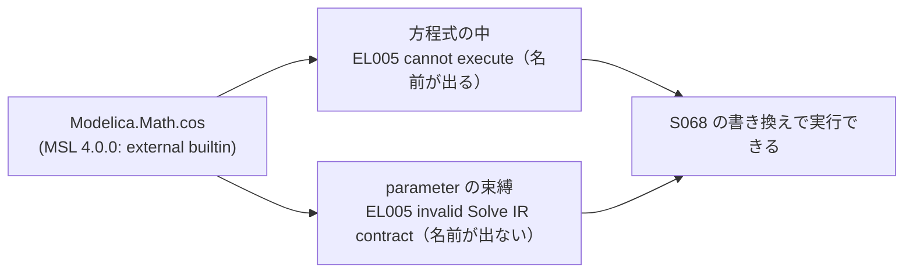

# S073 buildings-msl-400

| | |
| --- | --- |
| セッション | S073 |
| 日付 | 2026-11-02 |
| ブランチ | `feature/s073-buildings-msl-400` |
| Phase | P3 |
| スライド | [slides.html](slides.html) |
| 作業記録 | `log/work/2026-11-02-s073-buildings-msl-400.md` |
| 調査 | [research/libraries-2026-11-01.md](../../research/libraries-2026-11-01.md) の「Buildings を MSL 4.0.0 で回し直した（S073）」 |

## 1. 目的

[S067](../S067-libs-msl-400/解説書.md) と [S068](../S068-external-builtin/解説書.md) の持ち越し。S068 で `external "builtin"` を組み込み演算に書き換えた（[ADR-0029](../../adr/0029-external-builtin-rewrite.md)）後、Buildings だけは回し直していなかった。Buildings を MSL 4.0.0 で回し直し、S067 で 4.0.0 だけ実行できなかった 27 本と、その中で別のメッセージ（`invalid Solve IR contract: pure-call argument or slot interface is invalid`）だった `HeatTransfer.Convection.Examples.Interior`・`HeatTransfer.Windows.BaseClasses.Examples.InteriorConvection` の原因を確かめる。調査が中心で、Rust のコードは変えない。

## 2. 決定と理由

| 項目 | 決定 | 理由 |
| --- | --- | --- |
| CI | main（a778ea9）で `libraries.yml -f libraries='["Buildings"]' -f msl=4.0.0` を 1 本だけ | concurrency の group が 1 つで、同時に出すと待機中の run が cancelled になる |
| 手元の確かめ | release の `globe simulate` を 1 本ずつ、`setsid nohup` で切り離す | WSL の RAM が 3 GB。1 本の最大 RSS は約 180 MB だった |
| 原因の切り分け | S068 の書き換えを一時的に外して戻るかを見る。MSL を使わない最小の再現を作る | 書き換えの有無だけが違う比較にするため。一時的な変更はコミットしない |
| 判定 | Rumoca の穴（`external "builtin"` を実行できない）。上流の下書き [16](../../research/upstream/16-external-builtin-math-functions.md) に追記 | 新しい穴ではなく、呼ぶ場所でメッセージだけが変わる同じ穴 |

## 3. 図



結果（run 41364279300、全ジョブ success）:

| | 例題 | OK | 実行できた |
| --- | ---: | ---: | ---: |
| 4.1.0（S058） | 809 | 119 | 88 |
| 4.0.0（S067） | 809 | 119 | 61 |
| 4.0.0 + S068（S073） | 809 | 119 | **88** |

- 判定は 809 本とも S067 と同じ。実行は 4.1.0 と例題ごとに一致した（差 0 本）。
- 27 本の S067 での原因は `Modelica.Math.exp` 9・`sin` 8・`log` 4・`cos` 4 と、Solve IR の 2 本。
- Solve IR の 2 本は `final parameter Real cosTil = Modelica.Math.cos(til)`（`sin` も）を持つ。S067 は「MSL の別の関数の書き方」と疑ったが、70 本と同じ `external "builtin"` だった。
- メッセージの出所は Rumoca の `rumoca-phase-solve`（`error.rs`）と `rumoca-ir-solve`（`InvalidCallInterface`）。GlobeMode は note に写すだけ。

## 4. 再現手順

```bash
gh run list --workflow libraries.yml --limit 5      # 動いている run が無いことを見る
gh workflow run libraries.yml --ref main -f libraries='["Buildings"]' -f msl=4.0.0
gh run download 41364279300 -n libraries            # 表（Buildings 実行できた 88）
cargo xtask fetch-library Buildings
ln -s ../../../data/msl-4.0.0 data/msl-4.0.0         # worktree では main の取得物を借りる
cargo build --release -p globe-mode-cli
globe simulate -L data/msl-4.0.0 -L data/libs/Buildings \
  -m Buildings.HeatTransfer.Convection.Examples.Interior -o out.csv
```

- 手元の数字: `Interior` 37 s、`InteriorConvection` 67 s（4.0.0）。CSV は 4.1.0 とバイト単位で同じ。
- 書き換えを外すと（`lower_builtin_externals` の先頭で元の `Dae` を返す。コミットしない）2 本とも `invalid Solve IR contract` に戻る。

## 5. 次回

- S067 の「実行の差 76 本」は 75 本が S068 で解消した。残りは AixLib の `SensorVerification`（判定が ED019 に変わった 1 本）。
- 上流の下書き 16 を出すときは、parameter の束縛の形（今回の追記）も一緒に出す。どの `InvalidCallInterface` が出したかは追っていない。
