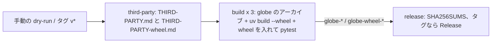

# S074 Python の wheel を release.yml で 3 ターゲットに配る

| | |
| --- | --- |
| セッション | S074 |
| 日付 | 2026-11-02 |
| ブランチ | `feature/s074-wheel-release` |
| Phase | P6 / P8（[S039](../S039-python-wheel/解説書.md) の持ち越し「他の OS の wheel」と、[S052](../S052-release-rc1-about/解説書.md) の持ち越し「wheel のライセンス表」） |
| スライド | [slides.html](slides.html) |
| 作業記録 | `log/work/2026-11-02-s074-wheel-release.md` |

## 1. 目的

S039 で作った Python の wheel `globe_mode`（crate `globe-mode-py`、PyO3 abi3-py312、maturin）は Linux x86_64 の CI で `uv run pytest` を回すだけで、配っていなかった。`release.yml`（[S044](../S044-release/解説書.md)・S052）の `globe` と同じ 3 ターゲット（linux x86_64・linux aarch64・windows x86_64）で wheel を作り、作った wheel を入れて pytest を回し、Release の assets と `SHA256SUMS` に足す。

## 2. 決定と理由

| 項目 | 決定 | 理由 |
| --- | --- | --- |
| ジョブ | 既存の `build` の matrix に step を足す（新しいジョブを作らない） | checkout・Rust・rust-cache を共有できる。matrix を二重に書かずに済む |
| 作り方 | `uv build --wheel --out-dir wheel`（maturin は pyproject の build-backend として uv が入れる） | 手元と同じ経路。maturin の action を足さない |
| aarch64 | `globe` と同じネイティブの `ubuntu-24.04-arm` ランナーで作る（cross・zig は使わない） | 既存の行がネイティブなので、そのまま。おかげで pytest も 3 つすべてで回せた |
| uv の入れ方 | Linux は mise-action の `install_args` に `uv` を足す。Windows は `python -m pip install uv` | Windows は mise の shim を避けている（ci.yml の rust-windows と同じ）。setup-uv の action を足さない |
| pytest | `uv run --isolated --no-project --with wheel/*.whl --with pytest pytest -q src/Python/tests` | `--no-project` で作業ツリーの `src/Python/mod` ではなく作った wheel の `globe_mode` を読む |
| ライセンス表 | `third-party` ジョブで同じ `about.toml`・`about.hbs` を `globe-mode-py` にも回し、`THIRD-PARTY-wheel.md` を作って wheel の `globe_mode/THIRD-PARTY.md` に入れる | `globe` の表は流用できなかった。`cargo tree` で比べると wheel の依存は cli の依存の部分集合に **pyo3 の 5 crate**（pyo3・pyo3-build-config・pyo3-ffi・pyo3-macros・pyo3-macros-backend）が加わる。表の仕組み（設定・雛形・許可の集合）は S052 のまま |
| 成果物の名前 | artifact は `globe-wheel-<target>`、ファイル名は maturin の付けた `globe_mode-0.1.0-cp312-abi3-<platform>.whl` | release ジョブの `pattern: globe-*` でそのまま集まる。`SHA256SUMS` は `globe-* globe_mode-*.whl` |
| platform タグ | `linux_x86_64`・`linux_aarch64`・`win_amd64`（manylinux にしない） | pip は `linux_*` を入れられる。PyPI に出すときに manylinux へ直す |

## 3. 図



## 4. 再現手順

```bash
git push -u origin feature/s074-wheel-release
gh workflow run release.yml --ref feature/s074-wheel-release   # 入力は無い（手動 = dry-run）
gh api repos/asari300/20261018_GlobeMode/actions/runs/<id>/artifacts -q '.artifacts[]|.name+" "+(.size_in_bytes|tostring)'
```

検証の結果（run 41365579800、約 20 分、5 ジョブとも success）:

- wheel: `linux_x86_64` 17,878,716 バイト、`linux_aarch64` 16,706,158、`win_amd64` 16,033,654。3 つとも `globe_mode/THIRD-PARTY.md`（336,053 バイト）を含む。
- wheel を入れた pytest: 3 ターゲットとも `2 passed`。
- `SHA256SUMS` に `globe` のアーカイブ 3 つと wheel 3 つの計 6 行。
- 手元: `python3 .github/scripts/test_ci_plan.py` 23 件 OK、`mise run ci:plan`。

## 5. 次回

- PyPI への公開（manylinux のタグ、`version` を Cargo のタグと揃える。いまの wheel の version は pyproject の 0.1.0 のまま）。
- macOS の wheel（`globe` も配っていない）。
- `graph` がライブラリとして読んだモデルを引けない、Arrow での受け渡し、anywidget（S039 の持ち越しのまま）。
