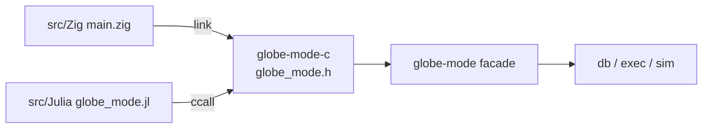

# S075 C ABI と Zig・Julia の例

| | |
| --- | --- |
| セッション | S075 |
| 日付 | 2026-11-02 |
| ブランチ | `feature/s075-c-abi` |
| Phase | P7 |
| スライド | [slides.html](slides.html) |
| 作業記録 | [log/work/2026-11-02-s075-c-abi.md](../../../log/work/2026-11-02-s075-c-abi.md) |

## 1. 目的

[roadmap](../../roadmap.md) の P7「言語 API と UI 比較」のうち、C / Zig / Julia（[features.md](../../features.md) の Julia API・Zig API）に手を付ける。facade `globe-mode` を C ABI で包み、Zig と Julia から `GlobeModeValidation.Simulation.Decay` を check → simulate する最小の例を置く。

## 2. 決定と理由

| 項目 | 決定 | 理由 |
| --- | --- | --- |
| crate | `globe-mode-c`（cdylib + staticlib + rlib）。facade だけに依存 | `globe-mode-py`・`globe-mode-wasm` と同じ形。rlib はテストから関数を呼ぶため |
| 面 | `gm_workspace_new(libraries_json)` / `gm_workspace_free` / `gm_set_file` / `gm_load_dir` / `gm_check` / `gm_graph` / `gm_simulate(ws, model, settings_json)` / `gm_solvers` / `gm_string_free` | `globe_mode._native` と同じ面 |
| 受け渡し | 結果は JSON の `char *`。`gm_string_free` で放す | py・wasm と同じ。型を言語ごとに写さない |
| 誤り | `{"error": "..."}` の JSON。NULL を返すのは `gm_workspace_new` だけ（理由は stderr） | 呼び手が 1 通りに扱える |
| panic | `catch_unwind` で止めて `{"error": "panic: ..."}` | FFI の境界で unwind させない |
| ヘッダ | `include/globe_mode.h` を手書き。`tests/header.rs` が `src/lib.rs` の `extern "C"` と型まで突き合わせる | cbindgen の依存を足さない |
| lint | この crate だけ workspace の `unsafe_code = "forbid"` を外す（ほかの lint は同じ） | `forbid` は crate の中で `allow` にできない |
| Zig | `build.zig` の `addTranslateC` でヘッダを読み、`libglobe_mode_c.so` に link（rpath つき） | `@cImport` より新しい版の作法。Zig 0.17 |
| Julia | `ccall` だけの `globe_mode.jl` 1 本。パッケージにしない | 最小。JSON の標準ライブラリが無いので結果は文字列のまま |
| CI | 入れない。`mise run c:zig` / `c:julia` で手元だけ | zig・julia のセットアップの時間に見合うかは次に決める |

## 3. 図



## 4. 再現手順

```bash
export CARGO_TARGET_DIR=...            # 共有の target
cargo test -p globe-mode-c             # 3 本
mise run c:zig                          # cargo build --release -p globe-mode-c → zig build run
mise run c:julia                        # cargo build --release -p globe-mode-c → julia test.jl
```

検証の結果:

- `cargo test -p globe-mode-c`: 3 本 ok（C ABI の往復、panic が JSON の誤りになる、ヘッダの 9 関数の署名が一致）。
- `mise run c:zig`: `check: passed=true`、`simulate: json=14522 bytes, last time=1`。
- `mise run c:julia`: `simulate: json=14521 bytes, last time=1.0`（JSON の長さは時間の計測値の桁で数バイト揺れる）。

## 5. 次回

- Zig・Julia を CI に入れるか（[作業記録](../../../log/work/2026-11-02-s075-c-abi.md)）。
- Julia のパッケージ化と JLL（BinaryBuilder）、Elixir の NIF。
- 参照シナリオ（[architecture.md](../../architecture.md) の「言語 API」）の graph と FMU の出力を Zig・Julia でも通す。
