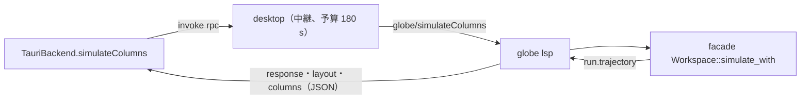

# S076 Desktop の結果も列ごとの道にする

| | |
| --- | --- |
| セッション | S076 |
| 日付 | 2026-11-02 |
| ブランチ | `feature/s076-desktop-columns` |
| Phase | P4 |
| スライド | [slides.html](slides.html) |
| 作業記録 | [log/work/2026-11-02-s076-desktop-columns.md](../../../log/work/2026-11-02-s076-desktop-columns.md) |

## 1. 目的

S065 の持ち越し（[roadmap](../../roadmap.md) の S065 の節、[S065 の解説書](../S065-columns-ui/解説書.md)）。ブラウザ UI は S051・S065 で `Backend.simulateColumns` の列の道になったが、Desktop（Tauri）の `TauriBackend` は sidecar `globe lsp` の `globe/simulate` が返す CSV を UI で解析していた。sidecar に列の道を足し、UI の CSV の解析をなくす。

## 2. 決定と理由

| 項目 | 決定 | 理由 |
| --- | --- | --- |
| 要求の形 | 独自要求 `globe/simulateColumns`（params は `{request}`、`globe/simulate` と同じ） | 既存の独自要求は 1 つの要求に 1 つの結果の形。`format` の引数で結果の形を変えるより、表の 1 行で済む |
| 結果の形 | `{response, layout, columns}`。`response` は `SimulateResponse`（`csv` は null）、`layout` は protocol の `ColumnsLayout`、`columns[i]` は列 `i` の数の配列 | wasm の `SimColumns`（`response`・`layout()`・`column(i)`）と同じ並び。`WorkerBackend` と同じ変換（`names.slice(1)`）で `Columns` になる |
| NaN / Inf | JSON の null（serde_json がそうする） | UI の `Columns` の欠損が null（uPlot）。`gapNonFinite` が要らない |
| 新しい計算 | 入れない。facade の `Workspace::simulate_with` の `run.trajectory` を並べ替えるだけ | LSP は facade だけを呼ぶ（S049、ADR-0023） |
| バイナリの道 | 作らない | 10 万点 × 7 列で CSV の道より速く（下の数字）、応答の大きさは同じ 13.8 MiB。Tauri の `invoke` は JSON なので、バイナリにするには別の口が要る |
| `parseCsv` | UI から消した | 使う所が無くなった（ブラウザは S065 から列の道） |
| Desktop の Rust | `worker.rs` の予算（180 s）と `files` の再生を `globe/simulateColumns` にも効かせた。`main.rs` の中継（`rpc`）は変えない | 中継は要求の名前を見ないが、予算と再生は名前で分けていた |

## 3. 図



## 4. 再現手順

```bash
cargo test -p globe-mode-lsp custom_requests
cargo build --release -p globe-mode-cli
# 計測: globe lsp に Wide（7 列、100,001 点）を globe/simulate（CSV → parseCsv）と globe/simulateColumns で交互に 5 回
node lsp-columns.mjs target/release/globe   # 作業用の一回きりのスクリプト（作業記録に要旨）
mise run check
mise run ui:check
```

検証の結果（数字）:

- 計測（WSL、release、他のセッションが並走して負荷平均 25 前後）: 要求を送ってから解析済みの配列まで、中央値で CSV の道 1425 / 1648 / 2538 ms に対し列の JSON 1110 / 951 / 1551 ms（3 回の計測。どれも 3〜4 割短い）。応答はどちらも 13.8 MiB。値は 1 万点おきに一致。
- 検査の数字は [作業記録](../../../log/work/2026-11-02-s076-desktop-columns.md) にある。

## 5. 次回

- 1 秒近くかかる残りは、サーバ側で `serde_json::Value` を組み立てる分と `JSON.parse`。もっと速くするなら、`Value` を介さず書き出すか、Tauri の生のバイト列（`tauri::ipc::Response`）で `Float64Array` を渡す。
- Desktop の smoke の `globe/simulate` は MSL を読んだ後の RSS の基準値なので変えていない。
