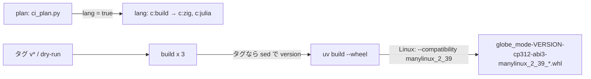

# S077 Zig・Julia の例を CI に入れ、wheel を版と manylinux で PyPI に出せる形にする

| | |
| --- | --- |
| セッション | S077 |
| 日付 | 2026-11-02 |
| ブランチ | `feature/s077-ci-lang-wheel` |
| Phase | P7 / P8（[S075](../S075-c-abi/解説書.md) の持ち越し「Zig・Julia を CI に入れる」と、[S074](../S074-wheel-release/解説書.md) の持ち越し「wheel の版と manylinux」） |
| スライド | [slides.html](slides.html) |
| 作業記録 | `log/work/2026-11-02-s077-ci-lang-wheel.md` |

## 1. 目的

- S075 で作った C ABI（`globe-mode-c`）を Zig（`src/Zig`）と Julia（`src/Julia`）から呼ぶ例（`mise run c:zig`・`c:julia`）は手元でしか回していなかった。ci.yml に入れて、壊れたら気づけるようにする。
- S074 で `release.yml` が作る wheel は、版が `pyproject.toml` の 0.1.0 のままでタグ `v*` と合わず、Linux の platform tag が `linux_x86_64`・`linux_aarch64` で PyPI に出せなかった。両方を直す。

## 2. 決定と理由

| 項目 | 決定 | 理由 |
| --- | --- | --- |
| ジョブ | ci.yml に `lang`（ubuntu-24.04 だけ）。`mise run c:zig` と `mise run c:julia` | 手元と同じ経路。`c:build`（release の `.so`）は mise の depends が先に回す |
| いつ回すか | `ci_plan.py` に出力 `lang` を足す。`globe-mode-c` が影響を受けたとき（依存の crate の変更を含む）、`src/Zig/*`・`src/Julia/*` を変えたとき、全体のとき。`mise.toml` の変更は `FULL_TRIGGERS` で全体になる | `python`（`globe-mode-py` が影響を受けたら回す）と同じ考え方。facade の変更でも C ABI の面は壊れうる |
| キャッシュ | `Swatinem/rust-cache` の `key: lang` | release の成果物なので、debug の `rust-linux` と分ける（`wasm-node`・`sundials` と同じやり方） |
| 自動の取得を止める | ジョブの env に `MISE_TASK_RUN_AUTO_INSTALL: "false"` | `wasm-node` と同じ。入れていないツールを mise run が入れ始めないように |
| wheel の版 | タグの push のときだけ、`uv build` の前に `pyproject.toml` の `version` を `sed` でタグ（`v` を除く）に書き換える。dry-run は 0.1.0 のまま | maturin は `[project] version` が静的ならそれを使う。`globe` のアーカイブの版（`GITHUB_REF_NAME#v`）と同じ取り方 |
| manylinux | Linux のときだけ `MATURIN_PEP517_ARGS="--compatibility manylinux_2_39"` | maturin が自分で glibc の記号を検査して tag を付ける。auditwheel・patchelf・新しい action は要らない。`pyproject.toml` に書くと手元の editable のビルドにも効くので、release.yml の環境変数にした |
| tag の段 | `manylinux_2_39`（ランナーの ubuntu-24.04 の glibc） | 先に `manylinux_2_34` を試したが、maturin の検査が `GLIBC_2.39`（libc）と `GLIBC_2.35`（libm）の記号で落とした（run 41376053596）。より古い glibc に向けるには manylinux の docker（新しい action）か maturin の `--zig`（zig は mise.toml にあるが、release の build に足して確かめる手間がかかる）が要るので、今回は見送った。Debian 12（2.36）・RHEL 9（2.34）の pip は入れられない |

## 3. 図



## 4. 再現手順

```bash
python3 .github/scripts/test_ci_plan.py
mise run ci:plan
git push -u origin feature/s077-ci-lang-wheel
gh workflow run ci.yml --ref feature/s077-ci-lang-wheel -f full=true
gh workflow run release.yml --ref feature/s077-ci-lang-wheel   # dry-run
```

検証の結果:

- 手元: `python3 .github/scripts/test_ci_plan.py` 24 件 OK。`mise run ci:plan` は `.github/` の変更で full、`lang: true`。
- ci.yml（`-f full=true`）run 41376046452: 全ジョブ success。`lang` は約 10 分 40 秒（キャッシュ無しの release ビルド込み）。zig 0.17.0・julia 1.13.2 で、どちらも `simulate: ... last time=1`。
- release.yml（dry-run）run 41376053596: `manylinux_2_34` では Linux の 2 つが maturin の検査で失敗（`GLIBC_2.39`・`GLIBC_2.35`）。
- release.yml（dry-run）run 41378655279（約 11 分、5 ジョブとも success）: wheel は `globe_mode-0.1.0-cp312-abi3-manylinux_2_39_x86_64.whl`・`…-manylinux_2_39_aarch64.whl`・`…-win_amd64.whl`。wheel を入れた pytest は 3 つとも `2 passed`。
- タグの版の差し替えは手元で `GITHUB_REF_NAME=v0.2.0-rc1` の `sed` を当てて `version = "0.2.0-rc1"` になることだけ確かめた（タグの push は試していない）。

## 5. 次回

- 古い glibc 向けの wheel（maturin の `--zig --compatibility manylinux_2_17` を試す。zig は mise.toml にある）。
- PyPI への公開そのもの（trusted publishing の設定はユーザーが PyPI 側で行う）。
- macOS の wheel と `globe`。
- Julia のパッケージ化と JLL、Elixir の NIF、参照シナリオの graph と FMU 出力を Zig・Julia で通す（S075 の残り）。
