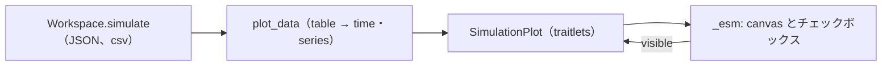

# S078 marimo と anywidget

| | |
| --- | --- |
| セッション | S078 |
| 日付 | 2026-11-02 |
| ブランチ | `feature/s078-marimo-anywidget` |
| Phase | P6 |
| スライド | [slides.html](slides.html) |
| 作業記録 | [log/work/2026-11-02-s078-marimo-anywidget.md](../../../log/work/2026-11-02-s078-marimo-anywidget.md) |

## 1. 目的

[S039](../S039-python-wheel/解説書.md) の持ち越し「anywidget」を済ませる（[roadmap](../../roadmap.md) の P6）。Python パッケージ `globe_mode` の `Workspace.simulate` の結果を、marimo や Jupyter の中で折れ線にする widget を作り、Decay を描く最小の marimo ノートブックを置く。Rust のコードは変えない。

## 2. 決定と理由

| 項目 | 決定 | 理由 |
| --- | --- | --- |
| 描画 | anywidget の `_esm` に、依存なしの `<canvas>` の折れ線を書く | uPlot の CDN はオフラインで開けない。npm から同梱するとビルドの段が増える。Decay 程度の確認なら軸の端の値だけで足りる |
| 依存の置き場 | `anywidget` を `pyproject.toml` の通常の依存に足す | CI の `python` ジョブ（`uv sync --locked`）と `release.yml` の wheel の pytest（`--with wheel`）はどちらも extra を入れない。extra にするとこの 2 か所も変える必要がある。代わりに wheel を入れると推移的に 18 本（ipython・ipywidgets など）増える |
| 結果の整形 | `globe_mode.widget.plot_data(response)` の 1 関数（既存の `table()` で polars に読み、列ごとに list にする） | 業務ロジックを JS に置かない。実行できなかった結果は `table()` と同じ ValueError |
| 表示の切り替え | trait `visible`（変数名の list）をチェックボックスと同期する | Python からも表示中の変数を読める・変えられる |

widget の traitlets（`sync=True`）:

| 名前 | 型 | 中身 |
| --- | --- | --- |
| `time` | `List(Float)` | 時刻の列 |
| `series` | `Dict` | 変数名 → 値の列（list of float） |
| `visible` | `List(Unicode)` | 描く変数名。既定は全部 |

ライセンス: anywidget 0.11.0 は MIT（依頼文では BSD-3-Clause とあったが、METADATA の `License-Expression: MIT` を確認、2026-11-02）。推移的依存はすべて許可の区分（[licenses.md](../../licenses.md)）。

## 3. 図



## 4. 再現手順

```bash
uv sync --locked
uv run pytest -q src/Python/tests
uv run marimo check src/Python/marimo/sim_app.py
uv run python src/Python/marimo/sim_app.py      # 全セルを実行して終わる
uv run marimo run src/Python/marimo/sim_app.py  # ブラウザで見る
```

検証の結果:

- `pytest -q src/Python/tests`: 4 passed（`test_widget.py` の 2 本を含む。Decay の 501 点、x(1) が e⁻¹）
- `marimo check`・`python sim_app.py`: どちらも終了コード 0
- `marimo export html` した HTML を headless Chromium で開き、canvas 1 枚・コンソールのエラー 0 件・折れ線が描かれたことを目で確認（手元だけ。テストには入れていない）

## 5. 次回

- 結果を Arrow で渡す（S039 の持ち越し）。点数の多い結果では JSON の list が重い
- 目盛り・ズーム・凡例のホバーが要るなら uPlot を npm から同梱する（大きさと根拠を作業記録に）
- marimo の WASM（Pyodide）で wheel を使う道は未着手
