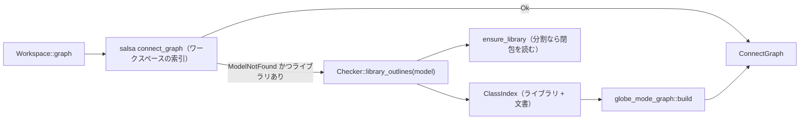

# S079 ライブラリのモデルの connect グラフ

| | |
| --- | --- |
| セッション | S079 |
| 日付 | 2026-11-02 |
| ブランチ | `feature/s079-graph-library-models` |
| Phase | P4 |
| スライド | [slides.html](slides.html) |
| 作業記録 | [log/work/2026-11-02-s079-graph-library-models.md](../../../log/work/2026-11-02-s079-graph-library-models.md) |

## 1. 目的

facade の `Workspace::graph(model, depth)` は、`set_file` で開いた文書のモデルしか引けず、ライブラリとして読んだモデル（MSL の `Modelica.Electrical.Analog.Examples.ChuaCircuit` など）は「モデル … が索引に無い」になっていた（S039・S046・S048 の持ち越し。[roadmap](../../roadmap.md)）。`check` と `simulate` は引けるので、`graph` も同じ道でライブラリのモデルを引けるようにする。

## 2. 決定と理由

| 項目 | 決定 | 理由 |
| --- | --- | --- |
| ライブラリのクラスの出どころ | 検査器の Session に読んであるライブラリの文書の構文木から、アウトラインを作る（`Checker::library_outlines`） | ライブラリは検査器（Rumoca の Session）の中にしか無い。本文を facade で持ち直すとメモリが倍になり、全部を構文解析し直すと遅い。アウトラインへの変換は `RumocaFrontend::outline` と同じ `class_outline` を使う |
| 分割読み込み（S037・S054） | 先に `ensure_library(model)` で検査と同じ閉包を Session に読む | 閉包にはモデルが使う部品の型がすべて入る（Rumoca が flatten するのに要る）。分割の利点（MSL の 292 / 2556 ファイル）を保つ |
| いつライブラリを見るか | ワークスペースの索引でモデルが見つからず、ライブラリがあるときだけ | ワークスペースのモデルの結果を変えない。salsa のクエリ（`connect_graph`）はそのまま |
| 索引の重なり | ライブラリを先、ワークスペースの文書を後に並べる（`ClassIndex::from_outlines` は後勝ち） | 開いた文書が同じ名前のライブラリのクラスより優先される |
| キャッシュ | しない（呼ぶたびに索引を作る）。コードに `shortcut:` を書いた | 依頼の範囲を超える。遅ければクエリにする |
| 触った crate | `globe-mode-frontend`（メソッドを 1 つ足す）と `globe-mode-db`（`connect_graph` の後ろの道） | 依頼は「graph と facade の範囲」だったが、facade からライブラリの中身へ届く既存の API が無かった。検査の道は変えていない |

## 3. 図



## 4. 再現手順

```bash
export CARGO_TARGET_DIR=…/.git-worktree/target-shared
cargo test -p globe-mode --test graph_library -- --nocapture   # data/msl があれば ChuaCircuit も
uv run pytest -q src/Python/tests
mise run check
mise run wasm:node && mise run wasm:compare
```

検証の結果（数字）:

- `RealCircuit` のグラフ: 4 ノード（`with_libraries`・`with_libraries_full`・`with_library_sources`・`with_library_sources_split` の 4 つの道で同じ）
- MSL の `ChuaCircuit` のグラフ（深さ 1）: 7 ノード
- 検査の数字は[作業記録](../../../log/work/2026-11-02-s079-graph-library-models.md)にある

## 5. 次回

- ワークスペースのモデルがライブラリの部品を使うときの型の解決（今はライブラリを見に行かず、型は `unresolved` に入る）
- ライブラリの索引のキャッシュ（MSL を全部読んだ道で呼ぶたびに 2556 文書から作る）
