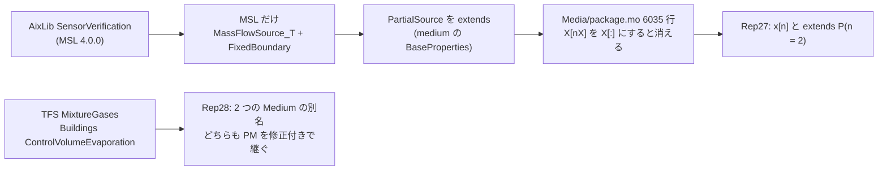

# S080 upstream-shape-proof-medium

| | |
| --- | --- |
| セッション | S080 |
| 日付 | 2026-11-02 |
| ブランチ | `feature/s080-upstream-shape-proof-medium` |
| Phase | P3 |
| スライド | [slides.html](slides.html) |
| 作業記録 | `log/work/2026-11-02-s080-upstream-shape-proof-medium.md` |

## 1. 目的

S070（[解説書](../S070-rumoca-upstream-libs/解説書.md)）と S072（[解説書](../S072-upstream-second-batch/解説書.md)）で【未確認】のまま残った 2 つの形を、自己完結の最小の再現にする。

1. ED019 `function shape proof`（下書き 25 の片割れ。AixLib の `SensorVerification` を MSL 4.0.0 で検査すると出る）
2. EF025 の replaceable な Medium の関数（下書き 20 の片割れ）

文書だけの作業で、製品コード・xtask・CI は変えない。issue は出さない（出すのはユーザー）。

## 2. 決定と理由

| 項目 | 決定 | 理由 |
| --- | --- | --- |
| 進め方 | 二分法。例題から MSL・ライブラリの部品を手元の `.mo` に写し、1 つずつ外す。MSL 4.0.0 の写しの 1 行を 4.1.0 の形に変えて原因を確かめた | エラーがファイル（`Modelica/Media/package.mo`）しか指さないため |
| 番号 | 新しい下書きは作らず、20 と 25 に「Minimal reproduction」の節を足す。再現は `20b`・`25b`、モデルは `Rep28`・`Rep27` | 依頼のとおり。同じコードの別の形なので、出すときに分けるかはユーザーが決める |
| 25b の判定 | **Rumoca の穴** | `x[n]`（`n` は定数）は正しい次元（MLS §10.1）、extends の修正は継いだ定数の値を決める（MLS §7.2）。omc は通す |
| 20b の判定 | **Rumoca の穴** | 修飾なしの `f` は呼んだモデルを囲む package で引く（MLS §5.3）。同じモデルのもう 1 つの別名は関係しない。omc は通す |
| EF025 の本数 | Medium は 138 本のうち 2 本（`loadResource` 136 本）と書き直した | 2026-11-02 の libraries の run 41365960542 の JSON を数え直した。S070 の「約 85 本」は表の 1 行（51 本）を全体と読んだ誤り |

## 3. 図



## 4. 再現手順

```bash
cd doc/research/upstream
R=../../../data/rumoca/rumoca-linux-x86_64     # cargo xtask fetch-rumoca
$R compile 25b-ed019-function-shape-proof-modified-package-constant.mo -m Rep27.M   # ED019
$R compile 25b-ed019-function-shape-proof-modified-package-constant.mo -m Rep27.M0  # 通る
$R compile 20b-ef025-two-medium-aliases-modified-extends.mo -m Rep28.M             # EF025
$R compile 20b-ef025-two-medium-aliases-modified-extends.mo -m Rep28.M1            # 通る
globe check 25b-ed019-function-shape-proof-modified-package-constant.mo --model Rep27.M
```

| 確かめたこと | 結果 |
| --- | --- |
| `globe check` と CLI のコード | Rep27 3 本・Rep28 4 本の 7 本で一致（失敗 2・対照 5） |
| omc 1.27.2 の `checkModel` | 7 本とも completed successfully |
| ライブラリの例題（CLI） | MixtureGases・ControlVolumeEvaporation は EF025、SensorVerification（MSL 4.0.0）は ED019 の同じメッセージ |

詳しい経緯は [libraries-2026-11-01.md](../../research/libraries-2026-11-01.md) の「残りの 2 つの形（S080）」、判定の一覧は [upstream/README.md](../../research/upstream/README.md)。

## 5. 次回

- 下書き 20・25 を Rumoca の main で確かめて出す（ユーザー）
- MSL 4.1.0 で出る `function shape proof` の 12 本（ThermofluidStream `myMedia`・AixLib の圧縮機・`OccupancySchedule`）が 25b と同じ形かを見る
- `splineDerivatives` の形、ED008 の `i` の 18 本は持ち越し
