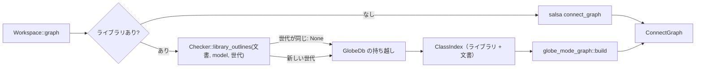

# S081 ワークスペースのモデルの中のライブラリの部品

| | |
| --- | --- |
| セッション | S081 |
| 日付 | 2026-11-02 |
| ブランチ | `feature/s081-graph-library-parts` |
| Phase | P4 |
| スライド | [slides.html](slides.html) |
| 作業記録 | [log/work/2026-11-02-s081-graph-library-parts.md](../../../log/work/2026-11-02-s081-graph-library-parts.md) |

## 1. 目的

S079（[解説書](../S079-graph-library-models/解説書.md)）の持ち越し 2 つを片付ける。

1. 開いた文書のモデルが MSL の部品（`Modelica.Electrical.Analog.Basic.Resistor R1` など）を持つと、`graph` はライブラリを見に行かず、部品の型が `unresolved` に入っていた。
2. ライブラリのモデルの `graph` を呼ぶたびに、ライブラリの文書のアウトラインを作り直していた（MSL を全部読んだ道で 2556 文書）。

## 2. 決定と理由

| 項目 | 決定 | 理由 |
| --- | --- | --- |
| いつライブラリを見るか | ライブラリがあれば常に、ライブラリ + 文書の索引で引く（S079 は「文書の索引に無いときだけ」） | 文書のモデルの部品の型もライブラリから引ける。ライブラリが無ければ今までどおり salsa の `connect_graph` |
| 分割読み込みの閉包 | `Checker::library_outlines(sources, model, cached)` が、文書の本文も渡して閉包を読む | 検査と同じ `ensure_library` の道。文書が使う MSL の部品のファイルも Session に入る |
| キャッシュ | `GlobeDb` がアウトラインを世代（分割で読んだファイルの数、全部読みは 0）ごとに持つ。世代が同じなら検査器は `None` を返す | 分割読み込みでは閉包が増えたときだけ作り直す。Session を共有するほかの DB が閉包を増やしても世代が変わる |
| 索引（`ClassIndex`）そのもの | 毎回作る（`shortcut:` をコードに書いた） | 文書の編集のたびに変わる。2 回目の ChuaCircuit は debug で約 52 ms で足りる |
| 触った crate | `globe-mode-frontend`（`library_outlines` の引数と戻り値）、`globe-mode-db`（`connect_graph` と欄 1 つ）、`globe-mode` のテスト | salsa のクエリは変えていない |

## 3. 図



## 4. 再現手順

```bash
export CARGO_TARGET_DIR=…/.git-worktree/target-shared
ln -s ../../../data/msl data/msl   # worktree に MSL が無ければ
cargo test -p globe-mode --test graph_library -- --nocapture
mise run check
mise run wasm:node && mise run wasm:compare
```

検証の結果（数字）:

- `tests/data/MslParts.mo`（`ConstantVoltage`・`Resistor`・`Ground`）の `unresolved`: ライブラリなし 3 → `with_libraries`・`with_libraries_full` とも 0
- MSL の `ChuaCircuit`（`with_libraries_full`、debug）: 1 回目 233.7 ms、2 回目 52.2 ms
- 検査の数字は[作業記録](../../../log/work/2026-11-02-s081-graph-library-parts.md)にある

## 5. 次回

- 索引（`ClassIndex`）ごとの持ち越し（2 回目の約 52 ms が気になったら）
- import した名前（`import Modelica.Electrical.Analog.Basic.*`）の解決は索引がまだ見ない
