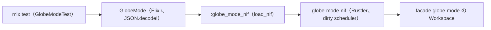

# S082 Elixir の NIF

| | |
| --- | --- |
| セッション | S082 |
| 日付 | 2026-11-02 |
| ブランチ | `feature/s082-elixir-nif` |
| Phase | P7 |
| スライド | [slides.html](slides.html) |
| 作業記録 | [log/work/2026-11-02-s082-elixir-nif.md](../../../log/work/2026-11-02-s082-elixir-nif.md) |

## 1. 目的

[roadmap](../../roadmap.md) の P7「言語 API」のうち、[features](../../features.md) の「Elixir / Gleam API: Rustler の NIF」に手を付ける（S075 の持ち越し。[S075 の解説書](../S075-c-abi/解説書.md)）。Python（`globe-mode-py`）・C ABI（`globe-mode-c`）と同じ面を Elixir から使えるようにし、Decay を check → simulate する試験を CI のジョブ `lang` で回す。

## 2. 決定と理由

| 項目 | 決定 | 理由 |
| --- | --- | --- |
| 経路 | 新しい crate `globe-mode-nif`（Rustler 0.39 の cdylib） | `globe-mode-c` の `.so` を Elixir から呼ぶには dlopen が要るが `:erlang` に無く、結局 NIF を書くことになる。Rustler なら resource と型の変換が付き、`unsafe` を手で書かない |
| 面 | `new(libraries)` / `set_file` / `load_dir` / `check` / `graph` / `simulate(ws, model, settings_json)` / `solvers` | `globe-mode-py` と同じ。結果は JSON の文字列で、型を 1 つずつ写さない |
| ワークスペース | `ResourceArc<Mutex<Workspace>>` | salsa のデータベースは Send だが Sync でない。BEAM の resource は Sync を要るので Mutex で 1 つずつ使う |
| scheduler | `check`・`graph`・`simulate` は DirtyCpu、`new`・`load_dir` は DirtyIo | 1 ms を超える NIF は普通の scheduler を止めるため |
| Elixir 側の依存 | Hex の依存 0（JSON は Elixir 1.18 の標準 `JSON`、Rustler の Hex パッケージも使わない） | NIF は `mise run elixir:test` が cargo で先に作り、`:erlang.load_nif` で読む。mix から cargo を呼ばない |
| Erlang モジュール名 | `globe_mode_nif`（Elixir では `defmodule :globe_mode_nif`） | Gleam の `@external(erlang, "globe_mode_nif", …)` からも同じ名前で呼べる |
| Gleam | 持ち越し | Gleam のプロジェクトに Erlang の読み込み口と試験を足すと CI の道がもう 1 本要る。今回は Elixir に絞る |

## 3. 図



## 4. 再現手順

```bash
mise run elixir:test     # cargo build --release -p globe-mode-nif → mix deps.get → mix test
python3 .github/scripts/test_ci_plan.py
```

検証の結果（数字）:

- `mix test`: 1 本、失敗 0（Decay の check が `passed`、simulate が `ok`、CSV の最後の時刻 1、索引に無いモデルの graph は `{:error, _}`）。
- 新しい依存: rustler・rustler_codegen 0.39.0、inventory 0.3.25、libloading 0.9.0（[licenses](../../licenses.md)）。`cargo deny check` は ok。
- CI の結果は [作業記録](../../../log/work/2026-11-02-s082-elixir-nif.md) に書く。

## 5. 次回

- Gleam の `@external` の例（`src/Gleam/globe_mode`）。
- rustler_precompiled で Hex に配る。
