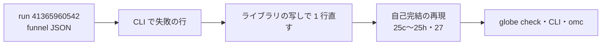

# S083 upstream-shape-proof-411

| | |
| --- | --- |
| セッション | S083 |
| 日付 | 2026-11-02 |
| ブランチ | `feature/s083-upstream-shape-proof-411` |
| Phase | P3 |
| スライド | [slides.html](slides.html) |
| 作業記録 | `log/work/2026-11-02-s083-upstream-shape-proof-411.md` |

## 1. 目的

S080（[解説書](../S080-upstream-shape-proof-medium/解説書.md)）で【未確認】のまま残った、MSL 4.1.0 で出る ED019 を自己完結の最小の再現にする。

1. `function shape proof` の `dependent extent ...` 12 本が、S080 の 25b と同じ形か
2. `splineDerivatives` の `function conditional` の形
3. `` `X`/`b`: axis 1 is variable-size ... `` の 5 本
4. S080 の途中で見えた CLI の ER002（継いだ入れ子のクラスを継いだ package の名前で引く）

文書だけの作業で、製品コード・xtask・CI は変えない。issue は出さない（出すのはユーザー）。

## 2. 決定と理由

| 項目 | 決定 | 理由 |
| --- | --- | --- |
| 進め方 | artifact の JSON で例題を特定し、Rumoca の CLI で失敗の行を出し、関数を写して 1 つずつ外す。ライブラリの写しでその行だけを直して消えるかを確かめる | `globe check` はファイルしか指さないため |
| 1 の判定 | 25b と同じは 1 本（ThermofluidStream `SimpleLiquidWater`）だけ。残り 11 本は 3 つの別の形（25c・25d・25e） | 失敗の行が別々（`Polynomials.mo`・`OccupancySchedule.mo`・`R134a.mo`）で、それぞれ別の条件で消える |
| 2 の判定 | 25 と同じ検査（`function conditional`）の別の入り口。再現 25g | Boolean でなく Real の配列の出力でも、for だけの枝で出る |
| 3 の判定 | 2 つの別の形（25f・25h） | Steam は束縛が後の定数を読む、MoistAir は大きさを呼び出しで決める |
| 4 の判定 | **Rumoca の穴**。新しい下書き 27 | MLS §7.1・§5.3.2 で継いだ要素も引ける。omc は通す |
| 番号 | 25 は既存の下書きへの追記と枝番 `25c`〜`25h`（`Rep29`〜`Rep34`）、ER002 は 27（`Rep35`） | 依頼のとおり。25 を形ごとに分けるかは出すときにユーザーが決める |

## 3. 図



## 4. 再現手順

```bash
cd doc/research/upstream
R=../../../data/rumoca/rumoca-linux-x86_64     # cargo xtask fetch-rumoca
$R compile 25c-ed019-function-shape-proof-size-of-call-sized-constant.mo -m Rep29.M   # ED019
$R compile 25c-ed019-function-shape-proof-size-of-call-sized-constant.mo -m Rep29.M0  # 通る
$R compile 27-er002-inherited-class-through-extending-package.mo -m Rep35.M          # ER002
globe check 25e-ed019-function-shape-proof-record-local-dimension.mo --model Rep31.M
```

| 確かめたこと | 結果 |
| --- | --- |
| `globe check` と CLI のコード | 7 つの再現の 25 本で一致（失敗 12・対照 13） |
| omc 1.27.2 の `checkModel` | 25 本とも completed successfully |
| ライブラリの写しで 1 行直す | TFS `SimpleLiquidWater` は S0〜S10 を通る。MSL `R134a1`・`R134a2`、IBPSA `OccupancySchedule` はこの ED019 を抜けて別の失敗で止まる |

詳しくは [libraries-2026-11-01.md](../../research/libraries-2026-11-01.md) の「ED019 の残り（S083）」、判定の一覧は [upstream/README.md](../../research/upstream/README.md)。

## 5. 次回

- 下書き 25・27 を Rumoca の main で確かめて出す（ユーザー）
- ER002（27）で止まるライブラリの例題を数える。CLI の EF024・ET004 は持ち越し
- ED008 の `i` の 18 本は持ち越し
