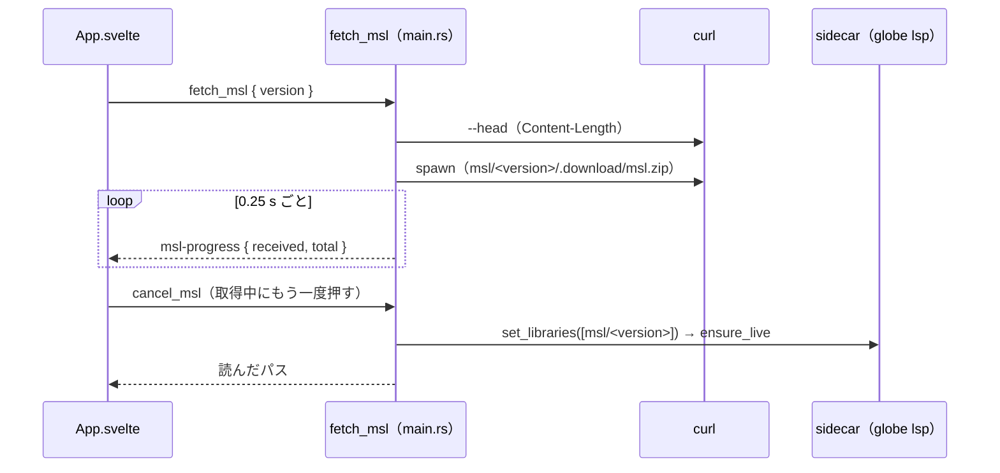

# S084 Desktop の MSL の版の切り替えと取得の進捗・取り消し

| | |
| --- | --- |
| セッション | S084 |
| 日付 | 2026-11-02 |
| ブランチ | `feature/s084-desktop-msl-switch` |
| Phase | P4 |
| スライド | [slides.html](slides.html) |
| 作業記録 | [log/work/2026-11-02-s084-desktop-msl-switch.md](../../../log/work/2026-11-02-s084-desktop-msl-switch.md) |

## 1. 目的

[S069](../S069-desktop-msl-fetch/解説書.md)（[ADR-0030](../../adr/0030-desktop-msl-placement.md)）の持ち越し 2 つを閉じる（[roadmap](../../roadmap.md) の P4）。

1. MSL の取得の進捗の割合と取り消し。
2. MSL 4.0.0 への切り替えの UI（公開ライブラリの多くは 4.0.0 が前提。S067 で xtask は `fetch-msl --version 4.0.0` を取れる）。

## 2. 決定と理由

| 項目 | 決定 | 理由 |
| --- | --- | --- |
| 版の置き場 | app data dir の `msl/<version>/`。起動時は `msl::VERSIONS`（4.1.0、4.0.0）の順に目印を探し、最初のものを渡す | 目印（`<版> <sha256>`）が版ごとなので 2 版を並べて置ける。切り替えで取得済みの版を落とし直さない |
| command | `fetch_msl { version: "4.1.0" \| "4.0.0" }` → 読んだパスの配列。その版を取得し、sidecar を `--library msl/<version>` だけで作り直す | S069 の形に引数を 1 つ足しただけ。外から渡したライブラリ（`--library`・`GLOBE_LIBRARY`）があれば切り替えずにエラー |
| 進捗 | イベント `msl-progress`、payload `{ received: number, total: number \| null }`。0.25 秒ごと | curl を `spawn` して zip の大きさを見る。全体は先に `curl --head` で Content-Length を聞く（無ければ null）。HTTP クライアントを足さない |
| 取り消し | command `cancel_msl` が `AtomicBool` を立て、curl を kill して途中の zip と `.download` を消す。`fetch_msl` は「MSL の取得を取り消した」の Err | 最小の形。展開（数秒）の途中は止めない |
| 定数 | 4.0.0 は xtask と同じ名前 `MSL_400_URL`・`MSL_400_SHA256` で `msl.rs` に写す | `desktop.yml` の一致の検査を同じ sed の組で 2 版分に広げられる |
| UI | Desktop だけ版の `<select>`（既定 4.1.0）。ボタンは「MSL x を取得する」→ 取得中は「取り消す」→ 読んだ後は「MSL x に切り替える」 | ブラウザ版の `MSL.json` は 4.1.0 だけ。版の判断と取得は Rust 側にあり、Svelte は表示だけ |

## 3. 図



## 4. 再現手順

```bash
# 定数の一致、fmt・clippy・試験、.deb の smoke（4.1.0 の取得を含む。4.0.0 の取得は入れない）
gh workflow run desktop.yml --ref feature/s084-desktop-msl-switch
# UI（svelte-check と Playwright。ブラウザ版の道は変えていない）
mise run ui:check
```

検証の結果（数字）は[作業記録](../../../log/work/2026-11-02-s084-desktop-msl-switch.md)。

- `msl.rs` の単体試験 3 本（版ごとの定数と置き場のパスの試験を 1 本足した）。
- 手元で、本物の 4.0.0 の URL に対して進捗（全体 29,117,960 バイト）と取り消し（`.download` が消える）を確かめた（コミットしない一時の試験）。

## 5. 次回

- 展開中の取り消し、複数ウィンドウでの同時取得の排他（ADR-0030 の (e) のまま）。
- 使わなくなった版の置き場の削除、Windows での取得の確認。
- 署名と自動更新、静かな `globe/setFile`。
