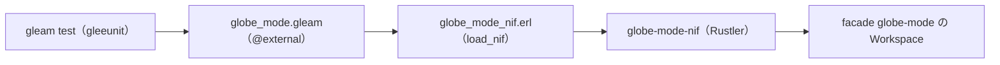

# S087 Gleam の `@external`

| | |
| --- | --- |
| セッション | S087 |
| 日付 | 2026-11-02 |
| ブランチ | `feature/s087-gleam-external` |
| Phase | P7 |
| スライド | [slides.html](slides.html) |
| 作業記録 | [log/work/2026-11-02-s087-gleam-external.md](../../../log/work/2026-11-02-s087-gleam-external.md) |

## 1. 目的

[roadmap](../../roadmap.md) の P7「言語 API」のうち、[features](../../features.md) の「Elixir / Gleam API」の Gleam の半分（S082 の持ち越し。[S082 の解説書](../S082-elixir-nif/解説書.md)）。S082 の NIF `globe-mode-nif` を Gleam の `@external` で呼び、Decay を check → simulate する試験を CI のジョブ `lang` で回す。Rust のコードは変えない。

## 2. 決定と理由

| 項目 | 決定 | 理由 |
| --- | --- | --- |
| 置き場 | `src/Gleam/globe_mode`（`gleam new` の最小の形、Erlang target） | `wisp_fmt` と分ける |
| 面 | `src/globe_mode.gleam` が `@external(erlang, "globe_mode_nif", …)` で 7 関数を宣言するだけ | ロジックは Rust 側。Gleam 側に包む関数を書かない |
| 結果の型 | `Result(String, String)`（JSON の文字列）、ワークスペースは中身の無い型 `Workspace` | Rustler の `Result<T, String>` は `{ok, T}` / `{error, Binary}` で、Gleam の `Result` と同じ形 |
| `set_file` | `Result(#(), String)` | Rustler は `Ok(())` を `{ok, {}}`（空のタプル）で返す。`Nil`（atom `nil`）ではない |
| `.so` の読み込み | `src/globe_mode_nif.erl`（`-on_load` で `erlang:load_nif`、パスは `GLOBE_MODE_NIF`） | `rustler::init!("globe_mode_nif")` なので、この名前のモジュールが読む。Elixir 側の `:globe_mode_nif` とは別のプロジェクトなので重ならない |
| 試験 | gleeunit で Decay。JSON は解析せず、`"passed":true`・`"ok":true`・CSV の最後の行の時刻 1 を文字列で探す | Hex の依存を gleeunit と gleam_stdlib だけにする |
| CI | `lang` の `erlef/setup-beam` に `gleam-version: "1.19.2"`（手元の mise と同じ版）、`mise run gleam:test` | BEAM と同じ道で入れる。mise の erlang は ubuntu-24.04 で動かない（S082） |

## 3. 図



## 4. 再現手順

```bash
mise run gleam:test      # cargo build --release -p globe-mode-nif → gleam test
```

検証の結果（数字）:

- `gleam test`: 1 本、失敗 0（Decay の check が `passed`、simulate が `ok`、CSV の最後の時刻 1、索引に無いモデルの graph は `Error`）。
- 新しい依存: Hex の gleam_stdlib 1.0.5・gleeunit 1.11.0（どちらも Apache-2.0、`wisp_fmt` と同じ版）。Rust の依存は 0。
- CI の結果は [作業記録](../../../log/work/2026-11-02-s087-gleam-external.md) に書く。

## 5. 次回

- Gleam の JS target から `globe-mode-wasm` を呼ぶ。
- rustler_precompiled で Hex に配る（Elixir と Gleam で共用）。
