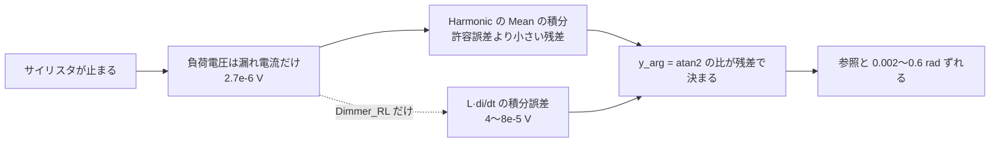

# S088 sim-dimmer-thyristor

| | |
| --- | --- |
| セッション | S088 |
| 日付 | 2026-11-02 |
| ブランチ | `feature/s088-sim-dimmer-thyristor` |
| Phase | P3 |
| スライド | [slides.html](slides.html) |
| 作業記録 | `log/work/2026-11-02-s088-sim-dimmer-thyristor.md` |
| 前のセッション | [S064](../S064-auto-esdirk-fallback/解説書.md)（[ADR-0028](../../adr/0028-auto-esdirk34-fallback.md)） |

## 1. 目的

[S064](../S064-auto-esdirk-fallback/解説書.md) の持ち越しの 3 件を調べる。

1. `Electrical.PowerConverters.Examples.ACAC.Dimmer_RL` の `vH01.y_arg`・`iH01.y_arg` が参照結果の管から外れる原因。`Dimmer_R` と同じか。
2. `Electrical.PowerConverters.Examples.ACDC.RectifierBridge2mPulse.ThyristorBridge2mPulse_DC_Drive` が `auto` の回し直し（予算 180 s）の時間切れの境目にある件。
3. `auto` の全体の予算（Rumoca の dopri45 が最初の予算 30 s を超えて走る件）。計測だけ。

実行系を直して収まるなら直し、収まらないなら理由を書いて残す。

## 2. 決定と理由

| 項目 | 決定 | 理由 |
| --- | --- | --- |
| `Dimmer_RL` と `Dimmer_R` | 同じ原因と判定し、2 本とも既知の外れ（`src/Modelica/msl-sim-known-deviations.txt`）に足した。実行系は直さない | 外れるのは、サイリスタが止まって第 1 高調波の振幅が漏れ電流の大きさ（参照で 2.7e-6 V、導通時の 110 V の 2e-8）まで落ちる窓の `y_arg` だけ。ほぼ 0 の振幅の位相は `Mean` の積分の残差で決まり、参照（Dassl）の側も解けていない。点弧の時刻・電流・導通している区間の信号はすべて合う |
| `ThyristorBridge2mPulse_DC_Drive` | 直さない（持ち越し）。CI の数字を残す | 回し直しは BDF にも esdirk34 にも元の予算 180 s をそのまま渡しているので、予算の分け方の 1 行では esdirk34 の時間は増えない。esdirk34 そのものが 94〜180 s 以上かかり（2.3）、時間はイベント約 3.75 万回のやり直しに使われる |
| (3) の予算 | 計測だけ（直さない） | 依頼どおり |
| wasm・`mise run check` | 回していない | 実行系（Rust）は変えていない。変えたのは既知の外れの一覧（テキスト）と文書だけ |

### 2.1 `Dimmer_RL` の外れ方

手元（release、`--solver esdirk34 --tolerance 1e-7`、77 s で終了）の結果を、MAP-LIB の参照結果（`dac67829`）と 0.02 s の窓（`Mean` の更新の周期 1/f）ごとに比べた。

| 区間 | サイリスタ | `vH01.y_rms`（参照 / GlobeMode） | `vH01.y_arg`（参照 / GlobeMode） |
| --- | --- | --- | --- |
| t = 0.03〜0.05 | 点弧した窓 | 1.3195 / 1.3195 | 2.9580 / 2.9580 |
| t = 0.07〜0.19 | 減衰 | 6.7e-3〜2e-5 / 同じ桁 | 2.62 / 2.62〜1.97（振幅が 1e-4 を切るとずれ始める） |
| t = 0.25〜1.01 | 止まっている | 2.67e-6 / 4〜8e-5 | 1.058 / 1.69〜1.79 |
| t = 1.03〜6.99 | 導通 | 0.1〜110 / 同じ（相対 1e-6） | 合う（5 桁） |
| t = 7.03〜8 | 止まっている | 2.67e-6 / 2〜8e-5 | 1.058 / 1.68〜1.72 |

- 止まっている間の負荷電圧は `R·i + L·di/dt`。電流（`iH01.y_rms` 2.2e-7 A）は参照と 4 桁合うが、電圧はこちらが `di/dt` の積分誤差の分だけ大きく（4〜8e-5 V）、窓ごとに揺れる。位相は振幅に対する比で決まるので、1.06 と 1.70 rad に分かれる。外れた点 19206 / 84773（23%）は、この 2 区間（約 1.9 s / 8 s）にあたる。
- `iH01.y_arg` の外れ（85 点、t = 0.2161）は t = 0.21〜0.23 の 1 窓で、電流の振幅が 3.4e-7 A まで減った窓（2.449 と 2.468）。

### 2.2 `Dimmer_R` の外れ方

手元（release、`--solver auto --tolerance 1e-7`）で同じように比べた。

- 点弧の時刻（`multiSensor.i` が 1e-2 A を超える時刻）は最初の 11 回が 1e-6 s まで一致（0.019122・0.049829・… ・0.229996）。
- 外れるのは t = 0.27〜0.39 の窓で、振幅が 7.9e-6 → 2.66e-6 V（漏れ電流だけ）に落ちる窓。y_rms は 1% 以内で合い、位相が 2.796 / 2.794、2.228 / 2.215、1.778 / 1.759 と 0.002〜0.02 rad ずれる。抵抗だけの負荷なので `di/dt` の誤差は無く、`Dimmer_RL` より外れが小さい（201 点）。
- [msl-sim-failures.md](../../research/msl-sim-failures.md) の節「管から外れた 10 本」の 10 では「点弧の時刻のずれが窓の平均に入る見込み【未確認】」としていた。点弧の時刻は一致したので、この見込みは外れ。許容誤差を 1e-8 にすると 9/11 → 4/11 に悪くなる（同じ節）ことも、ほぼ 0 の振幅の位相が許容誤差の下の残差で決まることと合う。

### 2.3 `ThyristorBridge2mPulse_DC_Drive` の時間

| 計測 | BDF | esdirk34 | 計 |
| --- | ---: | ---: | ---: |
| 手元（release、他のビルドの無いとき。`--timeout 900`） | 7.5 s で `GM-U0005` | 159.8 s で終了（点 114031、状態 18） | - |
| CI run 41403194603 の最初の試行（予算 30 s） | - | 時間切れ | 37.5 s |
| CI run 41403194603 の回し直し（予算 180 s） | 約 5 s | 180 s で時間切れ | 187.5 s（積分の段 185.0 s） |
| S050 の esdirk34 単独（ランナー） | - | 94.3 s | - |
| S064 の run 41282411061 / 41287267439 | - | 終了 / 時間切れ | 101 s / 187.4 s |

- 時間はイベントに使われている。出力の格子（15 s / 0.0002 s = 75001 点）の外の点が 37528 点あり、ほぼすべてがイベントの時刻（15 s で約 3.75 万回、1 秒に 2500 回）。esdirk34 は 1 回のイベントごとに歩を初めからやり直す（ヤコビ行列と LU の作り直し、小さな最初の刻み）ので、1 回あたり約 4 ms（手元）になる。ヤコビ行列の作り直しの回数そのものは、実行系に数える口が無いので数えていない。
- `run_auto` は回し直しの各段に元の予算をそのまま渡している（ADR-0028 (c)）。BDF は 5〜7.5 s で落ちるので、esdirk34 には 180 s がまるごと渡っている。予算の分け方を 1 行変えても esdirk34 の時間は増えない。収まるには esdirk34 の速さ（session の道はインタプリタで回る。`session.rs` の冒頭）か、回し直しの予算（xtask の 180 s）を変える必要があり、どちらも 1 行の変更の範囲を超えるので持ち越した。ADR-0028 には追記していない。

### 2.4 `auto` の全体の予算（計測だけ）

CI run 41403194603 の最初の試行（予算 30 s）で 30 s を超えたもの: `ThyristorBridge2Pulse_DC_Drive` 47.6 s（BDF → esdirk34 → dopri45）、`ThyristorBridge2mPulse_RLV_Characteristic` 53.3 s、`ThyristorBridge2mPulse_DC_Drive` 37.5 s、`IMC_YDarc` 32.3 s、`ThyristorCenterTap2mPulse_RLV_Characteristic` 31.3 s、`HBridge_DC_Drive` 30.9 s、`Dimmer_RL` 30.6 s。超える量は、回し直しの段ごとに 30 s を渡すことと、協調型の予算が 1 歩の内側では止まらないことの和で、最大でも段の数 × 30 s。応答の上限 120 s で外から止めたのは 8 本（`LightningSegmentedTransmissionLine` ほか）。規則は変えていない。

## 3. 図



## 4. 再現手順

```bash
# 参照結果（1 本だけ。commit は src/Rust/xtask/src/reference.rs の MAP_LIB_SHA）
curl -sfLO https://raw.githubusercontent.com/modelica/MAP-LIB_ReferenceResults/dac67829004dd99d00778c995a00363df6088de1/Modelica/Electrical/PowerConverters/Examples/ACAC/Dimmer_RL/Dimmer_RL.csv
# 手元（release）
globe simulate -L data/msl -m Modelica.Electrical.PowerConverters.Examples.ACAC.Dimmer_RL \
  --solver esdirk34 --tolerance 1e-7 --timeout 900 -o rl.csv
# CI（全例題 + esdirk34 単独）
gh workflow run msl-sim.yml --ref feature/s088-sim-dimmer-thyristor -f 'solvers=["esdirk34"]'
gh run download <run-id> -n msl-sim
```

検証の結果（数字）:

- `msl-sim.yml` run 41403194603（`--ref feature/s088-sim-dimmer-thyristor`、`solvers=["esdirk34"]`）: ジョブ `msl-sim` と `split-all` は success。356 本: 実行できた **310**・管に収まった **301 / 309**（S064 の 310・301 / 309 と同じ）。モデルごとの判定と管の結果は、前の `doc/msl-sim.md`（run 41287267439）と 355 行すべて同じ。既知の外れは 3 → 5 本（`Dimmer_R`・`Dimmer_RL` が「既知」に入った。合否の数は変えない）。
- ジョブ `solvers (esdirk34)` は、esdirk34 単独の数字を手元（他のビルドの無いとき）で取れたので、2 時間かかる前に止めた（cancelled）。
- 前回の `target/msl-sim.json` は feature ブランチの run のキャッシュに無く（キャッシュは S064 のブランチのもの）、報告に「前回との差」の節が出ていない。差は上のとおり手で突き合わせた。
- `check_docs.py`: リンク切れ 0。

## 5. 次回

- `ThyristorBridge2mPulse_DC_Drive`: イベント 1 回あたりの esdirk34 のやり直しを軽くする（イベントの後のヤコビ行列の使い回し、session の道の JIT）か、回し直しの予算を見直す。
- `auto` の全体の予算: 段ごとに予算を渡す今の規則のままで、超える量は最大で段の数 × 予算。全体に上限を置くなら、S064 の Lightning の件（残りを渡すと BDF の組み立てで使い切る）と合わせて決める。
- ほぼ 0 の振幅の位相を管で比べない（比べ方の側で振幅の下限を置く）かは、他の `Harmonic` の例題と合わせて考える。
