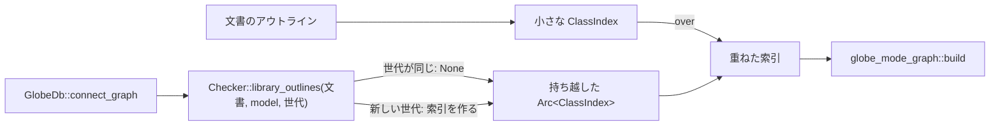

# S089 graph の import と索引の持ち越し

| | |
| --- | --- |
| セッション | S089 |
| 日付 | 2026-11-02 |
| ブランチ | `feature/s089-graph-imports-index-cache` |
| Phase | P4 |
| スライド | [slides.html](slides.html) |
| 作業記録 | [log/work/2026-11-02-s089-graph-imports-index-cache.md](../../../log/work/2026-11-02-s089-graph-imports-index-cache.md) |

## 1. 目的

S081（[解説書](../S081-graph-library-parts/解説書.md)）の持ち越し 2 つを片付ける。

1. `GlobeDb::connect_graph` は、ライブラリのアウトラインは持ち越していたが、クラスの索引（`ClassIndex`）は呼ぶたびに作り直していた（`shortcut:`）。
2. `import Modelica.Electrical.Analog.Basic.Resistor;` や `import SI = Modelica.Units.SI;` で書いた名前を索引が引かず、部品の型が `unresolved` に入っていた。

## 2. 決定と理由

| 項目 | 決定 | 理由 |
| --- | --- | --- |
| キャッシュ | `GlobeDb` の欄 `library_outlines` を `library_index: Option<(世代, Arc<ClassIndex>)>` に置き換えた | アウトラインはもう索引を作るためにしか使っていない。世代の意味は S081 と同じ |
| 文書のクラス | 文書のアウトラインから小さな索引を毎回作り、`ClassIndex::over(base)` でライブラリの索引の上に重ねる。引くとき文書側を先に見る | 大きな索引を写さずに済む。同じ名前は文書を優先する（S081 と同じ） |
| import の書式 | `ClassOutline::imports` の別名の形を `A.B.C` から `D=A.B.C` に変えた | 別名が落ちていて引けなかった。この欄を読む所はテストのほかに無かった |
| 引く順 | 内側のスコープから外へ、各段で「そのスコープのクラス → そのスコープのクラスの import」。先頭が `.` の名前はグローバルだけ | MLS §5.3.1・§13.2 の最小。import は書いたクラスの中だけ効き、継承しない |
| import の形 | qualified（`import A.B.C;` は `C` で引く）、renamed（`import D = A.B;`）、unqualified（`import A.B.*;`）、selective（`import A.B.{C, D};`。frontend が qualified 2 つにほどく） | 4 形とも 1 つの関数で済む |
| 触った crate | `globe-mode-ir`（`ClassIndex` の `base` と `over`・`resolve`）、`globe-mode-frontend`（別名の書式）、`globe-mode-db`（欄 1 つ）、`globe-mode` のテスト | salsa のクエリ・lsp・protocol・Svelte は変えていない |

## 3. 図



## 4. 再現手順

```bash
export CARGO_TARGET_DIR=…/.git-worktree/target-shared
ln -s <main のチェックアウト>/data/msl data/msl   # worktree に MSL が無ければ
cargo test -p globe-mode-ir
cargo test -p globe-mode --test graph_library -- --nocapture
mise run check
mise run wasm:node && mise run wasm:compare && mise run msl:compare
```

検証の結果（数字）:

- MSL の `ChuaCircuit`（`with_libraries_full`、debug）の graph: 1 回目 272.6 ms、2 回目 6.9 ms（S081 は 52.2 ms）
- `tests/data/MslPartsImport.mo`（3 形の import で `ConstantVoltage`・`Resistor`・`Ground`）の `unresolved`: 0
- 検査の数字は[作業記録](../../../log/work/2026-11-02-s089-graph-imports-index-cache.md)にある

## 5. 次回

- 継承したクラスの中の入れ子のクラスは、索引がまだ引かない
- ライブラリがあるとき、文書のモデルの graph は salsa の外で作るので、salsa の再計算の省き（backdate）は効かない（S081 と同じ）
