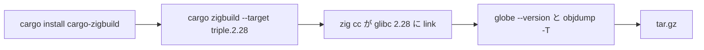

# S090 globe の CLI を zig で glibc 2.28 に

| | |
| --- | --- |
| セッション | S090 |
| 日付 | 2026-11-02 |
| ブランチ | `feature/s090-cli-glibc-zig` |
| Phase | P8 |
| スライド | [slides.html](slides.html) |
| 作業記録 | `log/work/2026-11-02-s090-cli-glibc-zig.md` |

## 1. 目的

[S086](../S086-wheel-manylinux-zig/解説書.md) の持ち越し。`release.yml` の `build` で作る `globe` の tarball（linux x86_64 / aarch64、S044・S052）は、ランナー（ubuntu-24.04）の glibc 2.39 に link していて、古い Linux では動かない。wheel と同じく zig を cc/linker にして glibc 2.28 を狙う。CI の定義だけを変え、Rust のコードは変えない。工程は [roadmap.md](../../roadmap.md) の P8。

## 2. 決定と理由

| 項目 | 決定 | 理由 |
| --- | --- | --- |
| 道 | `cargo-zigbuild`（MIT、CI で `cargo install --locked`） | `zig cc` の wrapper と `CC`・`CARGO_TARGET_*_LINKER` を自前で書くより短い。zig は S086 で mise から入れてある |
| 指定 | `cargo zigbuild --release --locked -p globe-mode-cli --target <triple>.2.28` | 末尾の `.2.28` で glibc の版を選ぶ。出力は `target/<triple>/release/globe` |
| 置き場所 | 1 つの段で Linux と Windows を分け、`BIN` を `GITHUB_ENV` に書く | 後の「動くか」「まとめる」は `$BIN` を使うだけ |
| 確認 | 「動くか確かめる」で `objdump -T` の最大の `GLIBC_` を出す | ログで版を見られる |
| aarch64 | 同じ行 | ネイティブのランナー（ubuntu-24.04-arm）。クロスはしない |
| sundials | 対象外 | release に `--features sundials` は入っていない（S044） |
| Windows | 変えない | `cargo build` のまま |

## 3. 図



## 4. 再現手順

```bash
cargo install --locked cargo-zigbuild
cargo zigbuild --release --locked -p globe-mode-cli --target x86_64-unknown-linux-gnu.2.28
objdump -T target/x86_64-unknown-linux-gnu/release/globe | grep -o 'GLIBC_[0-9.]*' | sort -uV | tail -1
target/x86_64-unknown-linux-gnu/release/globe check src/Modelica/GlobeModeValidation --model GlobeModeValidation.Simulation.Decay
gh workflow run release.yml --ref feature/s090-cli-glibc-zig
```

検証の結果（数字）:

- 手元（WSL、x86_64）: release のビルド 67 分 16 秒（`-j 4`、他のセッションと target を共有し、ロック待ちを含む）。`globe` は 44,613,776 B、最大の記号 `GLIBC_2.28`。`globe check` で Decay が S0〜S10 を通過（OK、終了コード 0）
- CI（release.yml の dry-run、run 41399388807）: success（約 21 分）。`globe` の最大の記号は x86_64・aarch64 とも `GLIBC_2.28`（S086 の run 41393637221 の x86_64 は `GLIBC_2.39`）。`globe --version` は `globe 0.0.1`。tarball は x86_64 16,679,369 B（前 18,598,129 B）・aarch64 14,450,491 B。build の段は x86_64 10 分 49 秒・aarch64 11 分 46 秒・Windows 16 分 38 秒（変えていない）。wheel の pytest は 4 passed

## 5. 次回

- PyPI への公開（trusted publishing。ユーザーの設定が要る）と macOS の wheel・`globe`
