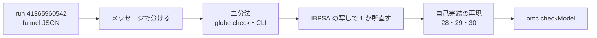

# S091 upstream-ef024-et004

| | |
| --- | --- |
| セッション | S091 |
| 日付 | 2026-11-02 |
| ブランチ | `feature/s091-upstream-ef024-et004` |
| Phase | P3 |
| スライド | [slides.html](slides.html) |
| 作業記録 | `log/work/2026-11-02-s091-upstream-ef024-et004.md` |

## 1. 目的

S083（[解説書](../S083-upstream-shape-proof-411/解説書.md)）の持ち越しを片付ける。

1. モデルの配列の次元を package の定数にすると EF024・ET004 が出る（S080 で見えた。【未確認】）。最小にし、Rumoca の穴か規定上の拒否かを決め、ライブラリの本数を数える
2. 下書き 27（ER002）の形で止まるライブラリの例題を数える
3. 25c で局所変数の名前が定数と同じときだけ目的のメッセージになる理由

文書だけの作業で、製品コード・xtask・CI は変えない。issue は出さない（出すのはユーザー）。

## 2. 決定と理由

| 項目 | 決定 | 理由 |
| --- | --- | --- |
| 本数の出どころ | libraries の [run 41365960542](https://github.com/asari300/20261018_GlobeMode/actions/runs/41365960542) の artifact `library-*` の `*-funnel.json`（`rumoca_code` と `message`） | 最新の定期実行。S083 と同じ run |
| 1 の判定 | **Rumoca の穴**。新しい下書き 28 | package の定数は定数式で、次元に書ける（MLS §3.8.1・§10.1）。`redeclare package` で渡したときだけ通る。omc は通す |
| EF024・ET004 の残り | メッセージで 2 つの別の形に分かれた。どちらも **Rumoca の穴**で、下書き 29（EF024 18 本）と 30（ET004 15 本） | 29 は IBPSA の写しで束縛を algorithm に移すと例題が通る。30 は自己完結の再現の対照が通る |
| 2 の判定 | ER002 68 本のうち 27 の形は **0 本** | 型の参照は取得しない `Modelica_DeviceDrivers` の 1 本だけ |
| 3 の判定 | 局所変数が package の定数と同じ名前のときだけ出る。呼ぶ関数の入力の名前には依らない | 名前を変えた 8 通り。束縛を関数の範囲で引いていると読めるが、コードは読んでいない【推測】 |
| 番号 | 28〜30（`Rep36`〜`Rep38`）。25・27 は追記 | 依頼のとおり |

## 3. 図



## 4. 再現手順

```bash
cd doc/research/upstream
R=../../../data/rumoca/rumoca-linux-x86_64     # cargo xtask fetch-rumoca
$R compile 28-et004-ef024-dimension-from-package-constant.mo -m Rep36.M    # ET004
$R compile 28-et004-ef024-dimension-from-package-constant.mo -m Rep36.M1   # EF024
$R compile 28-et004-ef024-dimension-from-package-constant.mo -m Rep36.M4   # 通る（redeclare）
globe check 29-ef024-local-function-binding-calls-replaceable-package.mo --model Rep37.M
globe check 30-et004-record-size-dimension-bound-to-call.mo --model Rep38.M
```

| 確かめたこと | 結果 |
| --- | --- |
| `globe check` と CLI のコード | 3 つの再現の 12 本で一致（失敗 7・対照 5） |
| omc 1.27.2 の `checkModel` | 12 本とも completed successfully |
| IBPSA の写しで 1 か所直す | `PartialProperties.checkState` の束縛を algorithm へ: `Media.Examples.WaterProperties` が S0〜S10 を通る。`UAFroRated` に `redeclare package MediumA`: ET004 が消え、別の GM-U0001 で止まる |
| 本数 | EF024 27（29 の形 18）、ET004 18（30 の形 15・28 の形 3）、ER002 68（27 の形 0） |

詳しくは [libraries-2026-11-01.md](../../research/libraries-2026-11-01.md) の「EF024・ET004 と ER002 の本数（S091）」、判定の一覧は [upstream/README.md](../../research/upstream/README.md)。

## 5. 次回

- 下書き 28〜30 を Rumoca の main で確かめて出す（ユーザー）
- EF024 の `nomVal` 7 本・`T`・`nXi`、ER002 の `specificEntropyOfpTX` 39 本を最小にする
- 30 をライブラリの写しで直して確かめる（今回は自己完結の再現だけ）
