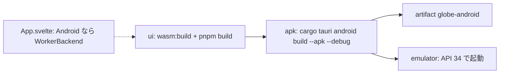

# S092 Android の APK を CI で作る

| | |
| --- | --- |
| セッション | S092 |
| 日付 | 2026-11-02 |
| ブランチ | `feature/s092-android-apk-ci` |
| Phase | P6 |
| スライド | [slides.html](slides.html) |
| 作業記録 | `log/work/2026-11-02-s092-android-apk-ci.md` |

## 1. 目的

[roadmap.md](../../roadmap.md) の P6 の「APK」「Android API 34 のエミュレータで検査と実行が通る」の 1 歩目。S038 の持ち越し「Android の sidecar」。Desktop（S049）は `globe lsp` を sidecar にするが、Android では別プロセスの実行ファイルを同梱して起動できない。手元に Android SDK・NDK は無いので、組み上げは GitHub Actions で行う。

## 2. 決定と理由

| 項目 | 決定 | 理由 |
| --- | --- | --- |
| 計算の道 | Web と同じ `WorkerBackend`（wasm の Web Worker） | 新しいコードが要らない。Rust を mobile の lib に直接 link する道は、UI のプロセスで計算することになる（[ADR-0023](../../adr/0023-desktop-and-web-process-layout.md) の (a)）ので持ち越し |
| 入口 | desktop の workspace に `src/lib.rs`（`#[cfg(mobile)]` の `run`、`#[tauri::mobile_entry_point]`）と `[lib]`（`globe_mode_desktop_lib`、staticlib・cdylib・rlib） | Tauri の mobile は lib を要る。Desktop の `main.rs` は変えない（Desktop では lib は空） |
| sidecar | `tauri.android.conf.json` が `bundle.externalBin` を空にする | `tauri-build` が Android の target triple の `binaries/globe-*` を探さないように |
| backend の選択 | `App.svelte` の `desktop` を `inTauri() && !/Android/i.test(navigator.userAgent)` にした | 1 行で済む。`tauri-backend.ts` は触らない。Desktop だけの UI（MSL の版の選択）も Android では出ない |
| `gen/android` | CI の `cargo tauri android init --ci` の出力（artifact `gen-android`）をコミットする | Tauri の指針。ビルドの出力は生成物の `.gitignore` が除く。desktop の `.gitignore` は `/gen/*` と `!/gen/android` |
| ABI | `--target aarch64 --target x86_64` | 実機とエミュレータ。armv7・i686 は時間と大きさのため省く |
| エミュレータ | `reactivecircus/android-emulator-runner`、API 34、x86_64、`google_apis`。`monkey` で起動して 45 s 後の logcat に `FATAL EXCEPTION` が無く、`pidof` が通ること | 検査と実行を UI から回す自動化は持ち越し |
| setup-android | `packages` を名指し | 既定の `tools` が今の cmdline-tools に無く、sdkmanager が落ちた（run 41408245562） |

## 3. 図



## 4. 再現手順

```bash
gh workflow run android.yml --ref main      # main に取り込んだ後（dispatch は既定のブランチに定義が要る）
gh run download <run-id> -n globe-android
adb install app-universal-debug.apk
adb shell monkey -p io.github.asari300.globemode -c android.intent.category.LAUNCHER 1
```

検証の結果（数字）:

- run 41409143035（feature の push、一時的に push の branches に feature を足した）: ui 48 s・apk 9 分 44 秒・emulator 2 分 47 秒、すべて success
- APK（`app-universal-debug.apk`）: 251,627,503 B（240 MiB）。大半は debug の Rust の `.so`（x86_64 122,546,328 B・arm64-v8a 121,819,912 B）
- エミュレータ: `ActivityTaskManager: Displayed io.github.asari300.globemode/.MainActivity for user 0: +2s455ms`。WebView 113 が起動し、`FATAL EXCEPTION` は 0
- コミットした `gen/android` での run: run 41411137967 で success（ui 59 s・apk 4 分 8 秒（cache あり）・emulator 2 分 32 秒）。APK は同じ 251,627,503 B、`Displayed` まで 3.2 s

## 5. 次回

- エミュレータで検査と実行を UI から自動で回す（P6 の完了条件。WebView の console を logcat で拾うか、`adb` から UI を叩く）
- Android での MSL の置き場（今は MSL.json を同梱しないので「MSL を読む」は失敗する）
- Rust を mobile の lib に直接 link する道、release の署名つき APK（大きさは release と strip で縮むはず【未確認】）
