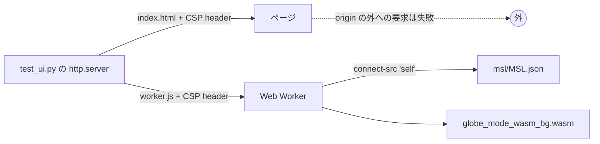

# S093 ブラウザの CSP と marimo の WASM

| | |
| --- | --- |
| セッション | S093 |
| 日付 | 2026-11-02 |
| ブランチ | `feature/s093-web-csp-marimo-wasm` |
| Phase | P6 |
| スライド | [slides.html](slides.html) |
| 作業記録 | [log/work/2026-11-02-s093-web-csp-marimo-wasm.md](../../../log/work/2026-11-02-s093-web-csp-marimo-wasm.md) |

## 1. 目的

[roadmap](../../roadmap.md) の P6 の完了条件のうち、まだ確かめていない 2 つに向けた作業。

- 「ブラウザが CSP `connect-src 'self'` のまま実行できる（サーバーで計算しない）」を試験で確かめる。
- 「marimo の WASM で 2 GB 未満に収まる」の可否と道筋を調べる（コードは書かない）。

## 2. 決定と理由

| 項目 | 決定 | 理由 |
| --- | --- | --- |
| CSP の中身 | `src/Svelte/index.html` の meta（S041 から）のまま変えない: `default-src 'self'; script-src 'self' 'wasm-unsafe-eval'; worker-src 'self'; connect-src 'self'; style-src 'self' 'unsafe-inline'; img-src 'self' data:` | 依頼の形と同じものが既にあった。`'unsafe-inline'` は style だけ（Svelte と CodeMirror が注入する style） |
| Web Worker の CSP | 試験のサーバーが同じ CSP を応答の header にも付ける（`index.html` の meta から読む） | meta の CSP は文書にだけ効き、`worker.js` には効かない。wasm の初期化と MSL の取得は worker の中なので、header で縛らないと確かめたことにならない |
| 外への要求 | 試験が context の全要求を見て、配った origin・`data:`・`blob:` 以外を失敗にする | 「サーバーで計算しない」は、静的ファイル以外に要求が出ないことで確かめる |
| 本番の配信 | header は試験のサーバーだけ。配信先の設定は持たない | 配信先（静的ホスティング）は未定。meta は文書に効くので、最低限は守られる |
| marimo の WASM | 調査だけ。先に試すのは anywidget の `_esm` から `globe-mode-wasm` を直接呼ぶ道 | emscripten 向けの wheel は `cargo check` は通るが、emsdk と Pyodide の版の固定を新しく抱える。詳細は [調査](../../research/marimo-wasm-2026-11-02.md) |

## 3. 図



## 4. 再現手順

```bash
export CARGO_TARGET_DIR=…/.git-worktree/target-shared
mise run ui:check                     # wasm:build → svelte-check → vite build → test_ui.py・test_graph.py

rustup target add wasm32-unknown-emscripten
CC_wasm32_unknown_emscripten=clang AR_wasm32_unknown_emscripten=llvm-ar-20 \
CFLAGS_wasm32_unknown_emscripten=--target=wasm32-unknown-emscripten \
PYO3_CROSS_PYTHON_VERSION=3.13 cargo check -p globe-mode-py --target wasm32-unknown-emscripten
```

検証の結果（数字）:

- `mise run ui:check`: 成功（514 s）。CSP の header を付けたまま、Decay の検査・実行、10 万点の描画、Bad、G のグラフ、MSL を読む（0.7 s）、ChuaCircuit の検査（3.4 s）・実行（1.9 s、信号 44 本）・グラフ（ノード 7）、GM-W1001 が通り、console の error 0、origin の外への要求 0。
- `cargo check -p globe-mode-py --target wasm32-unknown-emscripten`: emsdk が無いと `psm` の build script が `emar` を見つけられず失敗。clang と llvm-ar に差し替えると通る（223 crate、3 分 33 秒）。cranelift は依存の木に出ない。

## 5. 次回

- marimo の WASM: anywidget の `_esm` から `globe-mode-wasm` を呼ぶ道を試し、`marimo export html-wasm` でメモリを測る（2 GB の条件）。
- emscripten の wheel を作るなら emsdk と Pyodide の版の固定から。
- 配信先が決まったら、そこで CSP の header を付ける。
