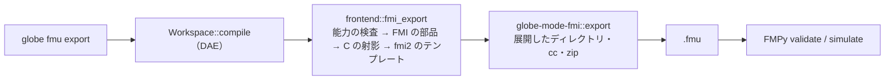

# S094 FMI Export（P5a、Rumoca のテンプレート）

| | |
| --- | --- |
| セッション | S094 |
| 日付 | 2026-11-02 |
| ブランチ | `feature/s094-fmi-export-rumoca` |
| Phase | P5（1 回目、P5a） |
| スライド | [slides.html](slides.html) |
| 作業記録 | [log/work/2026-11-02-s094-fmi-export-rumoca.md](../../../log/work/2026-11-02-s094-fmi-export-rumoca.md) |

## 1. 目的

[roadmap.md](../../roadmap.md) の P5 の完了条件「Export した FMU が FMPy・fmusim・fmuCheck を通る」に向けて、Rumoca のテンプレートの道（P5a）で FMU を出す。ユーザーの判断（2026-11-02）で P5a を先行し、P5b（自前のランタイム）は別の WP（S095）が並行して進める。

## 2. 決定と理由

決定は [ADR-0031](../../adr/0031-fmi-export-p5a-first.md)。

| 項目 | 決定 | 理由 |
| --- | --- | --- |
| テンプレート | Rumoca の組み込みターゲット `fmi2` を改変せずに使う | rev `276e82bd` に `fmi2`・`fmi3` があり、部品はすべて `rumoca-compile`・`rumoca-phase-solve` の公開 API で呼べる。自前のテンプレートは要らなかった |
| Rumoca を呼ぶ場所 | `globe-mode-frontend` の `fmi_export.rs` | ADR-0002 と CLAUDE.md §3（Rumoca は frontend と exec からだけ） |
| FMU にする場所 | `globe-mode-fmi` の feature `export`（`export_me_sources`・`write_fmu`） | 既定の `globe-mode-fmi` は roxmltree だけのまま（wasm32 でも通る） |
| 版 | FMI 2.0（ME と CS が 1 つの FMU に入る） | fmuCheck が 2.0 までしか検査できない。Reference-FMUs にも 2.0 がある |
| `--build` | `cc` で `binaries/linux64/<modelIdentifier>.so`。ヘッダは `--fmi-headers` で渡す | ヘッダを同梱しない。FMPy の `c-code` に FMI 2.0 のヘッダがある |
| guid | モデルの名前から作る | 同じモデルから同じ FMU になる（Rumoca の CLI は毎回 UUID v4） |

## 3. 図



## 4. 再現手順

```bash
H=$(uv run --no-project --with fmpy python -I -c "import fmpy, os; print(os.path.join(os.path.dirname(fmpy.__file__), 'c-code'))")
cargo run -p globe-mode-cli -- fmu export src/Modelica/GlobeModeValidation \
  -m GlobeModeValidation.Simulation.Decay --out /tmp/fmu --build --fmi-headers "$H"
cargo test -p globe-mode-cli --test fmu_export
```

検証の結果:

- FMU は 16.6 KB。`modelDescription.xml`（ScalarVariable 8）と `sources/` の C 7 ファイル（444 行）、`binaries/linux64/Rumoca_<guid>.so`。
- FMPy 0.3.32 の `validate`: 問題なし。
- FMPy の `simulate`（終了時刻 1）: ME（CVode、相対許容誤差 1e-8）で x(1) = 0.3678794151、既定の許容誤差では 0.3678330、CS で 0.3678794412（e⁻¹ = 0.3678794412）。
- 試験 `globe-mode-cli/tests/fmu_export.rs` 2 本（ソースの FMU、FMPy での ME。x86_64 の Linux で cc・uv・FMPy があるときだけ後者を回す）。

## 5. 次回

- fmusim・fmuCheck での検査（fmusim v0.15.0 のバイナリは取得したが、手元での実行の許可が無く持ち越し）。
- FMI 3.0（`render_rumoca_fmi(model, "fmi3")`）、Windows・macOS 向けのビルド（`zig cc`）。
- 入力を持つモデル（Rumoca の `host_driven_input_seeds` は crate の外から呼べないので start を種にしていない）と、事象のあるモデル（`fmi2` が断る）。後者は P5b（S095）の対象。
- 生成物が Rumoca のテンプレート（Apache-2.0）の文面を含むことの扱い【未確認】（[licenses.md](../../licenses.md)）。
