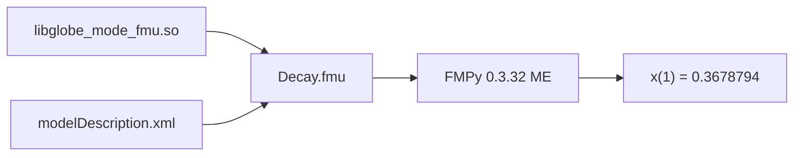

# S095 自前の FMU ランタイム（P5b の 1 回目）

| | |
| --- | --- |
| セッション | S095 |
| 日付 | 2026-11-02 |
| ブランチ | `feature/s095-fmu-runtime` |
| Phase | P5（P5b） |
| スライド | [slides.html](slides.html) |
| 作業記録 | [log/work/2026-11-02-s095-fmu-runtime.md](../../../log/work/2026-11-02-s095-fmu-runtime.md) |

## 1. 目的

- [roadmap.md](../../roadmap.md) の P5 の Export は P5a（Rumoca のテンプレート）の後に P5b（自前のランタイム）。2026-11-02 にユーザーが「P5a を先行し、それを参考にしつつ P5b を並行して進める」と決めた。P5a は S094 が進める。
- この回は、モデルを crate の中に固定（`GlobeModeValidation.Simulation.Decay`）した最小のランタイムを作り、FMPy で回す。

## 2. 決定と理由

詳細は [ADR-0032](../../adr/0032-p5b-own-runtime.md)。

| 項目 | 決定 | 理由 |
| --- | --- | --- |
| 置き方 | 自前で FMI 2.0 ME の 35 関数を `extern "C"` で出す（新 crate `globe-mode-fmu`、cdylib + rlib） | `fmi-export` 0.3.0 は FMI 3.0 のみで依存が増える。自前なら依存 0 で、`globe-mode-c`（S075）と同じ形 |
| モデル | Decay（`der(x) = -k*x`）を Rust で手書き。値参照 0 = `x`、1 = `der(x)`、2 = `k` | exec に「状態 → 微分」の公開 API が無く、exec は触らない約束 |
| `modelDescription.xml` | crate に手書き。`guid` は試験で `GUID` と突き合わせる | `globe-mode-fmi` の型で出すのは載せ替えのとき（P5a と共有） |
| stub | FMUstate・方向微分・Integer/Boolean/String は `fmi2Error`（`nvr = 0` は OK） | `can*` / `provides*` は既定の false なので呼ばれない |
| panic | `catch_unwind` は置かない | panic する道が無い。起きても Rust 2024 の `extern "C"` は abort する |
| 置き場 | `binaries/linux64/globe_mode_fmu.so` | FMI 2.0 の名前（`x86_64-linux` は FMI 3.0） |

## 3. 図



## 4. 再現手順

```bash
export CARGO_TARGET_DIR=…/.git-worktree/target-shared
cargo test -p globe-mode-fmu -- --nocapture
```

- `fmpy_simulates_decay`（Linux x86_64 だけ）は `cargo build --lib` で cdylib を作らせ、`tests/fmpy_decay.py` を `uv run --no-project --with fmpy python -I` で呼ぶ。uv か FMPy が無ければ skip。
- 結果: FMPy 0.3.32 の ME（CVode）で x(1) = 0.3678794150955906（e⁻¹ との差 2.6e-8）。
- `explicit_euler_through_the_c_abi`: 関数を直接呼ぶ陽的 Euler（10 万歩、k = 2）で x(1) が e⁻² に 1e-4 以内。CS と guid 違いの `fmi2Instantiate` は NULL。

## 5. 次回

- exec に「状態・パラメータ・時刻 → 微分・出力」の公開 API を足し、手書きの式を置き換える。
- 載せ替えの道（FMU ごとにビルド / Rumoca で compile / Solve IR の解釈実行）を選ぶ（ADR-0032 の (b)）。
- `modelDescription.xml` の生成を P5a（S094）と共有する。CS、FMI 3.0、Windows・macOS の置き場、fmusim での検査。
