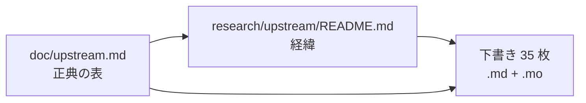

# S096 上流への報告のまとめ

| | |
| --- | --- |
| セッション | S096 |
| 日付 | 2026-11-02 |
| ブランチ | `feature/s096-upstream-summary-doc` |
| Phase | P3 |
| スライド | [slides.html](slides.html) |
| 作業記録 | `log/work/2026-11-02-s096-upstream-summary-doc.md` |

## 1. 目的

上流（Rumoca・diffsol）への issue の下書き 01〜30 を、提出する前に 1 枚の正典 [doc/upstream.md](../../upstream.md) にまとめる（ユーザーの判断、2026-11-02）。1 枚に 7 つの形が並んでいた下書き 25 を、1 枚 1 つの形に分ける。文書だけで、Rust のコードは変えない。

## 2. 決定と理由

- **正典の 1 枚。** [doc/upstream.md](../../upstream.md) に 35 行の表（01〜21、24、25、25b〜25h、26〜30）と、「提出の順」「提出のときの手順」「GlobeMode 側の回避を外す条件」の 3 節を置いた。経緯は [research/upstream/README.md](../../research/upstream/README.md) に残し、冒頭からリンクした。CLAUDE.md の正典の行に `upstream.md` を 1 語足し、README の文書の表に 1 行足した。
- **状態は 2 つ。** Rumoca v0.10.2 の CLI か自己完結の `.mo` で再現を確かめた件は「未提出」、API だけで見た件・CLI の形が `[not verified]` の件・diffsol の件は「Rumoca main で再確認が要る」。提出済みは 0。
- **提出の順は影響の本数順**（ユーザーの指示）。上位 5 は 17 ER132（267）・18 ER070（258）・19 EI032（235）・21 EF004（217）・20 EF025（138）。GlobeMode 側に回避のある件は後に回す。
- **25 を分けた。** 25 は `function conditional`（`isMonotonic`）だけに戻し、元の S080・S083 の節を 25b〜25h の `.md`（同じ英語の issue の型）に移した。各 `.mo` の 1 行目のコメントも `draft 25b` などに直した。

## 3. 図



## 4. 再現手順

```bash
python3 -I .claude/skills/session-docs/check_docs.py
```

表の一覧の行数は 35（`doc/upstream.md` の「一覧」の表）。

## 5. 次回

- ユーザーが 17 から順に、[doc/upstream.md](../../upstream.md) の手順で Rumoca main で確かめて出す。
- 04・05・07・08 の影響の本数は数えていない【未確認】。
- 25f・25h・25g の「Actual」のメッセージは S083 の記録から写したもので、CLI の全文は出すときに写し直す。
